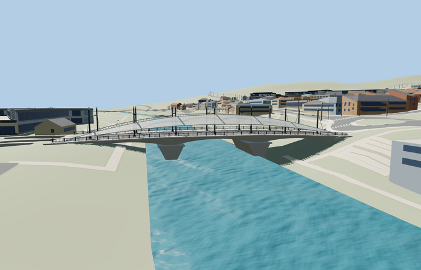

# Ibër Bridge

Main Ibar crossing in Mitrovica: paired swept perforated walkway canopies with inclined ribs, concrete haunched girders and flared piers, rounded cornices, outside walks, dark open railings and cable-linked lamps.

Editable geometry lives in models/; model-brief.json records the material library, four authored runtime levels, reference pictures and reconstruction limits. The detailed master is reproducible from this editable recipe; inspection and readiness decisions are recorded separately. All GLBs are ignored generated outputs.

Regenerate with `node content/worldgen/source/places/sr/srw/iber_bridge/models/generate-iber.mjs --ids=iber_bridge`. Append `--check` to verify exact reconstruction. Import with `node packages/worldgen/scripts/import-structure-models.mjs --ids=iber_bridge`, then generate runtime levels with `node packages/tooling/scripts/generate-landmark-lods.mjs --ids=iber_bridge`.

## Review status

Current completion decisions are in qa.json and QA-REVIEW.md when present; the readiness catalog is authoritative. integration-review.json records the authored source scope. placement-draft.json preserves the proposed orientation, datum and bounded replacement rules. A source build alone grants no visual or geographic approval.

Original geometry uses the repository license. Map-derived controls: © OpenStreetMap contributors, ODbL-1.0. Reference photos retain their own rights and are not model textures.
