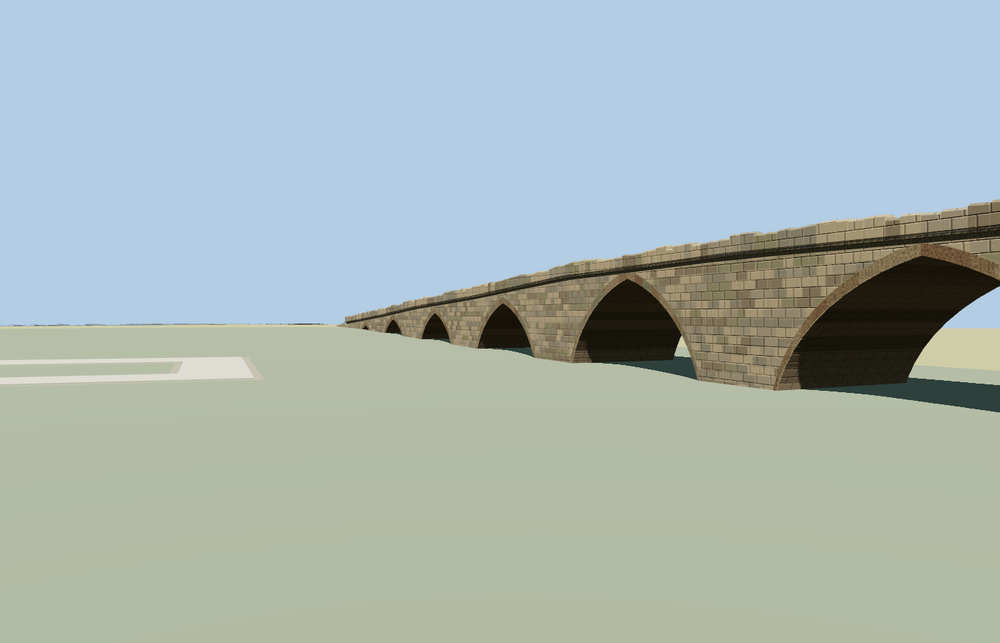

# Vushtrri Stone Bridge

The Vushtrri Stone Bridge spans a dry meadow in nine varied pointed masonry arches. A shallow deck hump and bent centerline follow the crossing, with warm voussoir rings, a rounded stone belt, irregular upright parapet blocks and graded stone approaches.

The named Ura e Gurit way 159091517 and attraction point match Q3396793. The model follows the signed PMTiles path and dry standard terrain. Every tier leaves all nine vaults open and meets the sampled ground within five centimeters at both path ends. The placement keeps 61 independent transport records and 25 neighboring buildings. The original mapped bridge path returns when the model fails to load.

The 24,932-triangle source rebuilds byte for byte. The first two runtime tiers total 147,484 bytes. Six GLBs validated and 36 current views were inspected.

The PMTiles path fixes the approaches and heading. Arch stations, deck width and masonry courses are approximated from the exterior views. The source terrain is coarse and leaves the historic channel dry. The bridge ends blend into its unedited surface. The photos establish the profile and materials. The span distribution and parapets are visual approximations.

Rebuild with `node packages/worldgen/scripts/generate-vushtrri-stone-bridge.mjs`. Append `--check` to compare exact bytes. Use `--ids=vushtrri_stone_bridge` for targeted import, LOD, placement and readiness.
