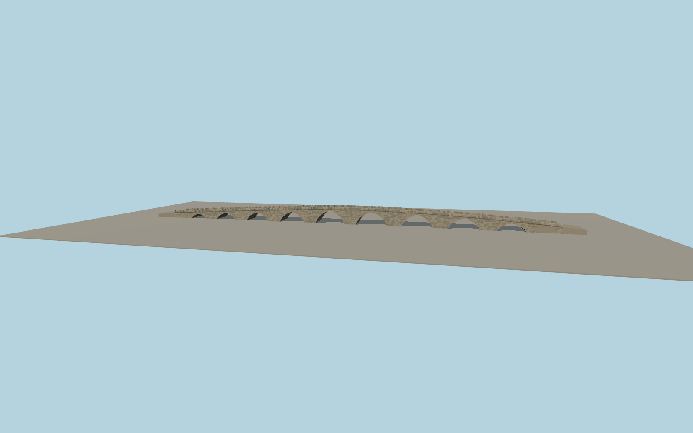

# Vushtrri Stone Bridge

The Vushtrri Stone Bridge spans a dry meadow in nine varied pointed masonry arches. A shallow deck hump and bent centerline follow the crossing, with warm voussoir rings, a rounded stone belt, irregular upright parapet blocks and graded stone approaches.

Run `node packages/worldgen/scripts/generate-vushtrri-stone-bridge.mjs` to rebuild the source master. Append `--check` to compare the exact bytes. Use `--ids=vushtrri_stone_bridge` for targeted import, LOD generation and placement.

The PMTiles path fixes the approaches and heading. Arch stations, deck width and masonry courses are approximated from the exterior views.

The source terrain is coarse and leaves the historic channel dry. The bridge ends blend into its unedited surface.

The photos establish the profile and materials. The span distribution and parapets are visual approximations.

Original geometry follows the repository license. Map data is © OpenStreetMap contributors under ODbL-1.0 via Protomaps. Terrain samples are described in terrain-grid.json. Ordinary pictures stay local and are not redistributed or used as textures. Current acceptance is recorded in qa.json.
