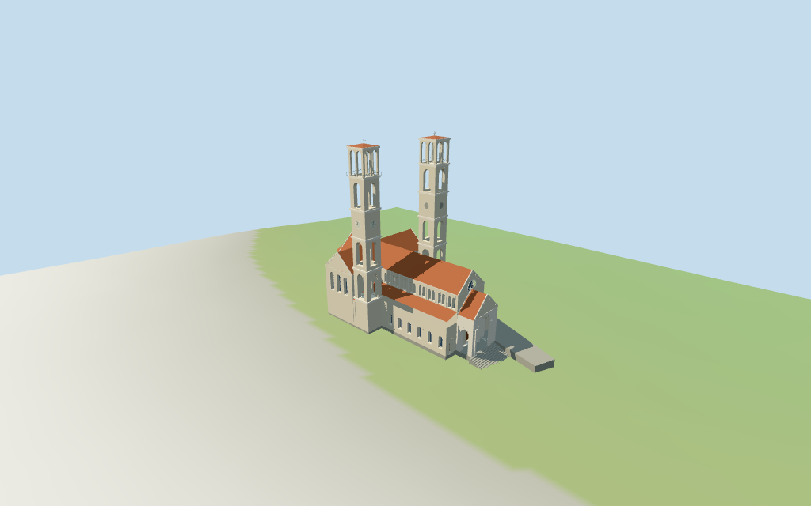

# cathedral_of_saint_mother_teresa_in_pristina — Cathedral of Saint Mother Teresa in Pristina review

Reviewed 2026-10-14 against current source/runtime bytes. Accepted for this medium-fi exterior and approximate geographic/terrain scope.

## Built result

Inspected all 11 final portable/source-terrain frames. The individual two-tower cathedral has tall tiered square campaniles with four open stages, a solid clock stage, paired upper arches, shallow terracotta caps and crosses. The left-of-front tower has clock hands; the other has a blank circular field, following the inspected 2025 exterior. A raised red-tiled nave with paired round clerestory windows, lower aisle roofs, transverse gabled crossing, rounded rear apse and low side ranges retains the current map outline. The front has a round rose, white-edged gables, a genuinely open arched porch, closed wood doors and broad entry steps. Corrected a tiny tile-quantization spike that caused a hipped porch roof, closed the low tower face adjoining the transept, widened/thinned the upper paired belfry masonry, gave district towers solid arched panels and grounded both tower feet. Deeper cavity probes confirm that the upper chambers are open; the earlier filled appearance came from oversized piers/reveals, not loose interior faces. Rear and low-platform facades remain estimates.

Medium-fi exterior from three useful pictures and standard viewer PMTiles/DEM only. The August2025 photograph confirms two completed towers, superseding older one-tower views. Current map tags control both 70m tower tops, including cap/cross; all stage divisions, wall thicknesses, nave/aisle/transept/apse/porch heights, windows, rose, trim, clock fields and steps are estimated from pictures and map fit. The two towers have different raw plan widths; precise architectural inequality is not surveyed. The 5m low-platform tag is retained with the explicit common-floor interpretation. Rear apse and low-platform exterior details are map-led approximations. Exact sculpture, lettering, clock numerals, stained-glass pictures, full interiors and certified walking are excluded. Terrain thresholds/absolute altitude and physical laptop/phone timings remain pending.

## Shared materials and placement

Inspected all 11 final shared-material/geographic frames. Five existing 256-square graphs provide ashlar, raw limestone, ceramic tile, granite and plain wood. Pale coursed walls, light trim, terracotta roofs, stone foundations/platform and brown wood use linear tints and metric UVs. Glazing, clock fields and metal are flat PBR colors. The shared ashlar approximates the photographed horizontal masonry; exact marble coursing and stained-glass pictures are not bespoke textures. Skyline uses graph mean colors. Every graph reads once. Unload disposes geometry, leaves zero live model geometries and restores ground. Geographic-flat-terrain images show the signed map alignment; source-terrain views show approximate foundation/entry contact. Ground colors are diagnostic.

Retained exact-QID OSM way 105555618 matches current main PMTiles feature 35184477644450 by the way-ID offset. Current main, two separate 70m tower outlines and one lower 5m building outline retain unscaled plans/tags at anchor [21.159371609,42.656365443], heading 1.185666760539rad. Front porch/rose at native +X, rounded rear apse at -X and two side towers sign the retained axis from useful pictures. Current PMTiles itself does not expose wikidata. All estimated body/nave/transept/apse/porch/lower-roof partitions reproduce their recorded raw-outline clipping. All 42 actual viewer footprint checks cover the four selected buildings while preserving two unrelated neighbors and the front street across six outputs. Standard DEM datum 585.753036m, estimated common floor 1.8m and sampled church/tower peak 1.433m give coarse contact. Both tower foundations follow the DEM; stairs are an estimated transition. The raw 5m lower building is interpreted as a platform/basement edge reaching the church floor over the lower terrain. Exact function/facades, street/door thresholds, absolute altitude and certified walking remain unverified. No road replacement.

Inspected all 27 final Earth-lighting frames: Economy/High, noon/late, three distances, silhouette, six details, four matched whole-model LODs and four transitions. Matched views include both complete towers/crosses, the church, stairs and low platform. Skyline keeps open four-post tower masses, clock blocks, shallow caps/crosses, main pitched roof/apse/transept, sparse porch piers and an inclined entry. District adds shared graphs, flat windows/doors/rose/clock fields, real porch arches and solid-pier arched tower panels. Street opens facade/rose/tower recesses and adds sparse pilasters/cornices/rails and steps. Closeup/master refine arch facets, rose spokes, corbels, clock marks and rail uprights. Curvature, openings, ornament and step profiles change visibly. The wider top belfry bays read open in current textured views. Swedish-cottage neighbors are synthetic context, not local mapped buildings.

## Browser budgets

| Level | Triangles | Bytes | Draws |
| --- | ---: | ---: | ---: |
| skyline | 633 | 64092 | 1 |
| district | 3490 | 331048 | 7 |
| street | 11543 | 1044564 | 7 |
| closeup | 19100 | 1761048 | 7 |

Initial skyline plus district: **395140 bytes** of geometry. Master: **2296148 bytes / 19100 triangles**. Five separately cached shared graphs; zero embedded images. Initial geometry excludes graph definitions/texture generation. Separate POSITION/NORMAL streams have equal CPU/GPU totals. Physical device timings pending.

## Verification

- Targeted byte reproduction: generate-additional-landmarks.mjs --ids=cathedral_of_saint_mother_teresa_in_pristina --check. Source/import/LOD/review hashes match.
- Six GLBs pass Khronos with zero errors, warnings or embedded images; four browser budgets pass.
- Four raw map controls/tags, retained exact-way identity, signed frame and standard DEM match. Recorded body/roof clipping compositions match. All outputs retain 70m tops above the common floor.
- **1,674 imported geometry probes** pass: roofs/stone gables, finials/grounded tower feet, visible open belfry bays/heads and upper cavities, closed attached face, porch tunnel/side arches, stair support, detailed facade/door/rose recesses and closed backing.
- **42 actual viewer footprint checks** pass: four selected buildings covered, two neighbors/front street preserved across six outputs.
- Five graphs read once; unload disposes geometry/restores ground.
- Source inventory/schema, recipe index, map-frame and medium-fi review bindings pass.
- Scene validation and 30-tick simulation pass: sha256:21f950e97b059a7a328e22c5ef56b9d4501a6f523a2bbc8075cc6e272021cc26.
- Inspected **49 final frames**: 11 portable, 11 shared/placement and 27 medium-fi. Reports keep paths/cameras/hashes; bulk images stay local and ignored.

Source hash: sha256:c1bf5e61c56bdbb51de66cb04785738486bfb0f2ee20768c6aa1aa87ae9328a4. Runtime hash: sha256:dc462b30e615e952fd407a767444c947dd371d81f261a4b4a21f842baaa7d540. Input hash: sha256:aebd0c7d588bce6d49b1634e0e9846c0537c2c9eddcacf62978dacc490f6f7b6.

Commands: targeted generate/import/LOD; capture-structure-models.mjs --ids=cathedral_of_saint_mother_teresa_in_pristina --reflections --antialias --fit-shadows; capture-landmark-library.mjs --ids=cathedral_of_saint_mother_teresa_in_pristina --reflections --adaptive-clipping --bounded-placement; capture-medium-fi.mjs --ids=cathedral_of_saint_mother_teresa_in_pristina --reflections; molen validate; molen sim run --ticks 30 --hash. No full engine suite/audit or full source rebuild repeated; next routine source checkpoint follows transfiguration_cathedral.

## Limits

- Retained exact-QID way 105555618 matches current main numeric PMTiles identity. Current unscaled main, two separate 70m tower footprints and one lower 5m building outline are retained. August2025 picture confirms two completed towers versus the older one-tower views. Tower 70m tops include shallow cap/cross; individual open stages and nave/aisle/transept/apse/porch heights are picture-led estimates. Lower 5m mapped building is interpreted as a low platform/basement edge reaching the common church floor over coarse DEM, not an independent 5m wall above that floor.
- Standard DEM datum 585.753036m; estimated common church floor 1.8m clears sampled church/tower peak 1.433m. Foundations and low platform edge follow coarse terrain; front stairs are an estimated transition, not surveyed steps. Raw5m platform height retained but interpreted at common floor. Exact court/street/door thresholds, absolute altitude and certified walking unverified.
- Medium-fi exterior from three useful pictures and standard viewer PMTiles/DEM. August2025 two-tower state supersedes older single-tower construction images. Nave/transept/apse/aisle/porch proportions,stage divisions,paired windows,rose,corbels and steps are picture-led estimates. Rear apse and low platform/basement facades/functions are map-led approximations. Exact lettering,sculpture,clock numerals,stained-glass pictures,full interiors and certified walking excluded. Absolute thresholds/altitude and physical device timings pending.
- Skyline retains two open tiered four-post towers,clock body,shallow caps/crosses,red-roofed basilica/apse/transept,coarse porch piers and inclined entry. District adds shared surfaces,flat windows/doors,front rose and clock fields,real open porch and solid-pier arched tower panels. Street cuts actual paired windows,rose and tower walls,adds sparse pilasters/cornices/railings and stepped entry. Paired top openings use wider bays and thinner upper masonry than the single-bay lower stages. All tower feet follow the coarse terrain. Closeup/master refine curves,rose spokes/corbels/clock marks/rail uprights. Openings,ornament and small roof profiles change visibly. Synthetic Swedish-cottage neighbors are not local mapped buildings.

Readiness accepts this exterior scope. The 1,000-candidate goal remains incomplete.
