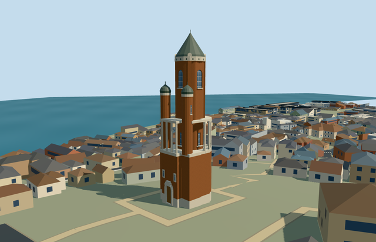

# gardos_tower — Gardoš Tower

Reviewed 2026-10-20 in one continuous author/build/inspect/fix round.

## Appearance

Inspected47 current source/shared/medium-fi/native-map views. The mapped asymmetric brick base/pale plinth, stepped arched closed entry, projecting front loggia and genuinely open curved columned gallery, both capped smaller turrets, tall round shaft/four arched upper windows/projecting sills, four brick piers/pale rounded crest pieces and closed steep roof/finial remain intact. Two ordinary front/opposite photographs informed this continuous build/review pass. Refined piers/crest pieces and connected side gallery cornices during construction. Corrected a copied OSM attribution URL before acceptance; all47 refreshed frame hashes exactly match the inspected pixels. No snow, signs/heraldry/photo atlas, furnished interior, separate fortress ruins or whole-hill platform.

## Shared materials and browser levels

Four existing256-square brick/stone_sandstone_raw/metal_painted/window_grid graphs and zero embedded images. Canonical material bindings read each graph once in the actual shared loader and release all model geometry on unload. Brick and stone use shared low-frequency textures; painted metal approximates the dark weathered roof/ironwork/closed door finish, while windows use the common untinted blue grid. Five near-level draws and one skyline draw, separate POSITION/NORMAL GPU streams and equal CPU/GPU geometry byte accounting. No unique per-building texture atlas.

| Level | Triangles | Bytes | Draws |
| --- | ---: | ---: | ---: |
| skyline | 905 | 92436 | 1 |
| district | 3141 | 285352 | 5 |
| street | 4011 | 355812 | 5 |
| closeup | 4011 | 355812 | 5 |

Four authored browser levels905/3141/4011/4011triangles and92436/285352/355812/355812bytes. Initial skyline+district377788bytes, below3MB phone/6MB laptop budgets. All levels remain below1000/4000/16000/64000triangle limits. Economy/high noon/late-afternoon, silhouettes, transitions and close gallery/window/roof views inspected; rails/slit/recess detail reduces at distance. Physical laptop/phone and dense downtown measurements remain pending. Levels905/3141/4011/4011 triangles; at most five draws.

## Approximate map fit

Retained exact-QID OSMway403091486/native35184775180318 anchors the specific tower at20.409737414,44.848316064. Global heading0/native east-south; internal X[.436277644,.899812101]/Z[-.899812101,.436277644] axes retain the high-resolution roughly10.411x9.618m rounded/squared base. Pictures allocate its western entry/loggia and eastern curved gallery, with20degree/2m fine-layout uncertainty. Bounded footing crosses the actual original6m DEM and floor.614639m meets coarse local grade; no broad slab/flattening/cutout. Only one shell removed with zero residual; all1318 independent resident inputs among1319 originals (2092 wider records), native roads and1496104.7834362353m2 water unchanged. Failure restores1319 originals and all levels unload with zero live geometry. Independent fortress/neighborhood inputs remain native context.

## Limits

Accepted medium-fi visualization of the complete connected tower exterior. Retained36m height has no qualifying dimension or reference URL; base/gallery10.6..17.7m, smaller turret caps23..24.8m/finials25.4m, main head30.4m/roof35.4m/finial36m and fine window/pier/corbel/rail/reverse inventory remain picture-led estimates. Shared painted roof/panel material is a stylized finish approximation, not a precise copper/wood survey. No measured floor count, furnished interior, conservation-level detail, surveyed terrain/ruin/flood accuracy or exact current condition is claimed.

## Selected checks

Six Khronos files: zero errors/warnings.228 actual mesh/material/contact checks; 47 current inspected views. Scene validation/sim30 and strict selected medium-fi audit pass. Source/runtime/LOD hashes and material bindings verified.

Rebuild: node packages/worldgen/scripts/generate-additional-landmarks.mjs --ids=gardos_tower; node packages/worldgen/scripts/import-structure-models.mjs --ids=gardos_tower; node packages/tooling/scripts/generate-landmark-lods.mjs --ids=gardos_tower --force.

Source: sha256:4774ac5b48150ea0f71b6a2d615af1a0498ac2bc9763e810fd1427c4c65fd302

Runtime: sha256:ef5e14c43c8f59e9e995cbc19ceba6f7b97e80759d43e7653bcacb2b84508a20

Input: sha256:e84574743dcf537281819d632c8ebd1a740eb13679738bfe1e76799b55236caa

## Viewed ordinary pictures

https://commons.wikimedia.org/wiki/File:Gardo%C5%A1_Tower.JPG — Nina Tomašević; CC-BY-SA-3.0. Viewed only; no pixels copied.

https://commons.wikimedia.org/wiki/File:Gardos_tower_Janos_Hunyadi.jpg — Ivan Aleksic; CC-BY-2.0. Viewed only; no pixels copied.

## Shared-material refresh —2026-10-29

Material-only refresh2026-10-29: actually inspected8 new shared-material/geographic-flat-terrain frames. Source,imported master,all four runtime levels,scene/map/placement and retained portable/medium-fi evidence remain byte-bound. Current shared graph hashes and read-once/disposal checks are renewed. This does not upgrade the previously documented terrain,architecture or physical-device scope.

Current output triangles: 905 / 3141 / 4011 / 4011. Current skyline+district bytes: 377788. Source master: 4011 triangles. These current pinned outputs take precedence over any historical counts above.
