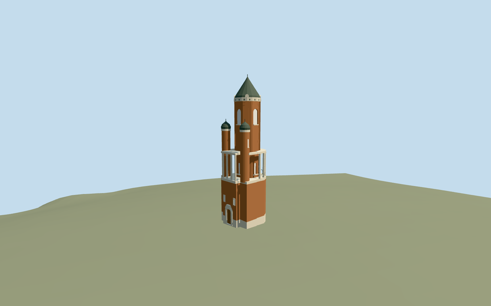

# Gardoš Tower

Specific Gardoš Tower connected exterior: native asymmetric rounded/rectangular brick base and pale plinth, stepped arched closed entry, projecting front loggia and curved open columned gallery, two smaller round turrets/capped roofs/finials, central round brick shaft with arched recessed closed glazing/projecting sills/vertical piers, pale head/cornice and closed steep dark roof/finial. Four existing shared brick/raw-stone/paint/window-grid graphs. No snow, visitors, signs/heraldry/photo atlas, furnished interior, separate fortress ruins or whole hill/platform.

## Evidence and reconstruction

Published dimensions and reconstructed details are separated in spec.json. Primary references:

- [Reference](https://commons.wikimedia.org/wiki/File:Gardo%C5%A1_Tower.JPG)
- [Reference](https://commons.wikimedia.org/wiki/File:Gardos_tower_Janos_Hunyadi.jpg)

Specific Gardoš Tower connected exterior: native asymmetric rounded/rectangular brick base and pale plinth, stepped arched closed entry, projecting front loggia and curved open columned gallery, two smaller round turrets/capped roofs/finials, central round brick shaft with arched recessed closed glazing/projecting sills/vertical piers, pale head/cornice and closed steep dark roof/finial. Four existing shared brick/raw-stone/paint/window-grid graphs. No snow, visitors, signs/heraldry/photo atlas, furnished interior, separate fortress ruins or whole hill/platform.

## Model and axes

4,011 triangles; 12,033 vertices; 5 material groups; 484,716 bytes. Native bounds: -6.086, -0.804, -6.150 to 5.019, 36.615, 5.473. Source hash: `sha256:4774ac5b48150ea0f71b6a2d615af1a0498ac2bc9763e810fd1427c4c65fd302`.

{"x":"east","y":"up","z":"south"}

The geographic proposal uses exact-QID OpenStreetMap evidence. Map-derived orientation and estimated architectural details require real-site visual review; preview eligibility is distinct from geographic/fidelity approval. Map attribution: © OpenStreetMap contributors, ODbL-1.0.

## Reproduce

Run `node packages/worldgen/scripts/generate-additional-landmarks.mjs --ids=gardos_tower` (or add `--check`). The generator preserves manually edited masters by checking their baseline hashes. Import through the standard authored-model workflow with optimization disabled; then capture all QA cameras, including shared-surface views.

## Pending work

- Specific Gardoš Tower connected exterior: native asymmetric rounded/rectangular brick base and pale plinth, stepped arched closed entry, projecting front loggia and curved open columned gallery, two smaller round turrets/capped roofs/finials, central round brick shaft with arched recessed closed glazing/projecting sills/vertical piers, pale head/cornice and closed steep dark roof/finial. Four existing shared brick/raw-stone/paint/window-grid graphs. No snow, visitors, signs/heraldry/photo atlas, furnished interior, separate fortress ruins or whole hill/platform.
- Retained exact-QID OSMway403091486/native building35184775180318 identifies Gardoš Tower. Own anchor20.409737414,44.848316064/global heading0/native east-south. Retained high-resolution mapped outline controls the complete base; internal X[0.436277643518402,0.899812101366741]/Z[-0.899812101366741,0.436277643518402] axes retain its rounded eastern end and squared western entry/loggia. Ordinary front and opposite photographs identify the base/gallery/two turrets/main shaft. Fine entry/window allocation retains20degree/2m uncertainty rather than a surveyed facade orientation.
- Retained Wikidata height36m has no qualifying dimension or reference URL. Native PMTiles has no qualified height. Visualization uses base/gallery floor10.6..11.2m, columned gallery to17.7m, smaller turret caps23..24.8m/finials25.4m, upper shaft30m/head30.4m, steep roof35.4m and main finial36m. Floor, aperture/corbel/pier/rail/roof condition and hidden reverse inventory are picture-led estimates; no measured floor count or conservation survey is claimed.
- Retain original6m standard Mapzen ground, native paths/roads/water and all independent fortress/neighborhood buildings. Replace only the tower shell. Bounded buried feet follow the retained tower outline; the gallery is supported by its base/columns, with no whole-hill mesh, broad terrain platform, flattening or ground/water cutout. Coarse DEM contact/nearby ruin and bank heights are not surveyed foundation/flood measurements.
- Two ordinary front/opposite photographs inspected. Retained exact-QID outline anchors the connected base, gallery, two turrets and main shaft;36m overall height is unqualified. Fine elevations/roof profile/window inventory and20degree/2m facing remain explicit estimates. No copied heraldry, photo atlas, snow, furnished interior, separate fortress ruins or whole-hill terrain model.

This bundle follows the medium-fi standard. Medium-fi appearance and geographic fit are reviewed separately. Hash-bound visual acceptance is recorded separately after capture inspection.
