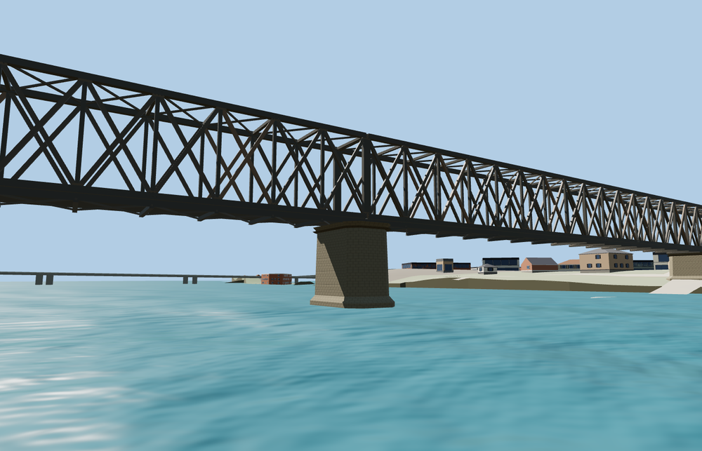

# Old Railway Bridge

Four dark riveted through-lattice spans cross the Sava on pale masonry piers. The source restores the photographed railway deck, paired rails and timber sleepers, the double diagonals, portal posts and overhead and underside bracing.

OSM way 10505926 and the Q4441190 identity fix the southeast crossing and placement. The native capture verifies three pier foundations, both abutments and the retained neighboring crossings. Both reference photographs bind the historical appearance to March 4, 2017. The native water, terrain and adjacent bridges remain on load, unload and failure. The original railway beyond the abutments is outside the dated asset. The current elevation grid puts the western pier on dry ground.

The 59,504-triangle source rebuilds byte for byte. The first two runtime tiers total 355,620 bytes. Six GLBs validated and 50 current views were inspected.

This model represents the documented pre-conversion railway appearance. Current construction and the planned pedestrian deck are separate appearance states. The OSM centerline fixes the signed placement. Pier stationing, lattice dimensions and historic deck fixtures are exterior visualization approximations. The supported date is the EXIF capture day of both reference photographs. The terrain and background roads in the fixture use present-day standard data.

Rebuild with `node packages/worldgen/scripts/generate-vushtrri-stone-bridge.mjs`. Append `--check` to compare exact bytes. Use `--ids=vushtrri_stone_bridge` for targeted import, LOD, placement and readiness.
