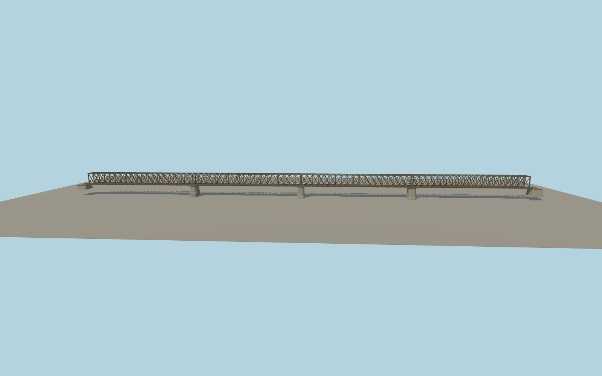

# Old Railway Bridge

Four dark riveted through-lattice spans cross the Sava on pale masonry piers. The source restores the photographed railway deck, paired rails and timber sleepers, the double diagonals, portal posts and overhead and underside bracing.

Run `node packages/worldgen/scripts/generate-old-railway-bridge.mjs` to rebuild the source master. Append `--check` to compare the exact bytes. Use `--ids=old_railway_bridge` for targeted import, LOD generation and placement.

This model represents the documented pre-conversion railway appearance. Current construction and the planned pedestrian deck are separate appearance states.

The OSM centerline fixes the signed placement. Pier stationing, lattice dimensions and historic deck fixtures are exterior visualization approximations.

The supported date is the EXIF capture day of both reference photographs. The terrain and background roads in the fixture use present-day standard data.

Original geometry follows the repository license. Map data is © OpenStreetMap contributors under ODbL-1.0 via Protomaps. Terrain samples are described in terrain-grid.json. Ordinary pictures stay local and are not redistributed or used as textures. Current acceptance is recorded in qa.json.
