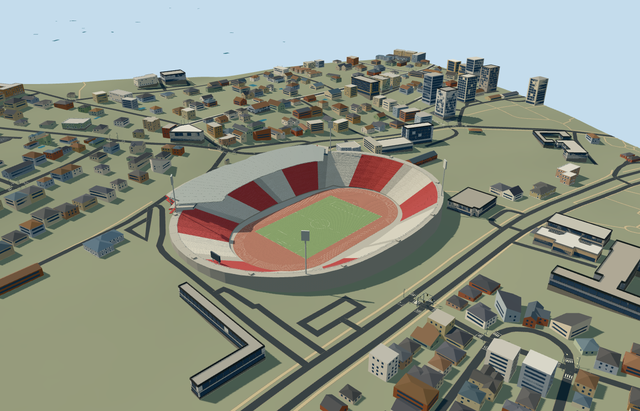

# rajko_mitic_stadium — Rajko Mitić Stadium

Reviewed2026-10-20 in one author/build/inspect/fix pass.

## Appearance

Inspected all 48 final current source, shared-surface, medium-fi and native views. Specific asymmetrical oval/retaining base, terracotta track/neutral football field, continuous red-cream seating bank/pale radial aisles, single western curved canopy/visible frame/rear posts/hospitality strip, curved office/entrance with red horizontal bands/pale surrounds/brick lower frontage, four inward-facing tall light heads and neutral supported end display. Partitioned track, field and foundation caps to remove overlapping surfaces, closed the front bank edge, adjusted the entrance roof above original contacts and raised the native inspection camera above the hillside during the same author/inspect/fix pass. No copied sponsor lettering, crest, seat artwork or crowd.

## Shared surfaces and browser budgets

Six existing 256px graphs: concrete_plain, brick, metal_painted, metal_standing_seam, window_grid and fabric_canvas. Brick frontage, red bands/painted seats/metal, low-frequency roof, shared glazing and track/turf reuse the library. No new graph, private atlas or embedded image. Six near draws/one skyline draw, each graph read once, separate POSITION/NORMAL streams and equal CPU/GPU accounting. Shared opaque glazing and neutral lights approximate material optics; no furnished interiors.

| Level | Triangles | Bytes | Draws |
| --- | ---: | ---: | ---: |
| skyline | 816 | 64096 | 1 |
| district | 2560 | 219792 | 6 |
| street | 9946 | 850528 | 6 |
| closeup | 45302 | 4014460 | 6 |

Four authored browser levels retain the specific mapped bowl/open field, single west canopy, red-cream blocks and four mast silhouettes. Fine rows, frame, lane lines, window bands and entrance appear near. Levels 816/2560/9946/45302 triangles; skyline plus district 283888 bytes, below3MB phone/6MB laptop initial asset targets. Physical ordinary-laptop/phone/tablet and dense-city timing measurements remain pending.

## Approximate native placement

Retained Q478000 and named native stadium POI35184398852115 establish own stadium parent52776558271433. Separate pitch35184398864119 supplies104.815887x69.297897m field axis. Native61-point outer and46-point hole define the specific asymmetrical bowl. Positive internalZ points predominantly west and holds the single canopy/main entrance. Anchor[20.464895334306085,44.783176337854]/heading0/native east-south/internal X[0.3095431668600383,0.9508853915431967]/Z[-0.9508853915431967,0.3095431668600383]. Field/track fit the native opening; all independent buildings remain native, including small western entrances/services. Fine20degree/2m facing and roof-arc allocation remain approximate. Production helper removes only owned stadium52776558271433. All783 independent resident records of784 originals and all1373 wider independent inputs remain unchanged, including small western entrance/service structures. Original6m grid, native roads and2441.199384440988square metres source water retained. Three actual PMTiles13/14/15 cases pass; generalized merged complexes use bounded clipping. Failure retains784 originals; every level unload restores original terrain/water/zero live model geometry. Original standard6m Mapzen grid, roads, water and every independent native building remain unchanged. Original datum104.26458293267648m defines field/modelY0; boundary samples span1.3475598249052894..16.573078968001354m. A retaining base under the owned bowl and bounded ground opening model the excavated stadium; the coarse terrain is not a stadium survey. Outer retaining edges and roof/light supports use their individual original contacts. Only parent52776558271433 is replaced at99.5percent coverage, with bounded clipping for generalized lower levels. No neighborhood slab or flattened approach roads. Failure/unload preserves/restores original context.

## Limits

Three ordinary photographs actually viewed: Isimic2013 overall bowl/track/west canopy/lights, Veliki Delija2012 east bank/track and the tourism board undated curved red-banded entrance/office/brick frontage. The club image host was browser-blocked and its pictures were not inspected or used as visual evidence. Established2012–2013 reference configuration; later track repaints and current branding remain excluded. No qualified native architectural heights. Working fieldY0 uses original datum104.26458293267648m; single bank1.4..21.5m/rim22m, western office windows18.1..24.7m/gallery23.4..25.9m and roof27.6..29.9m are picture-led allocations. Canopy arc0.72..2.42radians and front radial interpolation, four53m mast centres with51..59m rectangular heads, row counts, portal canopy3.4m above its highest original contact and neutral end display22.5..28m remain estimates. The photographs establish an older terracotta-track appearance, not later repaints or current-condition/survey/engineering/access certification. Sponsor lettering/crests and exact equipment counts are excluded. Original standard6m Mapzen grid, roads, water and every independent native building remain unchanged. Original datum104.26458293267648m defines field/modelY0; boundary samples span1.3475598249052894..16.573078968001354m. A retaining base under the owned bowl and bounded ground opening model the excavated stadium; the coarse terrain is not a stadium survey. Outer retaining edges and roof/light supports use their individual original contacts. Only parent52776558271433 is replaced at99.5percent coverage, with bounded clipping for generalized lower levels. No neighborhood slab or flattened approach roads. Failure/unload preserves/restores original context.

## Selected checks

Six Khronos files: zero errors/warnings.4700 actual geometry/material/contact checks,48 current inspected views,three actual native map-level cases. Selected source/import/placement/strict medium-fi/scene validation pass. Sim30 hash4c1f0ed71d93e3a766878f06ba3b765028bfdc67615bc8bb03d8fa1949cb74e8.

Source sha256:da9388512b6d175b9c5602d253905c3c32314602a44f17001eba1d1ecab1e73f

Runtime sha256:648e46178bd7db9ead6d47cf3fbbc7c0d1c6a65cf73e707a406aac8802089165

Input sha256:7add0cc1bad5c7706030825e8ab9bbf8064af2817344d8155ccef328842666b4

Rebuild: node packages/worldgen/scripts/generate-additional-landmarks.mjs --ids=rajko_mitic_stadium; node packages/worldgen/scripts/import-structure-models.mjs --ids=rajko_mitic_stadium; node packages/tooling/scripts/generate-landmark-lods.mjs --ids=rajko_mitic_stadium --force.

## Ordinary picture references

https://commons.wikimedia.org/wiki/File:Zvezda_stadion.jpg — https://thumb.wikimedia.org/wikipedia/commons/thumb/7/70/Zvezda_stadion.jpg/960px-Zvezda_stadion.jpg; Isimic; CC-BY-SA-3.0; viewed only, no copied pixels. Viewed only/no copied pixels.

https://commons.wikimedia.org/wiki/File:Red_Star_Belgrade_stadium_Marakana_(24.06.2012).jpg — https://thumb.wikimedia.org/wikipedia/commons/thumb/e/ec/Red_Star_Belgrade_stadium_Marakana_%2824.06.2012%29.jpg/960px-Red_Star_Belgrade_stadium_Marakana_%2824.06.2012%29.jpg; Veliki Delija; CC-BY-SA-3.0; viewed only, no copied pixels. Viewed only/no copied pixels.

https://www.tob.rs/en/what-to-do/sports-activities/fc-red-star-stadium — https://www.tob.rs/images/tekstovi/fc-red-star-stadium.jpg; Tourist Organization of Belgrade; individual photographer unverified; Copyright retained; viewed only, no copied pixels. Viewed only/no copied pixels.
