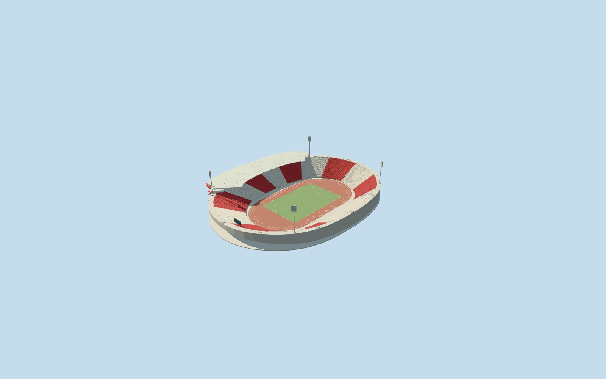

# Rajko Mitić Stadium

Specific Rajko Mitić/Red Star stadium in the established2012–2013 reference configuration. Own native asymmetrical oval/retaining base, terracotta athletics track/neutral football field, continuous red-cream seating bank/pale radial aisles/low rim galleries, single western curved pale canopy with exposed supporting frame/rear posts and west hospitality strip, curved pale office/entrance frontage with red horizontal bands/visible red supports/brick lower face, four tall inward-facing light heads and neutral supported end display. Later track repaints/current branding, copied lettering/crests/advertisements/seat artwork/crowd, furnished hidden rooms and independent neighboring structures are excluded.

## Evidence and reconstruction

Published dimensions and reconstructed details are separated in spec.json. Primary references:

- [Reference](https://commons.wikimedia.org/wiki/File:Zvezda_stadion.jpg)
- [Reference](https://commons.wikimedia.org/wiki/File:Red_Star_Belgrade_stadium_Marakana_(24.06.2012).jpg)
- [Reference](https://www.tob.rs/en/what-to-do/sports-activities/fc-red-star-stadium)

Specific Rajko Mitić/Red Star stadium in the established2012–2013 reference configuration. Own native asymmetrical oval/retaining base, terracotta athletics track/neutral football field, continuous red-cream seating bank/pale radial aisles/low rim galleries, single western curved pale canopy with exposed supporting frame/rear posts and west hospitality strip, curved pale office/entrance frontage with red horizontal bands/visible red supports/brick lower face, four tall inward-facing light heads and neutral supported end display. Later track repaints/current branding, copied lettering/crests/advertisements/seat artwork/crowd, furnished hidden rooms and independent neighboring structures are excluded.

## Model and axes

45,302 triangles; 135,906 vertices; 6 material groups; 5,440,104 bytes. Native bounds: -139.074, -0.700, -138.273 to 103.423, 59.000, 140.623. Source hash: `sha256:da9388512b6d175b9c5602d253905c3c32314602a44f17001eba1d1ecab1e73f`.

{"x":"east","y":"up","z":"south"}

The geographic proposal uses exact-QID OpenStreetMap evidence. Map-derived orientation and estimated architectural details require real-site visual review; preview eligibility is distinct from geographic/fidelity approval. Map attribution: © OpenStreetMap contributors, ODbL-1.0.

## Reproduce

Run `node packages/worldgen/scripts/generate-additional-landmarks.mjs --ids=rajko_mitic_stadium` (or add `--check`). The generator preserves manually edited masters by checking their baseline hashes. Import through the standard authored-model workflow with optimization disabled; then capture all QA cameras, including shared-surface views.

## Pending work

- Specific Rajko Mitić/Red Star stadium in the established2012–2013 reference configuration. Own native asymmetrical oval/retaining base, terracotta athletics track/neutral football field, continuous red-cream seating bank/pale radial aisles/low rim galleries, single western curved pale canopy with exposed supporting frame/rear posts and west hospitality strip, curved pale office/entrance frontage with red horizontal bands/visible red supports/brick lower face, four tall inward-facing light heads and neutral supported end display. Later track repaints/current branding, copied lettering/crests/advertisements/seat artwork/crowd, furnished hidden rooms and independent neighboring structures are excluded.
- Retained Q478000 and named native stadium POI35184398852115 establish own stadium parent52776558271433. Separate pitch35184398864119 supplies104.815887x69.297897m field axis. Native61-point outer and46-point hole define the specific asymmetrical bowl. Positive internalZ points predominantly west and holds the single canopy/main entrance. Anchor[20.464895334306085,44.783176337854]/heading0/native east-south/internal X[0.3095431668600383,0.9508853915431967]/Z[-0.9508853915431967,0.3095431668600383]. Field/track fit the native opening; all independent buildings remain native, including small western entrances/services. Fine20degree/2m facing and roof-arc allocation remain approximate.
- No qualified native architectural heights. Working fieldY0 uses original datum104.26458293267648m; single bank1.4..21.5m/rim22m, western office windows18.1..24.7m/gallery23.4..25.9m and roof27.6..29.9m are picture-led allocations. Canopy arc0.72..2.42radians and front radial interpolation, four53m mast centres with51..59m rectangular heads, row counts, portal canopy3.4m above its highest original contact and neutral end display22.5..28m remain estimates. The photographs establish an older terracotta-track appearance, not later repaints or current-condition/survey/engineering/access certification. Sponsor lettering/crests and exact equipment counts are excluded.
- Original standard6m Mapzen grid, roads, water and every independent native building remain unchanged. Original datum104.26458293267648m defines field/modelY0; boundary samples span1.3475598249052894..16.573078968001354m. A retaining base under the owned bowl and bounded ground opening model the excavated stadium; the coarse terrain is not a stadium survey. Outer retaining edges and roof/light supports use their individual original contacts. Only parent52776558271433 is replaced at99.5percent coverage, with bounded clipping for generalized lower levels. No neighborhood slab or flattened approach roads. Failure/unload preserves/restores original context.

This bundle follows the medium-fi standard. Medium-fi appearance and geographic fit are reviewed separately. Hash-bound visual acceptance is recorded separately after capture inspection.
