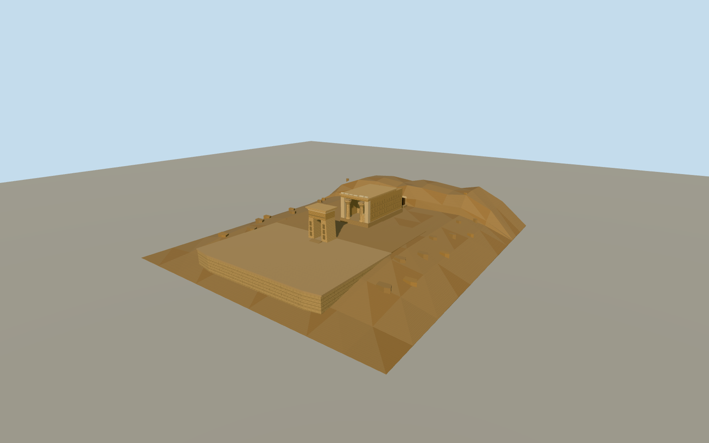

# Temple of Dendur, Nubia

The Temple of Dendur at its original nineteenth-century Nubian site, with the sandstone temple, detached pylon gateway, paved terrace and original rock-cut shrine.

Authoring state: **review-in-qa.json**. Current completion evidence is in [qa.json](qa.json) and the [completion ledger](../../../../qualla-structures/batches/qualla-003.PROGRESS.md).

- [Temple of Dendur](https://qualla.com/temple-of-dendur/)

The model depicts the documented nineteenth-century site. The nearby terrace and sloping rock are reconstructed relative to the temple. The modern terrain source reads 179 m across Lake Nasser. Its actual historic vertical datum is unavailable and the geographic viewer uses an approximate modern-surface reference.

The surveyed exterior includes the partially damaged entrance and retained columns, the free-standing gateway, sandstone terrace and off-center rock-cut shrine opening. Masonry joints, parts of the relief and the original Nile shoreline are estimated.

The historical placement is shown only for the documented pre-reservoir appearance. The present Metropolitan Museum installation, former missing pylon towers, surrounding village and inundation history are outside this model’s scope.

Build: `node content/worldgen/source/places/ss/ssp/temple_of_dendur/models/generate-temple-of-dendur.mjs`. Add `--check` to verify exact regeneration. 11102 triangles; 5 materials; no embedded photographs.
