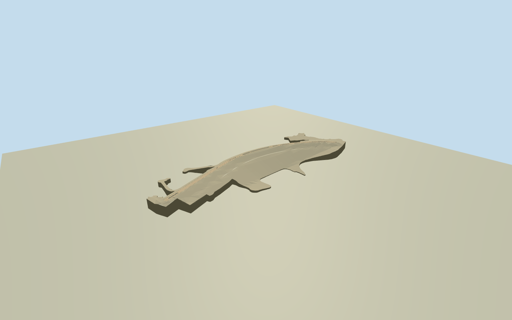

# Aswan High Dam

Complete native visible curved rock-fill High Dam body, broad stone/riprap slopes,40m crest, two-lane top road with pale physical parapets, and a lower downstream service terrace. Native746point outline and actual named crest road remain at their mapped scale. Detached electrical facilities, villages, friendship monument and reservoir/river landscape are separate from this dam asset.

Authoring state: **review-in-qa.json**. Current completion evidence is in [qa.json](qa.json) and the [completion ledger](../../../../qualla-structures/batches/qualla-002.PROGRESS.md).

- [Aswan Dam](https://qualla.com/aswan-dam/)

Primary Egyptian government text gives3830m total construction length,111m maximum foundation height,40m crest and520m main river section. Full native visible main-body polygon spans about2461m east-west and its named curved crest about2357m. Formal/hidden bank wings are not separately measured; native geometry is not stretched to the published total.

The model retains the complete mapped visible main dam outline. A nominal cross-section tapers from maximum111m near the middle toward the banks; exact submerged core, irregular bank excavation, buried foundation and service-terrace elevation are approximate. It is not an engineering or flood-flow model.

Two exact cleared Qualla public-domain Ijanderson977 originals control sloping riprap, lower service road and marker details. Colors, concealed faces and precise parapet/terrace arrangements remain medium-fi interpretations. No photograph, plaque/artwork or engineering diagram is used as a texture.

Detached power station/substation and transmission towers, friendship monument, villages, Low Dam and water landscape are excluded. Native dam-only ground opening avoids duplicate earth surfaces; host reservoir level, source DEM and bank/submerged contact remain approximate.

Build: `node packages/worldgen/scripts/generate-authored-places.mjs --ids=aswan_high_dam`. Add `--check` to verify exact regeneration. 13120 triangles; 4 materials; no embedded photographs.
