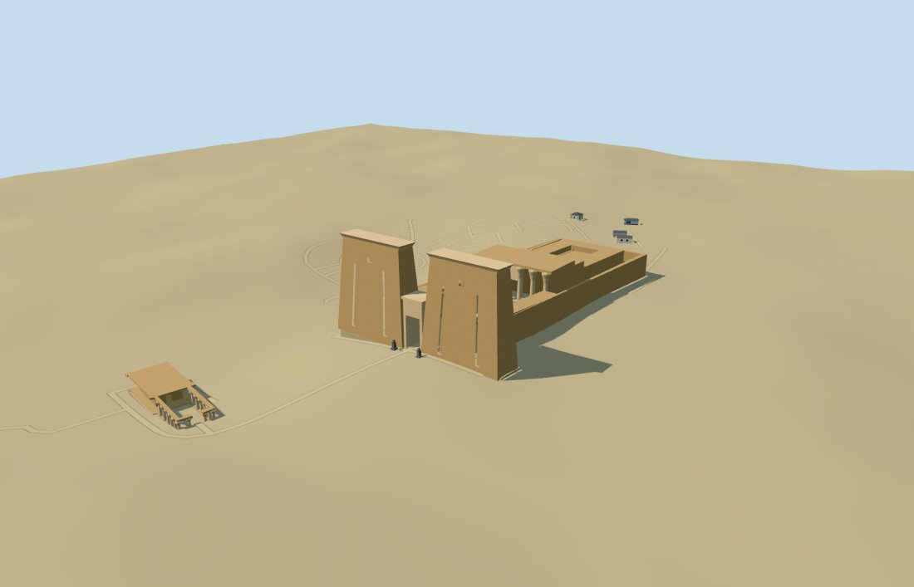

# N0495 — Temple of Edfu

Reviewed 2026-10-18. Accepted for the specific medium-fi exterior and approximate full-site map/DEM fit.

## Exterior and shared materials

Twin battered pylons, concave cornices, an open central gateway, tall facade recesses and two faceted falcons identify the entrance. The open court retains peristyle galleries, a raised column-fronted hall and separately mapped rear roofs. The southern colonnaded building retains fourteen mapped column centers and its rear wall controls. Fine relief and inscriptions are omitted; facade details, gallery columns and most elevations are estimates from an ordinary frontal picture and retained nominal dimensions.

Three common 256-square sandstone, limestone-grain and granite graphs use metric UVs and linear tints. Ground is an explicit earth constant. Four near draws, no embedded images or unique atlas. Each graph loads once; eviction frees all model geometry. Master: 14,019 triangles / 1,685,120 bytes.

## Browser levels

| Level | Triangles | Bytes | Draws |
| --- | ---: | ---: | ---: |
| skyline | 939 | 96,528 | 1 |
| district | 2,767 | 280,944 | 4 |
| street | 7,987 | 808,540 | 4 |
| closeup | 11,003 | 1,116,840 | 4 |

Initial geometry: 377,472 bytes plus the three shared graphs. The skyline retains the pylons, gateway, open court, hall roofs and southern component. Near levels refine columns, cornices and recesses. Separate attribute streams avoid duplicate GPU uploads.

Inspected 11 portable, 11 shared-material and 27 medium-fi frames, including the three review ranges, noon/late lighting, Economy/High, untextured silhouette and four LOD transitions. Synthetic procedural context is framed at scale 1.8 for this large compound. Physical-device and dense-city performance measurements remain pending.

## Geographic fit

The actual approximately 73 × 143 m main envelope and separate southern controls set the plan. The 593 × 258 m archaeological-site boundary is not a building footprint. Raw east/south coordinates retain the pylon front facing 2.08 degrees west of south. The retained nominal maximum pylon height is 36 m.

The original 161-square / 6 m Mapzen-USGS grid is unchanged. Cross-axis medians establish a graded visualization floor; two complete compound floors and local perimeter joins provide approximate contact. Full-site loading replaces 22 native temple/column records and preserves all 26 independent buildings in the 960 m tile exactly. Across the larger extract, 27 independent records remain outside the replacement masks. No water is present in this local extract. Failure retains all 48 native tile buildings and original ground; eviction restores ground and disposes all model geometry.

Inspected 24 full-site, failure and partial-residency views. The synthetic 64 m partial tile verifies clipping and lifecycle with empty semantic context; it exposes the known terrain-excavation sky-sliver issue at temporary clipped boundaries. Full-site contact does not approve those temporary edges. The shared flat stage also exposes sky under graded floors and is not ground-contact evidence.

## Checks and limits

Six Khronos validations have zero errors and warnings. All 172 shape/opening probes, 167 mapped outline vertices and 1,496 compound-floor samples pass. Selected source/import/placement checks, strict medium-fi audit, scene validation and 30-tick simulation passed. Source checking verifies 921 logical bundles and 665 indexed structure recipes. All previous 501 readiness approvals remain ready.

Exact carvings, inscription inventories, navigable interiors and surveyed thresholds are omitted. Roof and column heights outside the retained pylon fact are visualization estimates. No bespoke survey, archival reconstruction or device-performance claim is made. No repository-wide rebuild or npm audit was repeated for this model.

## Rebuild and reference

Two registered recipes (edfu-model.mjs and edfu-temple-model.mjs) plus retained map/reference/terrain inputs reconstruct the master and four browser levels. Run generate-additional-landmarks.mjs --ids=N0495, import-next-1000-models.mjs --ids=N0495 and generate-landmark-lods.mjs --ids=N0495 with Node.

Ordinary frontal picture: https://commons.wikimedia.org/wiki/File:Temple_Edfou_Egypte.jpg — Patrick.reb, CC BY-SA 3.0, viewed only. No picture pixels are shipped.

Source: sha256:085653d72367539c7b00b5202e9e413d12f030c6fe1373831ff10cfd07f5895b

Runtime: sha256:ffc2aead8befe6506d76c012174c0bd49d565b3362435aa1f0a0aad875a6f44b

Input: sha256:85f092f8ec059e96541b6e31f2fc8e7cbc356df55dcaa7de579964a7f4f1b3f9
