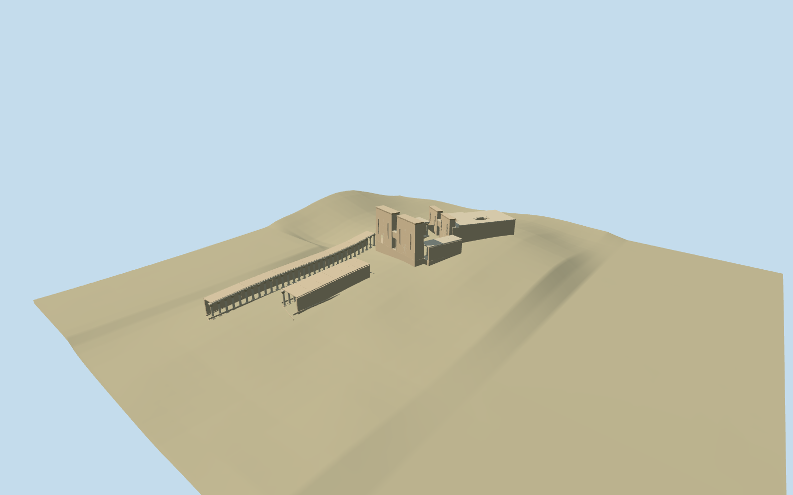

# N0545 — Temple of Isis in Philae

Reviewed 2026-10-19 in one continuous author/build/inspect/fix round.

## Appearance

Inspected53 current source/shared/medium-fi/native/fallback views in one ordinary-picture/map/construction/review round. Specific Isis complex: two differently aligned battered twin pylons with true central gateways and smaller west-tower passage; cavetto cornices, vertical dark slot details and original simplified shallow figure/register vocabulary. Mapped rear sanctuary preserves both open roof courts, west court range and east portico have flared plant-capital columns, and both long forecourt colonnades remain open to native ground. Same-round correction clipped relief marks to the small gateway aperture and conservatively buried rear-wall bases after inside-view contact inspection. No copied deity/story/hieroglyphic atlas or complete hidden ritual interior.

## Shared materials and browser levels

Two existing256-square graphs: stone_sandstone_raw for warm wall/trim and metal_painted for tinted dark details. Three roles/at most three draws, each graph read once; metric UVs/linear tints and zero embedded images. Separate GPU streams and matching CPU/GPU accounting. LODs964/3900/12388/16948triangles; initial476860bytes. Eviction releases model geometry.

| Level | Triangles | Bytes | Draws |
| --- | ---: | ---: | ---: |
| skyline | 964 | 98768 | 1 |
| district | 3900 | 378092 | 3 |
| street | 12388 | 1269408 | 3 |
| closeup | 16948 | 1719412 | 3 |

Inspected noon/late/economy/high/context, silhouette, all four levels/transitions and four detail angles plus inside-forecourt native view. Skyline retains both distinct pylon bearings/real passages, open roof holes and sparse columns; district restores flared capitals/denser columns and cornices; street/close add original relief, more plant-capital facets/petals and fuller column stations. Flat shared ground obscures low terrain-relative forecourt shafts; source/medium/native terrain and inside view establish their full form/contact. Some high-angle/outer views hide a colonnade behind its roof/backwall; the inside view covers the column row. Detail crops omit parts of the overall complex; whole views cover the complete silhouette. Green ground, procedural neighboring monuments/buildings, paths and water remain host context.

## Approximate map fit

Retained exact-QID temple-siteway93872388/Q1503673 and named PMTiles Philae Temple point35184465961220 correlate five occupied controls35184572861120,35185194956229,35185194956230,35185198368745,52776560831061. The site boundary is not itself a building footprint. Anchor32.88423049,24.025280187; heading0; first cross-axis+.287rad, second about+.544rad, entrance toward southern forecourt. Five matching controls replaced with2cm numeric tolerance and zero residual. All50 independent records including neighboring monuments, original6m ground/water and paths preserved; failure restores55 originals, unload frees geometry. Only occupied bases are locally level/buried; long colonnade backs/architraves follow sampled grade. Open courts stay native ground. No broad precinct/island slab, flattening or ground/water cutout.

## Limits

Accepted medium-fi from four inspected ordinary forecourt/pylon, second-pylon, court-column and sanctuary-side pictures plus standard PMTiles/Mapzen. Added court/side views filled specific capital/passage/behind-pylon coverage gaps; no bespoke research. Actual map outlines and two roof holes control extent. Heights, hidden room/roof divisions, west court allocation, exact column/capital/relief inventory, reconstruction joints and thresholds remain explicit approximations. Original shallow geometric figure/register vocabulary conveys relief without copying religious narrative or readable hieroglyphs. Native coarse island DEM cannot preserve level paving or exact shoreline/terrace levels: long colonnades follow sampled grade, not survey levels. No complete hidden ritual interior; Trajan kiosk/independent monuments remain native host context. Physical-device/dense-city timings remain pending.

## Selected checks

Six Khronos files: zero errors/warnings.204 actual mesh/contact probes; 53 current inspected views. Scene validation/sim30 and strict selected medium-fi audit pass. Source and runtime hashes/material bindings/LOD caps verified.

Rebuild: node packages/worldgen/scripts/generate-additional-landmarks.mjs --ids=N0545; node packages/worldgen/scripts/import-next-1000-models.mjs --ids=N0545; node packages/tooling/scripts/generate-landmark-lods.mjs --ids=N0545 --force.

Source: sha256:a919605dde215200ba822a3d9342d868ce762e6cfcb646b8f66b500f158d2b50

Runtime: sha256:2f64e8be5c11eb69945d7b6d60e51cdfc3fbe62780b5bc3332948f44a30eb541

Input: sha256:8d4bf882a19d27e615a7a823882e066b1a95fe24cede3052cb9024b8aabd800d

## Viewed ordinary pictures

https://commons.wikimedia.org/wiki/File:Forecourt_of_the_Temple_of_Isis_with_the_eastern_colonnade_and_first_pylon_of_Isis,_Philae,_Egypt_(52417544356).jpg — Carole Raddato; CC-BY-SA-2.0. Viewed only; no pixels copied.

https://commons.wikimedia.org/wiki/File:The_second_pylon_of_the_Temple_of_Isis,_Philae,_Egypt_(49812289548).jpg — Carole Raddato; CC-BY-SA-2.0. Viewed only; no pixels copied.

https://commons.wikimedia.org/wiki/File:CourApresPremierPyloneTempleIsis.jpg — Gilles Renault; CC-BY-SA-2.0-FR. Viewed only; no pixels copied.

https://commons.wikimedia.org/wiki/File:Side_of_the_Second_Pylon_and_Temple_of_Isis_as_seen_from_outside_(14469477942).jpg — Jorge Lascar; CC-BY-2.0. Viewed only; no pixels copied.
