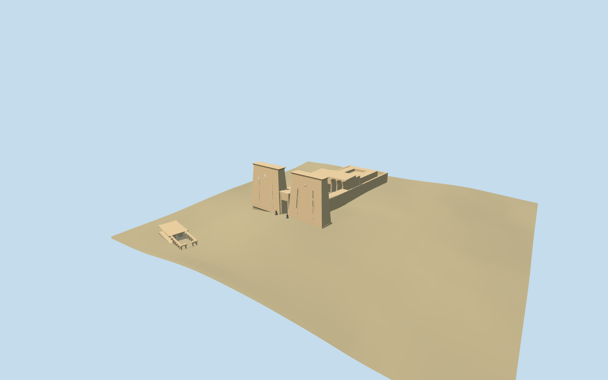

# Temple of Edfu

Specific Edfu exterior: twin battered pylons and open gateway, open forecourt and peristyle, raised column-fronted roofed hall, independently mapped rear roof ranges and enclosing passage wall. The separate southern mapped colonnaded building retains all fourteen column controls and rear wall controls. No generic archaeological-park mass substitutes for the temple.

## Evidence and reconstruction

Published dimensions and reconstructed details are separated in spec.json. Primary references:

- [Reference](https://commons.wikimedia.org/wiki/File:Temple_Edfou_Egypte.jpg)

Three shared256-square stone graphs,metric UVs,linear tints and an explicit earth constant. No embedded images or unique atlas. Two registered recipes reconstruct the master and four browser levels.

## Model and axes

14,019 triangles; 42,057 vertices; 4 material groups; 1,685,120 bytes. Native bounds: -52.230, -6.085, -94.116 to 51.972, 39.655, 123.208. Source hash: `sha256:085653d72367539c7b00b5202e9e413d12f030c6fe1373831ff10cfd07f5895b`.

{"x":"east","y":"up","z":"south"}

Retain the unchanged161-square/6m standard Mapzen-USGS grid and92.762m reference datum. Median cross-axis samples establish an approximate longitudinal visualization grade. Complete opaque court floors and local perimeter joins replace ground only under the two occupied mapped compounds. The original grid remains outside. These coarse levels are not surveyed archaeological thresholds.

## Reproduce

Run `node packages/worldgen/scripts/generate-additional-landmarks.mjs --ids=temple_of_edfu` (or add `--check`). The generator preserves manually edited masters by checking their baseline hashes. Import through the standard authored-model workflow with optimization disabled; then capture all QA cameras, including shared-surface views.

## Pending work

- Specific Edfu exterior: twin battered pylons and open gateway, open forecourt and peristyle, raised column-fronted roofed hall, independently mapped rear roof ranges and enclosing passage wall. The separate southern mapped colonnaded building retains all fourteen column controls and rear wall controls. No generic archaeological-park mass substitutes for the temple.
- Q613037 identifies Temple of Edfu. Standard PMTiles building52776572243683 supplies its eight-point perimeter and open inner court; five independent roof-range controls and the southern building with fifteen parts retain their own positions. The593-by258m archaeological-site boundary is not the temple footprint. Raw+X east/+Z south and heading0 preserve the signed south-facing pylon front,2.08 degrees west of south.
- Retained nominal facts give137m length,79m width and36m pylon height. Mapped wall envelope is about73by143m; tower taper, cornices, staff recesses and open portal follow one ordinary frontal photograph. Court columns, roof heights, simplified falcons and southern building elevation are visualization estimates; no exact relief or inscription inventory.
- Retain the unchanged161-square/6m standard Mapzen-USGS grid and92.762m reference datum. Median cross-axis samples establish an approximate longitudinal visualization grade. Complete opaque court floors and local perimeter joins replace ground only under the two occupied mapped compounds. The original grid remains outside. These coarse levels are not surveyed archaeological thresholds.
- Fine relief,inscriptions,exact carving inventories,navigable interiors and surveyed thresholds are omitted. Southern roof/column heights are approximations from normal-map controls; this is not an archaeological reconstruction. Synthetic partial residency exposes the existing terrain-excavation sky-sliver limitation at temporary clipped boundaries; full-site contact does not approve those temporary edges.

This bundle follows the medium-fi standard. Medium-fi appearance and geographic fit are reviewed separately. Hash-bound visual acceptance is recorded separately after capture inspection.

## Additional geographic data

©OpenStreetMap contributors; Protomaps; Mapzen/USGS terrain.
