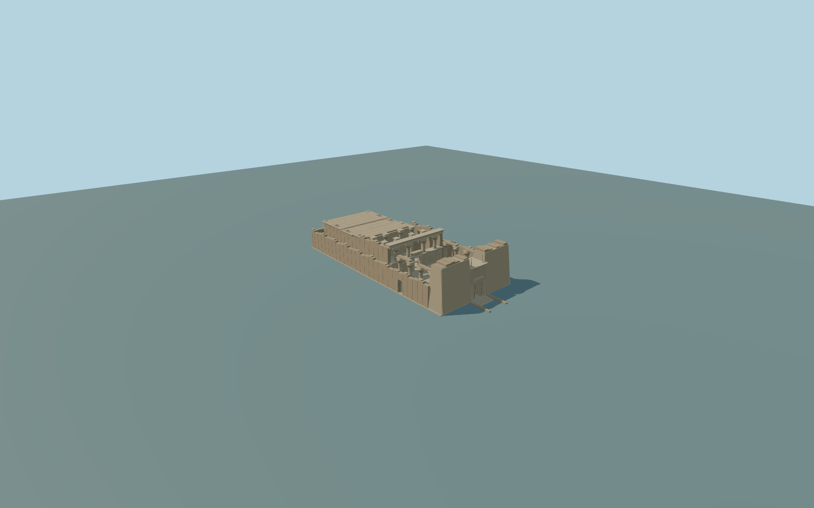

# Temple of Kalabsha

Complete current principal temple exterior:two battered broken-top pylon towers and physically open central portal,raised approach/steps,open stone forecourt and three-sided surviving colonnade,high four-column hypostyle screen/open passage and roofless hall,distinct rear vestibule/sanctuary roofs/chambers,lower irregular surrounding enclosure and side postern. Separate nearby Kertassi,Beit el-Wali and other island monuments are excluded and remain native map buildings.

Rebuild: `node packages/worldgen/scripts/generate-temple-of-kalabsha.mjs`;append `--check` for exact source bytes. Select import/LOD/placement with `--ids=temple_of_kalabsha`. Detailed source and four browser tiers are separate ignored GLB outputs.

Complete current principal temple exterior:two battered broken-top pylon towers and physically open central portal,raised approach/steps,open stone forecourt and three-sided surviving colonnade,high four-column hypostyle screen/open passage and roofless hall,distinct rear vestibule/sanctuary roofs/chambers,lower irregular surrounding enclosure and side postern. Separate nearby Kertassi,Beit el-Wali and other island monuments are excluded and remain native map buildings.

No native internal footprints/heights. Pylon15.5m,hall13m,rear roofs10.8m and all columns/doors/screens/broken courses are original photo-proportional approximations scaled to the retained76.511x34.309m footprint,not a surveyed restoration. Exact sculpted reliefs/inscriptions and unobserved inner chambers are excluded.

One unchanged129x129/2m field covers256m,oversampling a coarse global island DEM.193m rounded datum;the field is not a survey of the reconstructed temple platform. Original structural foundations/entry steps connect without flattening. Fine roof/column/relief/course inventories and thresholds/accessibility grades approximate. No full interior reconstruction,landscape/lake/quay/boats/scattered excavation fragments/temporary visitor equipment or separate island temples. Physical device performance unmeasured.

Four existing256px limestone,weathered stone,granite andpainted-metal graphs;metric UVs andlinear vertex colors,no private/new/embedded images. Abstract disc/borders/floral capitals are original geometry,not exact relief/inscription copies. Skyline/district simplify wall courses,capitals and gate hardware;major courts/portals/hall remain open. Tier errors4/2/1/.35m are estimates,not measured mesh distances.

Original geometry:repository license. Map:© OpenStreetMap contributors,ODbL-1.0;Protomaps. Standard terrain:terrain-grid.json. Ordinary pictures stay local and are not redistributed or used as textures. Current acceptance:qa.json.
