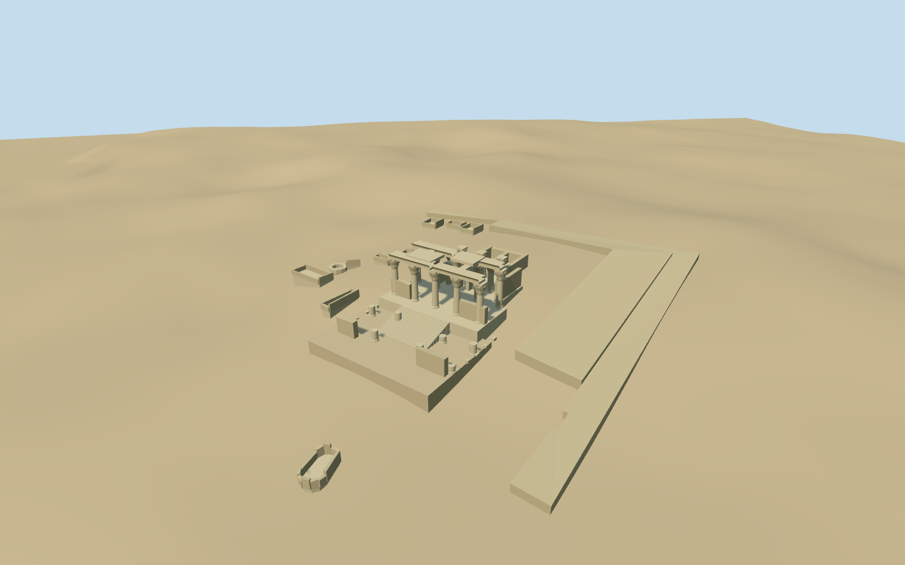

# Temple of Kom Ombo

Temple of Kom Ombo present-day medium-fi surviving double temple: stepped river-facing approach, broken forecourt shafts, paired entrance axes with low screens, floral-capital hypostyle columns, surviving stone lintels/cavetto cornices and winged discs, narrower inner hall, paired roofless rear shrines, mapped enclosure remnants and ancillary ruins, and a shallow visible well-mouth treatment. No complete ancient roof, intact pylon, detailed hieroglyph inventory or neighboring Crocodile Museum is reconstructed.

## Evidence and reconstruction

Published dimensions and reconstructed details are separated in spec.json. Primary references:

- [Reference](https://commons.wikimedia.org/wiki/File:The_Temple_at_Kom_Ombo_(I).jpg)
- [Reference](https://commons.wikimedia.org/wiki/File:KomOmboToSE.jpg)
- [Reference](https://commons.wikimedia.org/wiki/File:Kom-ombo.jpg)

Two registered recipes build the specific surviving double temple and enclosure remnants with shared 256² material graphs, metric UVs and linear tints. No embedded images or unique atlas.

## Model and axes

10,232 triangles; 30,696 vertices; 3 material groups; 1,230,296 bytes. Native bounds: -22.201, -12.000, -104.168 to 115.271, 18.761, 56.195. Source hash: `sha256:0a7c11cb4e7ae96145d9ea50e8e8a74bf6b21abb3561aa8a1bb4e8aabd749604`.

{"x":"east","y":"up","z":"south"}

The geographic proposal uses exact-QID OpenStreetMap evidence. Map-derived orientation and estimated architectural details require real-site visual review; preview eligibility is distinct from geographic/fidelity approval. Map attribution: © OpenStreetMap contributors, ODbL-1.0.

## Reproduce

Run `node packages/worldgen/scripts/generate-additional-landmarks.mjs --ids=temple_of_kom_ombo` (or add `--check`). The generator preserves manually edited masters by checking their baseline hashes. Import through the standard authored-model workflow with optimization disabled; then capture all QA cameras, including shared-surface views.

## Pending work

- Temple of Kom Ombo present-day medium-fi surviving double temple: stepped river-facing approach, broken forecourt shafts, paired entrance axes with low screens, floral-capital hypostyle columns, surviving stone lintels/cavetto cornices and winged discs, narrower inner hall, paired roofless rear shrines, mapped enclosure remnants and ancillary ruins, and a shallow visible well-mouth treatment. No complete ancient roof, intact pylon, detailed hieroglyph inventory or neighboring Crocodile Museum is reconstructed.
- Q1243401/way90446374 identifies the ruin precinct rather than a solid modern building. The standard map supplies the stepped main-hall footprint, two large L-shaped enclosure strips, seven small ancillary remnants, a west detached ruin and the circular well. Internal+U runs northeast; the paired main front faces southwest toward the river. The low front, broad main hall and narrowing rear arrangement follow the mapped vertices. The Crocodile Museum and small later kiosk remain independent, with a0.1mm numerical margin at shared mask edges.
- Three ordinary photographs guide the surviving form. Approximate14m upper front cornice, about10.7m floral columns, low screen walls4.6m, broken forecourt shafts1.8–4m and lower irregular rear chambers. Main10-column and smaller6-column groupings, secondary partitions and individual capitals are visualization estimates from pictures and mapped plan dimensions, not a surveyed stone inventory. Fine carved narratives and inscriptions are omitted.
- Pinned small standard2026-10-14 PMTiles/Mapzen extract. Main and forecourt decks use separate visualization datums above the local coarse grid, with retaining foundations and a stepped transition. Enclosure remnants follow the standard native grade. Ground and Nile water stay native, with no ground/water cutout. The well is a shallow sealed mouth/basin above the native grade rather than a claim to its surveyed underground shaft.
- Mapped footprints guide the present complex. Column groups, partitions, damage and exact levels are picture-led visualization estimates. The well is a shallow sealed mouth treatment. The modern Crocodile Museum remains independent; no complete ancient roof or navigable interior is claimed.

This bundle follows the medium-fi standard. Medium-fi appearance and geographic fit are reviewed separately. Hash-bound visual acceptance is recorded separately after capture inspection.

## Additional geographic data

©OpenStreetMap contributors; Protomaps; Mapzen/USGS terrain.
