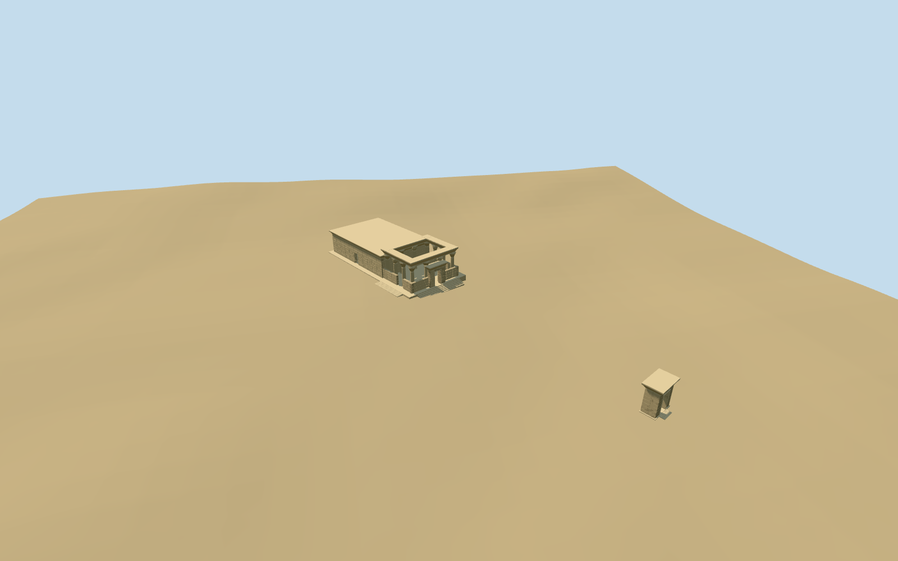

# temple_of_hibis — Temple of Hibis

Reviewed 2026-10-19 in one continuous author/build/inspect/fix round.

## Appearance

Inspected48 current source/shared/medium-fi/native/fallback views during this same construction pass. Lower roofed sandstone body with true front/south doors, small square wall sockets and cavetto cornice. Taller roofless portico has varied palm/bell/bud capitals, seated perimeter beams, low screens/actual side gap and open central doorframe. Raised occupied platform/short treads and separate thick open gateway with original winged-disc silhouette. No full portico roof, copied relief/inscription atlas or temporary scaffold. Hidden internal support/room inventory and other distant gates/quay are not reconstructed.

## Shared materials and browser levels

Two existing256-square graphs: stone_sandstone_raw for body/screens/trim and stone_limestone_raw for columns. Each read once; metric UVs/linear tints and zero embedded images. Master16390triangles/1969312bytes; levels748/2336/13566/16390triangles, initial308436bytes, at most three runtime draws. Separate GPU streams/equal CPU-GPU accounting; unloading frees model geometry. Existing cavetto helper reused unchanged. Fixed first-entry index binding before inspection so every LOD uses its specific authored geometry.

| Level | Triangles | Bytes | Draws |
| --- | ---: | ---: | ---: |
| skyline | 748 | 79072 | 1 |
| district | 2336 | 229364 | 3 |
| street | 13566 | 1253152 | 3 |
| closeup | 16390 | 1514724 | 3 |

Inspected noon/late/economy/high context, silhouette, four authored levels/transitions and three details. Skyline keeps roofed body/open portico, screens/front frame and separate gateway; district restores round capital profiles/cornice, street adds coursed masonry/sockets and original petals, close-up increases capital density/quiet abstract relief. Flat shared stage partly buries the negative-datum gate threshold; terrain-bearing source/native/medium-fi views establish full local contact. Synthetic neighboring buildings are comparison context.

## Approximate map fit

Exact-QID OSMway98894290/Q4115642 is a226.9x157.5m archaeological precinct boundary, not a temple roof. Standard PMTiles has no building polygons here. Named ruinsPOI35184470983133 fixes approximate primary body center[-38.851238986624736,-3.2655914214297206] relative to anchor30.555698636,25.476418144. Named attractionPOI35184470983122 and original eastern reference point align an approximately northeast approach; internal main bearing-0.5118553083174939rad follows that line, rather than the precinct boundary axis. Ordinary east/south photos support signed front facing. Main envelope/column/screen allocation remains picture-led, about10m/20degree uncertainty. The single pictured gateway is allocated at the original eastern reference point[34.47281716039595,-43.126395247428185] on that approach with about25m location uncertainty; exact gate association is not mapped. No native building shell is replaced. Keep the retained standard6m Mapzen ground, native paths/water and zero native building-polygon set unchanged. Primary occupied platform and distant gate use independent level floors above sampled local envelope maxima; buried sides and short local approaches meet native grade. No precinct-wide platform, terrain flattening, ground/water cutout or removal of independent features. Coarse DEM does not resolve paving or thresholds; exposed footing heights/approach engineering and independent gate assignment are approximate. Native fixture retains zero building polygons/zero water records, all path features and original6m ground through loaded levels, failed-load fallback and unloading. No native building shell is removed. Architecture/bearing follow named points and pictures rather than incorrectly treating the entire archaeological precinct boundary as a roof. Independent gateway floor and placement remain approximate.

## Limits

Accepted medium-fi exterior from four ordinary2000/2006/2008 photos and the retained standard PMTiles/Mapzen extract, carried through one author/build/inspect pass. Main center/approach bearing, 12 perimeter supports, envelope/screens/roof/door allocation, capitals/quiet relief and pictured gateway association are explicit visualization estimates. Primary floor0.7496698205014417m/gateway floor-1.2263996087076436m fit coarse terrain; no survey or stair/foundation engineering claim. Other gates/quay/precinct walls/palms/scaffold and current restoration state remain unclaimed. Physical phone/laptop timing pending.

## Selected checks

Six Khronos files: zero errors/warnings.256 actual mesh/contact probes; 48 current inspected views. Scene validation/sim30 and strict selected medium-fi audit pass. Source and runtime hashes/material bindings/LOD caps verified.

Rebuild: node packages/worldgen/scripts/generate-additional-landmarks.mjs --ids=temple_of_hibis; node packages/worldgen/scripts/import-structure-models.mjs --ids=temple_of_hibis; node packages/tooling/scripts/generate-landmark-lods.mjs --ids=temple_of_hibis --force.

Source: sha256:bbbcf8ab05001647aa1aa02fc756606297ade5e444a44cb21772f215174df93a

Runtime: sha256:b7dc4b7b27c48f9134788cd7e8c7c2a231ebca1a854b68a6aca9f6e35d7823b9

Input: sha256:1ead9dd18230d0df411072d6c42debfee4a35abe94e9bf5e2262cedfeffe4c88

## Viewed ordinary pictures

https://commons.wikimedia.org/wiki/File:Temple_of_Hibis.jpg — ASartan; CC-BY-SA-3.0. Viewed only; no pixels copied.

https://commons.wikimedia.org/wiki/File:HibisTemple.jpg — Roland Unger; CC-BY-SA-3.0 / GFDL. Viewed only; no pixels copied.

https://commons.wikimedia.org/wiki/File:HibisPorticoSouthSide.jpg — Roland Unger; CC-BY-SA-3.0 / GFDL. Viewed only; no pixels copied.

https://commons.wikimedia.org/wiki/File:Flickr_-_isawnyu_-_Hibis,_Temple_(I).jpg — NYU Excavations at Amheida Staff / Institute for the Study of the Ancient World; CC-BY-2.0. Viewed only; no pixels copied.
