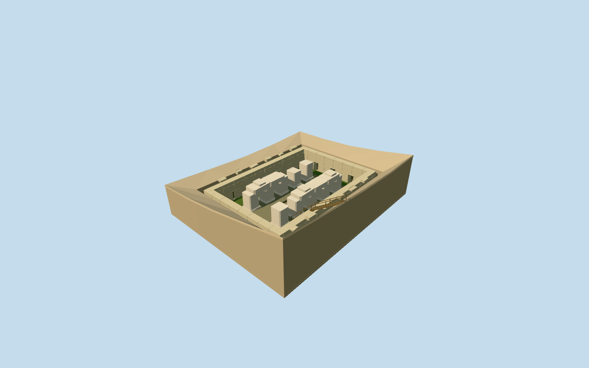

# Osireion

Standing Osireion open megalithic hall/excavation: two rows of five massive plain square granite piers with worn bases/fractured surviving heights, incomplete longitudinal lintels and loose cap blocks. Coursed perimeter masonry with recessed rectangular door/niche bays, exposed central wet stone island/rectangular floor recesses and shallow opaque green-water moat in the pictured low-water state. Narrow timber side stair/bridge with simple rails. Complete opaque excavation floor and fitted retaining/earth rim meet a bounded mapped ground opening. No intact ancient roof, covered underground rooms/long passage, copied relief/graffiti or neighboring Seti I temple reconstruction.

## Evidence and reconstruction

Published dimensions and reconstructed details are separated in spec.json. Primary references:

- [Reference](https://commons.wikimedia.org/wiki/File:Osireion_02.JPG)
- [Reference](https://commons.wikimedia.org/wiki/File:Osireion_at_Abydos.jpg)

Standing Osireion open megalithic hall/excavation: two rows of five massive plain square granite piers with worn bases/fractured surviving heights, incomplete longitudinal lintels and loose cap blocks. Coursed perimeter masonry with recessed rectangular door/niche bays, exposed central wet stone island/rectangular floor recesses and shallow opaque green-water moat in the pictured low-water state. Narrow timber side stair/bridge with simple rails. Complete opaque excavation floor and fitted retaining/earth rim meet a bounded mapped ground opening. No intact ancient roof, covered underground rooms/long passage, copied relief/graffiti or neighboring Seti I temple reconstruction.

## Model and axes

7,612 triangles; 22,836 vertices; 5 material groups; 916,852 bytes. Native bounds: -24.004, -6.700, -25.029 to 24.006, 4.298, 25.025. Source hash: `sha256:24b60143ca9d7f946c7ed5e54ddb6ef1e19115c0010ce842c9900c9cd9df9639`.

{"x":"east","y":"up","z":"south"}

The geographic proposal uses exact-QID OpenStreetMap evidence. Map-derived orientation and estimated architectural details require real-site visual review; preview eligibility is distinct from geographic/fidelity approval. Map attribution: © OpenStreetMap contributors, ODbL-1.0.

## Reproduce

Run `node packages/worldgen/scripts/generate-additional-landmarks.mjs --ids=N0556` (or add `--check`). The generator preserves manually edited masters by checking their baseline hashes. Import through the standard authored-model workflow with optimization disabled; then capture all QA cameras, including shared-surface views.

## Pending work

- Standing Osireion open megalithic hall/excavation: two rows of five massive plain square granite piers with worn bases/fractured surviving heights, incomplete longitudinal lintels and loose cap blocks. Coursed perimeter masonry with recessed rectangular door/niche bays, exposed central wet stone island/rectangular floor recesses and shallow opaque green-water moat in the pictured low-water state. Narrow timber side stair/bridge with simple rails. Complete opaque excavation floor and fitted retaining/earth rim meet a bounded mapped ground opening. No intact ancient roof, covered underground rooms/long passage, copied relief/graffiti or neighboring Seti I temple reconstruction.
- Exact-QID OSMway90456113/Q2033435 gives approximately38.96x31.31m archaeological envelope and undirected long axis; standard PMTiles named OsireionPOI35184462544945 lies within0.16m of anchor31.918428132,26.18413313. Anchor heading0/native east-south; internal long axis-.97476887509rad points NE toward independently mapped Seti I temple, which remains untouched. Two five-pier rows are parallel to that axis. Signed bridge, recess and surviving-lintel allocation is picture-led and may be reversed by180degrees despite its fixed mapped long axis; mapped outline is an archaeological extent, not a measured pier/foundation plan. No PMTiles building shell corresponds to Osireion; replace none.
- Picture/map estimates: occupied low-water island22.5x10.2m, floor-5.45m relative to coarse anchor datum, excavation bed-6.3m, shallow water-5.5m. Ten square piers approximately2.4m across and3.5-4.2m tall, uneven broken tops, incomplete1m-deep longitudinal lintels. Main chamber outer28x21m/perimeter wall1.4m thick with three end recesses/five side bays. Outer excavation39x31.3m follows mapped envelope; perimeter meets retained6m terrain. Missing roof/covered subterranean chambers are not restored. Absolute pit depth, low/high-water levels, hidden foundations, exact surviving lintel/block inventory and stair engineering remain visualization estimates.
- Keep the original standard6m Mapzen height grid, native water/paths and every independent building. A bounded approximately39x31m opening follows only the exact mapped archaeological envelope. A complete opaque authored bed at-6.3m covers the whole opening at every LOD; retaining walls/sloping rim meet the native edge and original terrain returns on failure/unload. No broad precinct flattening, neighboring-temple cutout or deletion. Coarse DEM rises about4m across the pit and cannot resolve its true excavation/terrace sections; native-edge wall heights/depth and the small visitor stair are approximate. The opaque green surface is a static pictured low-water/algae visualization, not hydrology or a replacement for native mapped water.
- Two ordinary standing photographs. Opaque low-water/algae surface is a dated visual state, not hydrology. Depths, worn-block/lintel inventory and bridge/recess allocation are approximate. No intact full roof, covered underground rooms or neighboring Seti temple restoration.

This bundle follows the medium-fi standard. Medium-fi appearance and geographic fit are reviewed separately. Hash-bound visual acceptance is recorded separately after capture inspection.

## Additional geographic data

©OpenStreetMap contributors; Protomaps; Mapzen/USGS terrain.
