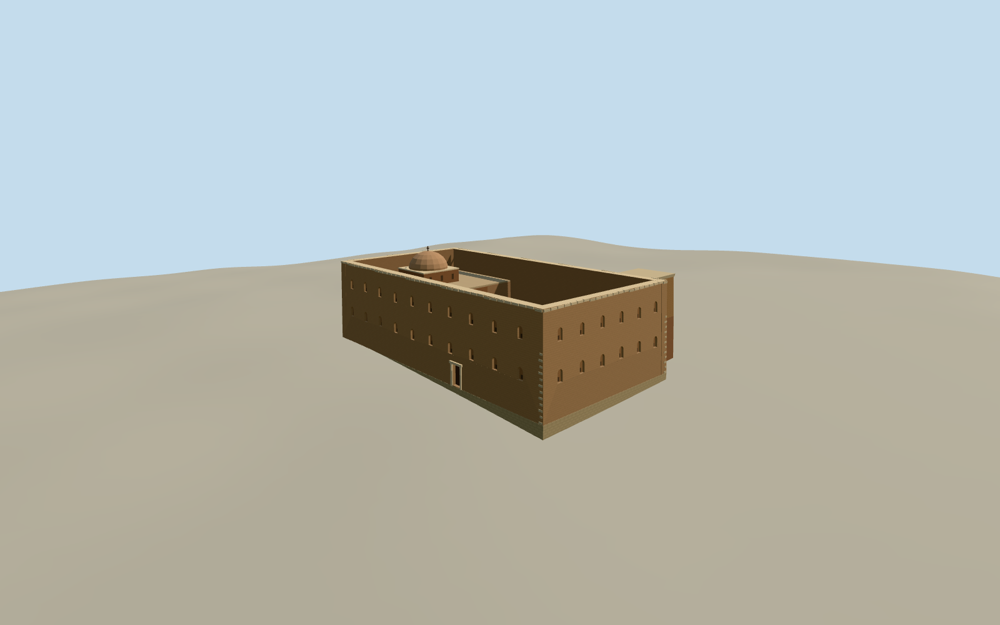

# Red Monastery, Sohag

Coptic monastery church at Sohag with its battered brick exterior, roofless nave, sanctuary dome and southern keep.

Authoring state: **review-in-qa.json**. Current completion evidence is in [qa.json](qa.json) and the [completion ledger](../../../../qualla-structures/batches/qualla-003.PROGRESS.md).

- [Red Monastery](https://qualla.com/red-monastery/)

The model depicts the May 2024 exterior of the historic church and southern keep. The protected wall paintings and the modern buildings surrounding the courtyard are outside this exterior model’s scope.

The Qualla photo gives the batter, cornice and two rows of niches. The photographed dominant wall is interpreted as the western end. Exact rear opening counts, the heights of the top surfaces and the keep’s geometry are estimated.

The open nave, east sanctuary, dome and southern keep follow published architectural records. The mapped outline controls the main church; the keep and roof subdivision are approximate. The original elevation samples remain unchanged.

Build: `node content/worldgen/source/places/ss/ssw/red_monastery/models/generate-red-monastery.mjs`. Add `--check` to verify exact regeneration. 6188 triangles; 7 materials; no embedded photographs.
