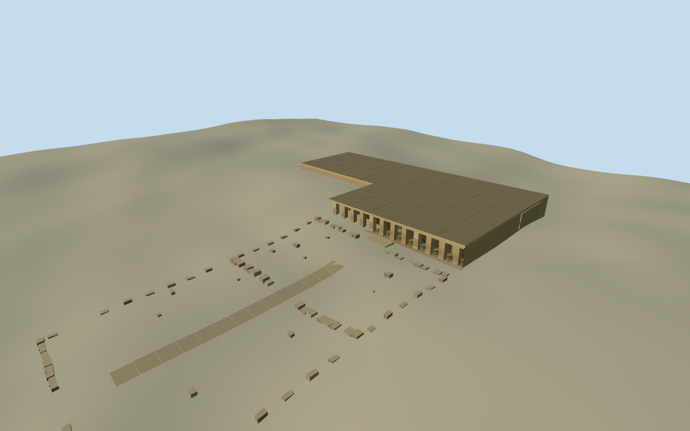

# Temple of Seti I (Abydos)

The standing Temple of Seti I at Abydos, with its limestone row of twelve piers, L-shaped roof, two interior columned halls and ruined forecourts.

Authoring state: **review-in-qa.json**. Current completion evidence is in [qa.json](qa.json) and the [completion ledger](../../../../qualla-structures/batches/qualla-003.PROGRESS.md).

- [Temple of Seti I (Abydos)](https://qualla.com/temple-of-seti-i-abydos/)

The model shows surviving ancient masonry as represented by the 1990 exterior and current mapped building. Court stumps, surface wear and select threshold elevations are approximate.

Roof slab divisions, simplified porch reliefs and internal walls represent the measured layout and available views. The Osireion and adjacent separate temples fall outside its scope.

Build: `node content/worldgen/source/places/ss/ssw/temple_of_seti_i_abydos/models/generate-temple-of-seti-i-abydos.mjs`. Add `--check` to verify exact regeneration. 10508 triangles; 5 materials; no embedded photographs.
