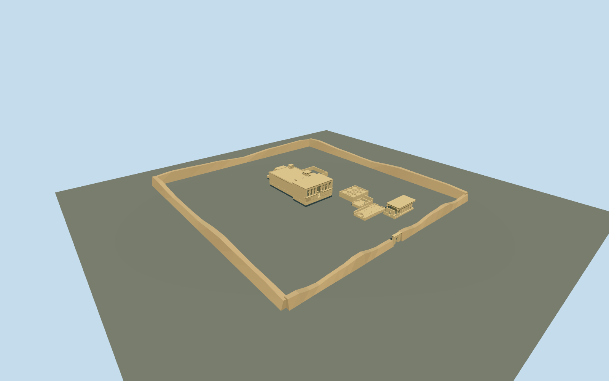

# dendera_temple_complex — Dendera Temple complex

Reviewed2026-10-19. Accepted for medium-fi exterior visualization and approximate PMTiles/DEM fit. Built, inspected, corrected and completed in the same continuous authoring round.

## Exterior

Inspected the current complete exterior: primary stepped Hathor temple, six front Hathor capitals and24 hypostyle columns, screen walls/jambs/cavetto cornices, roof kiosk/rooms/stair, Roman mammisi, roofless older mammisi/basilica/sanatorium, surviving Isis chamber/court, dry sacred-lake basin and north portal/eroded enclosure. Fixed the roof gap and defaced capitals during authoring; the final pass increased the overly regular wall crest erosion. No copied reliefs or invented intact faces.

## Shared materials

Four reused256² material graphs: raw sandstone, lime plaster, adobe and painted metal. Metric UVs and linear tints; zero embedded images or unique atlases. Each graph loads once. Flat-ground material captures expose some retaining depth and an underside gap beneath the elevated temple floor; the retained actual-terrain site views establish contact. The lake is dry. Exact palms and relief figures are not reconstructed.

## Browser levels

| Level | Triangles | Bytes | Draws |
| --- | ---: | ---: | ---: |
| skyline | 986 | 101012 | 1 |
| district | 3742 | 349868 | 3 |
| street | 11274 | 1050020 | 3 |
| closeup | 22832 | 2105392 | 4 |

Inspected all26 standard views: noon/late, Economy/High, three distances, silhouette, selected details, four explicit levels and transitions. Levels986/3742/11274/22832 triangles;1/3/3/4 draws. Initial geometry450880bytes, within phone/laptop budgets. The skyline keeps stepped temple masses, six front capitals, ancillary masses and precinct; shallow ruins and individual stumps resolve as distance closes. Physical-device/dense-city timings remain pending.

## Geographic fit

Reviewed approximate exterior fit on the unchanged standard161-square/6m Mapzen grid. SourceY0 is the original raw-map anchor sample; the primary floor follows its front approach at sourceY7.1. Bounded openings beneath the primary stepped footprint and dry lake are covered by opaque geometry at all four levels. Other monument floors sit above their sampled local maximum, with retaining foundations. Seven mapped temple/roof/sanatorium records are selectively replaced; seven independent facilities/structures are preserved byte-for-byte in the retained site fixture. Numerical boundary remnants are below1e-7m². Failed loading restores all14 native records and original ground; eviction frees geometry. No native water is present or removed. No exact archaeological thresholds, excavated strata or terrain survey are claimed. Signed facade axis follows the retained map front edge. The roof controls and sanatorium keep original map vertices as inputs; simplified geometry follows their approximate extents. Mammisi/ruin POIs constrain relative centers. Ancillary dimensions, Isis/lake/gateway positions and eroded wall circuit use the already inspected ordinary visitor diagram and pictures, not a survey. The large tourism boundary is not treated as a wall line.

## Limits

Accepted as a specific medium-fi exterior complex and approximate standard-map fit. Unmeasured ancillary dimensions, temple heights conflicting with coarse map tags, crypts/interior rooms, exact stone courses, relief portraits/glyphs, individual damage and vegetation remain outside the reconstruction. Flat synthetic stages cannot establish archaeological grade. Partial10m residency shows only clipped fragments; surrounding tiles are required for the whole complex. No bespoke research was used.

## Checks

Four registered recipes rebuild the2,742,744-byte master. Six Khronos files: zero errors/warnings.54 meaningful floor/hall probes pass. Current source/runtime hashes, scene validation and sim30 pass. Inspected10 portable,10 shared,26 medium-fi and12 site/partial views; the boundary probe rerender is pixel-identical to the partial closeup. Full rebuild and lock refresh remain batch work.

Rebuild: node packages/worldgen/scripts/generate-additional-landmarks.mjs --ids=dendera_temple_complex; node packages/worldgen/scripts/import-structure-models.mjs --ids=dendera_temple_complex; node packages/tooling/scripts/generate-landmark-lods.mjs --ids=dendera_temple_complex.

Source: sha256:4ead3f815f99a59c3588228ad00d1832e718998c34b44ace8a597523c027426a

Runtime: sha256:53d5f61887540bf735eb2ccf1cb168bd032439b0c46ecb1f0ea2f4884862ab7e

Input: sha256:b664d9864a5b81c62de1b3824e4bcb126a443b71d927dfa25df4e31be725f587
