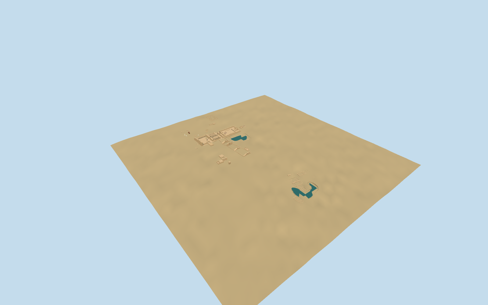

# Karnak Temple Complex

Principal medium-fi exterior visualization of Karnak:Amun entrance,courts,hypostyle hall,eastern pylons/obelisks,shrines,Akhmenu,east temples,sacred lake,southern pylons,Khonsu,Opet,Bab El Amara,Ptah,Taharqa,northern/entrance chapels,peristyle,Montu and Mut precinct exteriors. Fine carving,inscriptions,exact ruin inventories and hidden historic interiors are omitted. Point-derived Montu,Taharqa,main Mut,TempleA and ChapelB retain explicit uncertainty. Standard-map/DEM site fit is approximate.

## Evidence and reconstruction

Published dimensions and reconstructed details are separated in spec.json. Primary references:

- [Reference](https://images.cnrs.fr/photo/20010001_0819)
- [Reference](https://www.reiseninaegypten.com/blog/der-karnak-tempel)
- [Reference](https://www.klook.com/en-US/activity/166682-private-half-day-tour-to-luxor-east-bank/)
- [Reference](https://in.pinterest.com/pin/ancient-beauty-aerial-view-of-karnak-temple-complex--367747125827126117/)
- [Reference](https://commons.wikimedia.org/wiki/File:Karnak_Khonsu_Temple_R01.jpg)
- [Reference](https://commons.wikimedia.org/wiki/File:Karnak_Khonsu_Temple_R02.jpg)
- [Reference](https://commons.wikimedia.org/wiki/File:Karnak_Tempel_Ipet_01.jpg)
- [Reference](https://commons.wikimedia.org/wiki/File:Karnak_Tempel_Ipet_02.jpg)
- [Reference](https://commons.wikimedia.org/wiki/File:Temple_of_Ptah_in_Karnak_01.jpg)
- [Reference](https://commons.wikimedia.org/wiki/File:Karnak_Ptah_07.jpg)
- [Reference](https://www.cfeetk.cnrs.fr/travaux/etude-restauration-edifice-de-taharqa-du-lac/)
- [Reference](https://commons.wikimedia.org/wiki/File:White_Chapel_of_Senusret_I_in_Karnak_Open_Air_Museum_04.jpg)
- [Reference](https://commons.wikimedia.org/wiki/File:Chapelle_Rouge.jpg)
- [Reference](https://commons.wikimedia.org/wiki/File:Alabaster_chapel_of_Amenhotep_I_%28Karnak%29.jpg)
- [Reference](https://commons.wikimedia.org/wiki/File:Thutmose_IV%E2%80%99s_peristyle_hall_%28Horus-2009%29.jpg)
- [Reference](https://commons.wikimedia.org/wiki/File:Precinct_of_Montu_in_Karnak_04.jpg)
- [Reference](https://arce.org/project/mut-temple/)
- [Reference](https://arce.org/project/mut-temple/)

Three existing 256-square shared stone graphs, plus flat ground and still-water materials. Metric UVs and linear vertex tints. No embedded images, unique atlas, copied reliefs or lettering. Source master and four LODs reconstruct from the registered recipes and source controls.

## Model and axes

64,074 triangles; 192,222 vertices; 5 material groups; 7,692,112 bytes. Native bounds: -188.873, -9.385, -339.405 to 305.300, 30.493, 882.065. Source hash: `sha256:9ab959bed4ff351bb7aec618eadc6cb2693cadec4600ed637037037d03e7428b`.

{"x":"east-southeast into main temple","y":"up","z":"south-southwest across courts"}

Approximate exterior placement from retained standard viewer PMTiles and unmodified161-square/16m DEM plus ordinary pictures. The hypostyle-hall control anchors the signed26-degree axis;native+X points ESE,+Z SSW,+Y up. NativeY0 is the DEM sample at the exact model anchor. Independent temple/shrine groups use retained-DEM neighborhood medians;processional and approach ramps connect their levels. Both lake levels use retained native-water lower quartiles. Thirty-one covered ground pockets and52separate building masks preserve432independent retained building records. Actual DEM tile:365independent records unchanged. Native-water replacement is limited to the two modeled lake footprints;failed loads,partial residency and eviction preserve or restore unloaded surfaces. Architectural grades and point-derived envelopes/facing remain visualization estimates,not surveyed archaeological elevations or hydrology.

## Reproduce

Run `node packages/worldgen/scripts/generate-additional-landmarks.mjs --ids=karnak_temple_complex` (or add `--check`). The generator preserves manually edited masters by checking their baseline hashes. Import through the standard authored-model workflow with optimization disabled; then capture all QA cameras, including shared-surface views.

## Pending work

- Principal medium-fi exterior visualization of Karnak:Amun entrance,courts,hypostyle hall,eastern pylons/obelisks,shrines,Akhmenu,east temples,sacred lake,southern pylons,Khonsu,Opet,Bab El Amara,Ptah,Taharqa,northern/entrance chapels,peristyle,Montu and Mut precinct exteriors. Fine carving,inscriptions,exact ruin inventories and hidden historic interiors are omitted. Point-derived Montu,Taharqa,main Mut,TempleA and ChapelB retain explicit uncertainty. Standard-map/DEM site fit is approximate.
- Q522862/relation14358790 is retained as archaeological identity only,never a single extruded building. Separate standard PMTiles controls identify the authored Amun core and its eastern pylon fragments,shrines,open court,exterior walls,Akhmenu ranges and exterior east temples. Mapped room/ruin containers are not blindly filled as complete roofs. Named information points are labels,not building centers. The sacred lake water is a component of PMTiles water multipolygon260831100,with a separate named point35184398171942. Southern pylon controls52776575486412–415 are independent multipart footprints;their centers and orientation are not the whole archaeological relation axis. Three independent mapped controls35184487873041,35184697656739 and35185622410047 set Khonsu,Opet and Bab El Amara. Their different axes are preserved;nearby service containers remain independent. The distant information point is not used as the temple center. Ptah uses its own six-vertex building35184462531641 and narrow eastward axis. Lakeside Taharqa35184490263836 is a named map point only;its28x20m extent and facing remain estimates with10m horizontal uncertainty. Nearby building35185932659984 remains independent. Twelve independent building controls identify the northern/entrance chapels and multipart peristyle. Named Montu35184462531640 is point-derived:90x70m extent and facing are estimates with25m horizontal/20degree angular uncertainty. No whole archaeological area is extruded. Mut ruins label35184848706149 and northern gate35185621169302 constrain the principal temple;the broad site label is not a building center. Independent mapped35184521847296 sets RamessesIII. TempleA and ChapelB remain picture-positioned estimated envelopes. Two overlapping Mut water components are unioned without altering the separate Amun lake component. Small building35185621169303 remains independent.
- Only the northern SethosII shrine has a5m mapped height in these controls. Other heights, pylon batter and broken tops, columns/capitals, surviving beams, stairs and small forms are picture-guided medium-fi estimates. The side-column rhythm is an authored134-column approximation (12tall central and122smaller), not a surveyed placement or a claim of exact surviving stone count. No ancient complete roof reconstruction, copied reliefs, inscriptions or interior rooms. Two standing obelisks are visible in the retained ordinary aerial pictures. The retained PMTiles has no separate named point for them. Positions within the mapped third/fourth-pylon courts,widths and heights are picture-guided estimates;not surveyed or independently measured. Akhmenu has an authored20-column central festival-hall rhythm and separate outer piers;exact surviving counts,roof coverage,room heights and statue forms remain picture-guided approximations. No reliefs,inscriptions or historical paint are copied. Southern pylon heights and broken profiles are inferred from ordinary aerial views;the PMTiles supplies their footprint pairs,not surveyed heights. Lake depth,water level,bank width and stair sections are visualization estimates. Coarse statue/Scarab silhouettes do not reproduce fine historical carving. Khonsu and Opet heights,roof survival,upper apertures,cornices,column rhythm,raised entrance and Bab El Amara dimensions are inferred from ordinary exterior pictures. Shared stone textures supply broad material character;no reliefs or lettering are copied. Ptah portal heights,gate stations,partial roof survival and columns,and Taharqa low enclosure,pit depths,internal pockets and stairs are picture-guided medium-fi estimates. No reliefs,inscriptions or hidden historical interiors are reproduced. Northern shrine,piers,cornices,beams,ramps and broken ruin heights are picture-guided estimates. Hakoris alone has a mapped5m height;its open pavilion arrangement is typological. White/alabaster and red-stone tints reuse the same material graphs. Hidden rooms,carving,inscriptions and hypothetical complete ancient roofs are omitted. Mut surviving low ruins,broken porch columns,door jambs and representative statue forms use ordinary photographs. Heights,room survival,statue counts and small features are estimated. Complete ancient roofs,sculpture detail,reliefs and lettering are omitted.
- Unchanged retained standard161-square/16m viewer DEM. Geographic vertical poses use local DEM medians;processional and approach ramps join the independent floor groups. Native-water lower quartiles set both lake levels. The257-square/6m source-local review fixture lowers only occupied pockets for isolated inspection;separate actual-site captures use the unmodified DEM. Approximate visualization fit,not surveyed archaeological grades or hydrology.
- Whole-complex geographic integration and current medium-fi/shared-material acceptance

This bundle follows the medium-fi standard. Medium-fi appearance and geographic fit are reviewed separately. Hash-bound visual acceptance is recorded separately after capture inspection.

## Additional geographic data

©OpenStreetMap contributors;Protomaps;Mapzen/USGS terrain.
