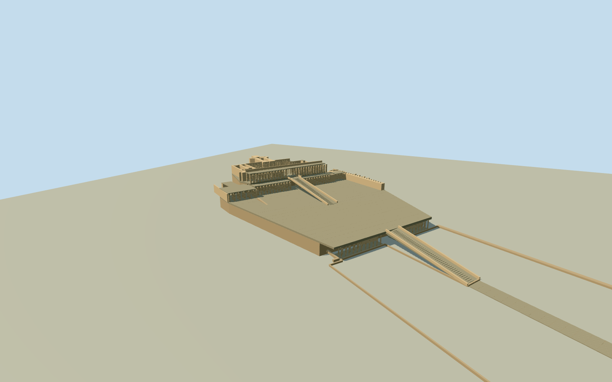

# Mortuary Temple of Hatshepsut

Whole restored three-terrace Mortuary Temple of Hatshepsut: true open square-pier colonnades/upper Osirian pilasters, intrinsic courts/two rising central ramps/stone rails and stepped lanes, native165 pier footprints/seventeen architectural components, attached Hathor/Anubis chapels and upper open peristyle/solar-cult/sanctuary wall complexes. Five exact distinct creator PD-self/CC0 originals after Qualla-first assessment. Actual plan/whole native parts, bounded original vertical sections/hidden architecture/fine statue and unmapped column census, no cliff/neighboring temples/modern facilities/copied images.

Authoring state: **review-in-qa.json**. Current completion evidence is in [qa.json](qa.json) and the [completion ledger](../../../../qualla-structures/batches/qualla-002.PROGRESS.md).

- [Mortuary Temple of Hatshepsut](https://qualla.com/mortuary-temple-of-hatshepsut/)

Actual individual mapped Hatshepsut terrace/portico/ramp/chapel/retaining-wall and square-pier controls, union of physical component bounds/heading0 fixed before original independent field/floor/sections/geometry. Archaeological site perimeter is context only; no complete solid temple box or natural-cliff substitute.

Actual seventeen portico/ramp/chapel/court/retaining-wall polygons and165 individual square-pier footprints control detailed architecture, not a site-property extrusion. Lower porticos have44 native piers and Anubis12; middle/frontupper portico pier census is not mapped and is an original photo-bounded two-row inference within actual roof polygons. Upper court/peristyle native piers retained, historic=pillory is a source tag and does not prove every pier is a complete standing statue. Platform envelopes derive original bounded hulls from actual retained walls/colonnade controls, not the entire archaeological site boundary. All three terraces, open courts/two axial ramps/attached chapels/cult/sanctuary wings remain intrinsic whole model; neighboringThutmose/Mentuhotep temples/naturalcliff/modernfacilities excluded. Named standalone Osiris statue298087912 was one of the166 initial small barrier footprints; excluded as free-standing art, not raised into a column. Native raw coordinates remain in provenance.

Original independent512m129x12916641samples/two rawtiles/SW151.2759m providerrelative datum/nativecomponentunionanchor/heading0 frozen before once-only lower-ramp-foot floor-38.4934m and all architectural choices. Photo-bounded decks.15/7.2/14.4m, principal colonnade roofs6.3/13.5/20.7m, backparapet22.1m, uppercourtpiers19.7/walls20.4/solar17.8and15.7m, Anubis12.8/Hathor12.9m, intrinsic ramprails1.1m. All heights/roof and damagedstatue/pier census/platform hull/hidden rooms/currentfinish and contact original estimates, not native surveyed vertical sections. No late field/floor/frame/section retune or raising. Raw cliff/host relief retained; native architecture-bounded preview openings only, replacementfalse.

Published Qualla corpus assessed first; two exact CC0 relief originals inspected but not used for architectural scope. Five distinct clear direct creator-own PD-self/CC0 exteriors actually used, exact native hashes/inventory passed. No questionable1946 plan, Flickr binding repair, media metadata changes, protected supplemental pixels or copied imagery. Standing2010/2016 shell/current native parts; later fine conservation condition not surveyed.

Native lower44/Anubis12/peristyle piers retained in close levels; middle/frontupper pier rows, six simplified original mummiform pilasters/partial damaged census and horizontal platform envelope hulls are photo-bounded estimates. Hidden sanctuary/chapel/peristyle roof/wall profiles/ancient fine ornament simplified. Lower court remains open ground with intrinsic perimeter/path, not filled property building. Neighboring temples/natural cliff/scaffolds/people/modern shelters excluded.

Original independent512m129field/two raw tiles/floor fixed before all vertical sections and geometry; no fitting, flattening, reacquire/reframe/late raising. Intrinsic terrace preview openings only; precise courtyard/retaining/cliff/entry/foundation contacts unverified. Portable flat ground and context houses are fixtures; replacementfalse.

Build: `node content/worldgen/source/places/ss/ssx/mortuary_temple_of_hatshepsut/models/generate-mortuary-temple-of-hatshepsut.mjs`. Add `--check` to verify exact regeneration. 39265 triangles; 3 materials; no embedded photographs.
