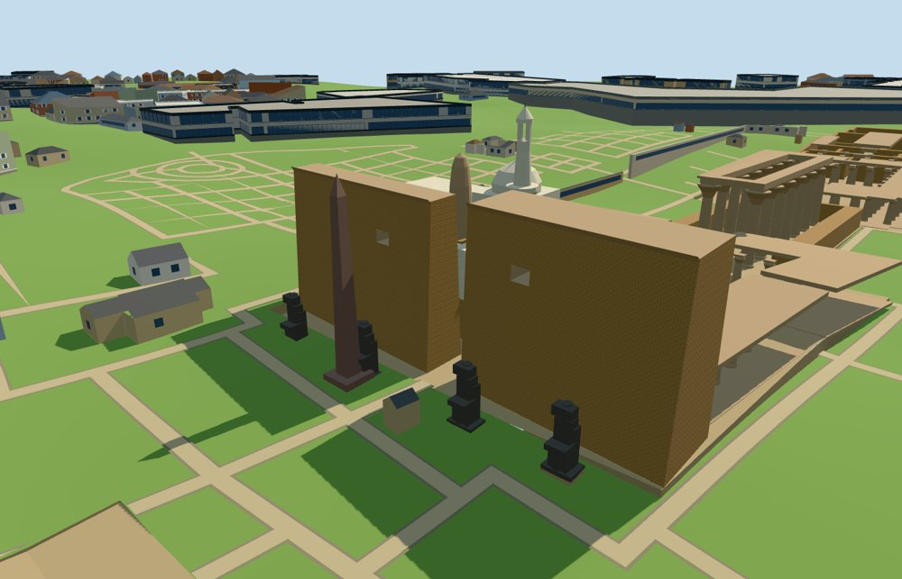

# N0491 — Luxor Temple

Reviewed2026-10-18. Specific medium-fi exterior and approximate normal PMTiles/DEM fit accepted.

## Exterior

Inspected all16 current portable views. Unequal battered entrance pylons retain their real gap and high square apertures; a tapered obelisk and seated-statue silhouettes mark the approach. Seven column pairs, flared capitals and upper beams retain an open aisle. Both courts stay open. Rear ranges use boundary wall bands, axial portals, selected chambers and partial roofs instead of a solid slab. Serapis, Tetrastyl and the Tripartite Shrine remain distinct. The raised Abu el-Haggag exterior follows its independent footprint, with a cream dome, white open-lantern minaret and older tapered stone minaret. Fine reliefs, statue carving and measured surviving stone inventories are omitted.

## Shared materials

Inspected all16 current shared-material views. Four common256² graphs: sandstone, raw sandstone, granite and lime plaster; metric UVs, linear tints and one matte floor constant. Five material draws nearby, no embedded images or unique atlas. Each graph loads once; eviction disposes all model geometry. The flat shared fixture places its ground atY-10 to reveal geometry; its visible cutout voids do not establish terrain contact. The independent unmodified-DEM fixture supplies approximate site-fit evidence.

## Browser levels

| Level | Triangles | Bytes | Draws |
| --- | ---: | ---: | ---: |
| skyline | 954 | 99884 | 1 |
| district | 3762 | 387336 | 5 |
| street | 15179 | 1565052 | 5 |
| closeup | 26923 | 2987804 | 5 |

Inspected all32 current medium-fi views: three distances, noon/late, Economy/High, untextured silhouette, detail cameras and all four level/transition comparisons. The skyline keeps pylons, obelisk, colonnade rhythm, open court layout and mosque silhouette; nearby levels restore columns, apertures, lantern, shrine beams and selected rear roofs. Native site context additionally shows adjacent procedural buildings. Skyline joins are deliberately coarser than near excavation edges. Initial skyline+district487220bytes, plus shared graph textures; all four levels meet1000/4000/16000/64000triangle and eight-draw limits. Separate GPU attribute streams avoid duplicate uploads. Physical laptop/phone/tablet and dense-city measurements remain pending.

## Placement and streaming

Reviewed approximate fit to retained unmodified standard 161-square/6m DEM: piecewise graded court floors, seven occupied ground pockets, detailed joins nearby and coarse skyline joins. All four levels retain covered floors. Full-site renders retain 281 independent map buildings and unchanged native water. Heights and excavation edges are estimates. Native fragments of 33.6374m² and 0.1917m² remain where masks protect independent mapped overlaps; no whole duplicate temple or mosque. Partial-residency clipping is tested separately and does not establish contact outside the resident domain. Signed global heading is -2.199114857512855rad, along the mapped colonnade southwest with northeast entrance.104 control vertices round-trip to retained raw PMTiles coordinates.7,420 floor samples cover all28 pocket/LOD combinations. Full-site/failure/partial-residency images are inspected; failure retains all284 original tile buildings and water, and eviction restores both surfaces. The partial128m test contains no native building records and proves clipping/lifecycle only, not neighbor preservation there.

## Limits

Accepted as a specific medium-fi exterior and approximate normal-map/terrain fit. Architectural heights, ruin survival, mosque component centers, statue shapes, column counts outside the pictured colonnade, small shrine envelopes and excavation edges are estimates. Facing uncertainty remains6degrees. Fine sculpture, inscriptions, exact thresholds, historical interiors, complete ancient roofs and vegetation are outside scope. The synthetic fixture does not reproduce local landcover or neighboring facades. Partial residency can expose temporary model/domain edges; no contact claim is made outside resident terrain. No bespoke survey or terrain research was added.

## Source and validation

Two registered recipes and retained map/reference/terrain inputs reconstruct the master and browser levels. Six Khronos validations have zero errors/warnings.91 geometry probes,104 control round-trips and7420 floor samples pass.64 official views and22 actual-site/failure/partial views were inspected. Source/import/placement --check, strict medium-fi and scene validate/sim30 pass. Bulk captures remain ignored; one additional small site preview is retained.

Rebuild: node packages/worldgen/scripts/generate-additional-landmarks.mjs --ids=N0491; import-next-1000-models.mjs --ids=N0491; generate-landmark-lods.mjs --ids=N0491. Capture source with --antialias --fit-shadows --reflections; shared with --adaptive-clipping --reflections --bounded-placement; medium-fi with --ids=n0491_luxor_temple --reflections.

Source: sha256:b66e57d07d0302e45dd3b5f04702f496fc4ec10ccf8cd1ab926ab3fca57c75e6

Runtime: sha256:c9ed133d044df763d249e7e4c2e9fe022c11a17761624ba24bc168045958830a

Input: sha256:2f57da4c57a9b5232d2d9cce5f9120b298a0051d4e77d0ef8f7ad26a25703a67

## References

- https://commons.wikimedia.org/wiki/File:Luxor_temple_entrance.JPG

- https://commons.wikimedia.org/wiki/File:LuxorTempleColonnade.jpg

- https://commons.wikimedia.org/wiki/File:Luxor_Temple_Mosque.jpg

- https://commons.wikimedia.org/wiki/File:Abu_el-Haggag_R03.jpg
