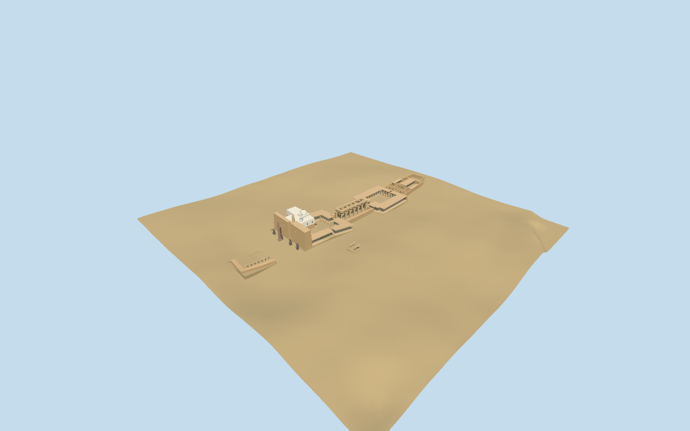

# Luxor Temple

Luxor principal exterior from ordinary pictures and standard PMTiles: distinct entrance wings, surviving obelisk, open courts, seven-pair colonnade, rear ranges, selected shrines and the independently mapped Abu el-Haggag mosque exterior. Fine reliefs, statue carving, hidden historic interiors and surveyed floors are omitted.

## Evidence and reconstruction

Published dimensions and reconstructed details are separated in spec.json. Primary references:

- [Reference](https://commons.wikimedia.org/wiki/File:Luxor_temple_entrance.JPG)
- [Reference](https://commons.wikimedia.org/wiki/File:LuxorTempleColonnade.jpg)
- [Reference](https://commons.wikimedia.org/wiki/File:Luxor_Temple_Mosque.jpg)
- [Reference](https://commons.wikimedia.org/wiki/File:Abu_el-Haggag_R03.jpg)

Four shared256²stone/lime-plaster graphs and one explicit matte floor constant;metricUVs and linear tints. No embedded images,unique atlas,photo textures,reliefs or copied lettering. Source and four browser levels rebuild from two registered recipes and retained source controls.

## Model and axes

38,363 triangles; 115,089 vertices; 5 material groups; 4,606,876 bytes. Native bounds: -146.556, -3.011, -47.810 to 184.900, 33.381, 68.000. Source hash: `sha256:b66e57d07d0302e45dd3b5f04702f496fc4ec10ccf8cd1ab926ab3fca57c75e6`.

{"x":"southwest into the temple","y":"up","z":"northwest across the colonnade"}

Principal temple and Serapis controls plus the independent mosque footprint are replaced with authored exterior geometry. Standard PMTiles and the unchanged coarse DEM establish approximate placement; neighboring map buildings and native water are preserved.

## Reproduce

Run `node packages/worldgen/scripts/generate-additional-landmarks.mjs --ids=N0491` (or add `--check`). The generator preserves manually edited masters by checking their baseline hashes. Import through the standard authored-model workflow with optimization disabled; then capture all QA cameras, including shared-surface views.

## Pending work

- Luxor principal exterior from ordinary pictures and standard PMTiles: distinct entrance wings, surviving obelisk, open courts, seven-pair colonnade, rear ranges, selected shrines and the independently mapped Abu el-Haggag mosque exterior. Fine reliefs, statue carving, hidden historic interiors and surveyed floors are omitted.
- Q319841/way1079039494 identifies the archaeological area only. Standard PMTiles multipart building52776574920845 defines the temple ranges and parallel colonnade strips;35185602195324 independently fixes Serapis. Named obelisk,Tripartite Shrine and Tetrastyl points fix their approximate centers. Native+X follows the mapped colonnade southwest,not the broader undirected archaeological rectangle.
- No mapped architectural heights in the selected controls. Pylons,obelisk,column/capital profiles,partial roofs,statues,small shrines and rear room survival use picture-guided medium-fi estimates. Column rhythms outside the pictured seven-pair colonnade are authored approximations,not a measured surviving inventory. Mosque body, raised floor, dome and two attached minarets use picture-guided estimates; the tall background New Mosque minaret is not included.
- Retained unmodified standard161-square/6m DEM. NativeY0 is sampled at the chosen colonnade entrance origin;piecewise neighborhood medians guide approximate floor grades. Covered floor polygons exclude the raised mosque foundation;boundary panels join the coarse terrain. No archaeological survey or bespoke terrain source.
- Serapis ruin heights and Tripartite Shrine/Tetrastyl envelopes are approximate. Abu el-Haggag retains its independent mapped footprint and an approximate picture-guided raised exterior,dome and two minarets. Other nearby buildings remain native context. No fine sculpture,inscriptions,navigable interiors or surveyed thresholds.

This bundle follows the medium-fi standard. Medium-fi appearance and geographic fit are reviewed separately. Hash-bound visual acceptance is recorded separately after capture inspection.

## Additional geographic data

©OpenStreetMap contributors;Protomaps;Mapzen/USGS terrain.
