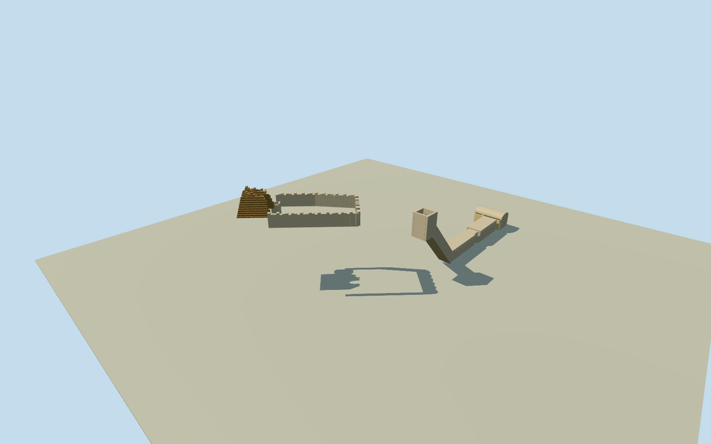

# Tomb and Chapel of Kha and Merit (TT8)

WholepairedTT8funeraryarchitecture: ruinedsteepmudbrickpyramidchapel/brokenbarrelvault/wornplaster/niche, bentterracecourtyard/sidepit, separatecompletecarvedshaft/steepstairs/twocorridors/neck/asymmetrictransversevaultedburialroom. MuseumCC0Qualla-firstoriginals andprimarymetrictext; no intactpyramid/hillmesh/laterKenychapel/museumobjects. Historicalcirca1924interpretation,30mapproximatesiteregistration andestimatedhiddenprofiles.

Authoring state: **review-in-qa.json**. Current completion evidence is in [qa.json](qa.json) and the [completion ledger](../../../../qualla-structures/batches/qualla-002.PROGRESS.md).

- [Tomb of Kha and Merit](https://qualla.com/tomb-of-kha-and-merit/)

WholeTT8pairedsite, exactMuseoEgizioCC0outside/interior/1906Balleriniplan/accessoriginals. Chapelbase4.66x4.72m/75degreebatter and12.45x7.6mcourt fromprimary1924/1925text. Hypogeumwhole18mcorridor/5.28..5.52x3.32..3.44mroom/northmagneticaxis fromprimary1925text, topology/asymmetricchamber/recesses fromCC0plan. Sourcepointbased30msiteregistration and25mNEopposite-slopecomponentoffset areexplicitlyapproximate, notnativewallmeasurements.

Originalindependent128m129x129field/16641heights acquiredfirst; originaldatum121.7444m andallrawtiles/heightbytesretained. ChapelNEdoorapproachandshaft-southapproachseparatelysampledfromthatfieldbeforemesh. Early20thcenturycarveddepth/rockwall/erodedchapelprofilesandhistoricgradeareboundedreconstruction. Primary1925reports11.7mdepthfromlaterupperchapelfloor; use11.7mwholeuppermouth-to-corridor drop, splitestimated4mshaft+7.7msteep24-riserdescent. Exact1906entrylevel/upper-neighborfloorrelation isunverified; nohistoricalthresholdsurvey/declination/geometricerrorcertificate. No terrainflattening/reacquisition/registrationwarp.

NativeQ744424sitepointnotasurveyedcomponent/dooranchor; alternativeWPpointabout29maway.30msiteregistrationuncertainty/20degfacinguncertaintyretained. Approximatepairedplacementnotanexactreconstructionofmodernsiteor1906photocamera.

No originalintact9.32mpyramid/pyramidionrestoration. Survivingbrokenmudbrickmass/vault/jambs/wornplaster/nichemodelled; exactmissingbrick/paintgeometryandcoloursareoriginalestimates, no painted-scene facsimile/photo texture.

Wholecarvedshaftslope/twocorridors/neck/asymmetrictransversevault retained. Unphotographedbacks/rockshellthickness/actualriser-count/clearance/precisedepthdefinition/conservationareestimated; laterKenychapelandmuseumcontentsomitted.

Historicalcirca1924interpretationonly; hostsourceDEMdoesnotresolveexcavationlevels/individualthresholdsandmaycontainunknownsurfaceclassification. Physicalcourtyard/entry/pitcutoutsonly, originalunmaskedfieldretainedforindependentreview.

Build: `node content/worldgen/source/places/ss/ssx/tomb_of_kha_and_merit/models/generate-kha.mjs`. Add `--check` to verify exact regeneration. 21214 triangles; 3 materials; no embedded photographs.
