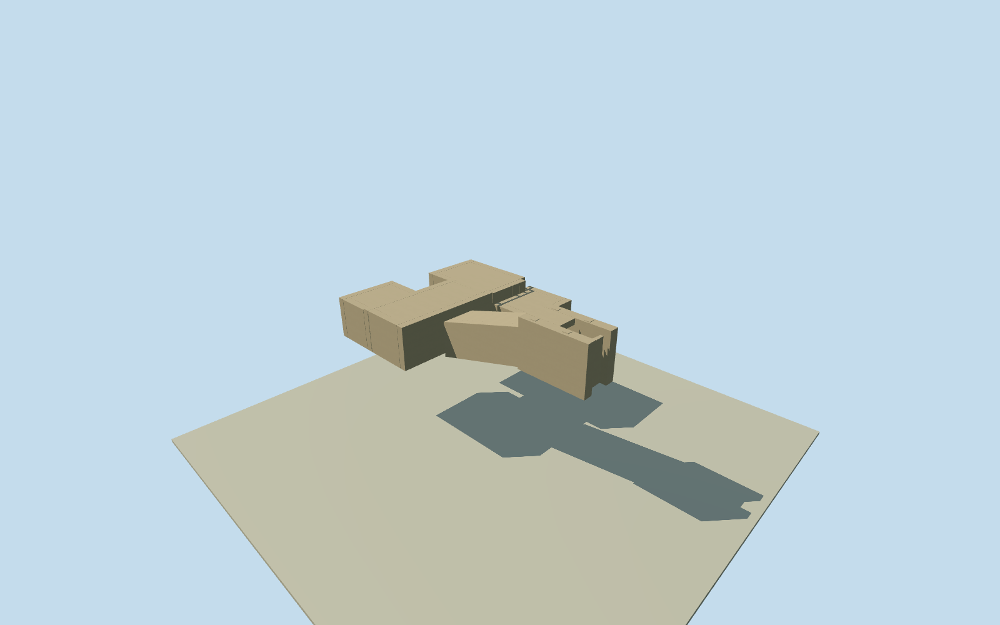

# Tomb of Tutankhamun (KV62), Egypt (1922)

Complete intrinsic KV62tomb architecture in its24November1922discovery phase, beforefirstdooropening: sixteenroughrockcutentrancesteps/openstairwell/firstsealedmasonrydoor; descending7.6mpassage andsecondsealeddoor; whole8mantechamber/annexe/sepulchralhall/treasurystorechamber withclosedcarvedrockwalls/roofs andintrinsicconnectingdoorways/partition/thirdandfourthsealeddoors. Undergroundchambersremainbelowgrade. Original1923Carterplan suppliesmetres/topology; surroundingrockshellthickness/ceilingheightswherenotgiven/doorsections/gradeandexactregistrationareboundedestimates. Excludemoderncanopy/signs/glasswalkways/replica, adjacentRamsesVI/workmenshuts/naturalvalleymountains, excavationrail/crates/people andmovableburialobjects/shrines/coffins/furniture. Not anabovegroundextrusionoftheundergroundway or a door-only substitute.

Authoring state: **review-in-qa.json**. Current completion evidence is in [qa.json](qa.json) and the [local 100 ledger](../../../../qualla-structures/batches/PROGRESS.md).

- [Tomb of Tutankhamun](https://qualla.com/tomb-of-tutankhamun/)

Complete intrinsic KV62tomb architecture in its24November1922discovery phase, beforefirstdooropening: sixteenroughrockcutentrancesteps/openstairwell/firstsealedmasonrydoor; descending7.6mpassage andsecondsealeddoor; whole8mantechamber/annexe/sepulchralhall/treasurystorechamber withclosedcarvedrockwalls/roofs andintrinsicconnectingdoorways/partition/thirdandfourthsealeddoors. Undergroundchambersremainbelowgrade. Original1923Carterplan suppliesmetres/topology; surroundingrockshellthickness/ceilingheightswherenotgiven/doorsections/gradeandexactregistrationareboundedestimates. Excludemoderncanopy/signs/glasswalkways/replica, adjacentRamsesVI/workmenshuts/naturalvalleymountains, excavationrail/crates/people andmovableburialobjects/shrines/coffins/furniture. Not anabovegroundextrusionoftheundergroundway or a door-only substitute.

Independent256m129x129originalfield/16641heights/two rawTerrariumzoom15tiles anddatum182.6405m fixedbeforeallfloors/mainsections. Localupperstairpoint[4,0]isoriginaldatum;upperstairfloor+.15m,16estimated.2mrisers and2.128mestimatedpassagedescent fixtombfloorlevelsonce. Source2mgrid/4.303moutputpixelsare notarchaeologicalaccuracy or1922grade. Nativelevel−3notusedasmetres; chambersremainbelowgrade. Neverreacquire/flatten/reframe/movefloors/mainsectionstomakerenderspass.

Firstdoorconnection toactualnativeeastcorridorpoint±4m/bearing±8degrees. Primarybookmetreplan governsroomarchitecture; currentnativeoutlineonlysiteidentity. Hiddenverticalsections/flooroffsets explicitlyestimatedbeforegeometry, not surveycertified.

OriginalplanlabelH2.73isgildedshrinecornice, not roomheight. Room3.62mheightlabelretainedforburialhall; otherverticalsectionswillbeestimatedafteroriginalfield.

Nativecurrentoutline/level−3areidentitycontext, not aabovegroundbuildingfootprintorabsoluteelevation.

No modernentrancecanopy/steelgrillesinstalledlater/reconstructedpaintings/archaeologicalcontents.

Originalindependentcompositeterrainwillbefrozenbeforefloors/mainsectionsandretainedunchanged; onlyrealentrancevoidgetsphysicalgroundopening, undergroundroomroofsremainburied.

Sixteen.2mriserheight/2.128mpassagedescent/1mburialfloordrop/roomrockshellthickness are explicit architectural estimates; source thirteen-foot textualoffset refers to neighboringRamsesVIentrance, not stairdrop, and was not used as such.

Primaryroominteriordimensionsretained; antechamberE-W3.65mis26x12fttext-supportedapproximation, originalmeterplan8mN-S. Otherstatedplanmetresgovernroomlayout.

Allfoursealeddoorwallsclosedon24November1922; no laterwood/steelgrilles or openedfirstdoor. Wholehiddenroomarchitecturederivedfromoriginal1923plan, withmovablecontentsomittedfromarchitecturalscope.

Onlyactualentrancevoidreceivesgroundopening. Closedroofs/undergroundchambersmustnotbeuncoveredbyabroadpadcutout or raisedabovegradeforreview. Useexplicitinside/diagnosticreviewcameras.

Build: `node content/worldgen/source/places/ss/ssx/tomb_of_tutankhamun/models/generate-tomb.mjs`. Add `--check` to verify exact regeneration. 1108 triangles; 2 materials; no embedded photographs.
