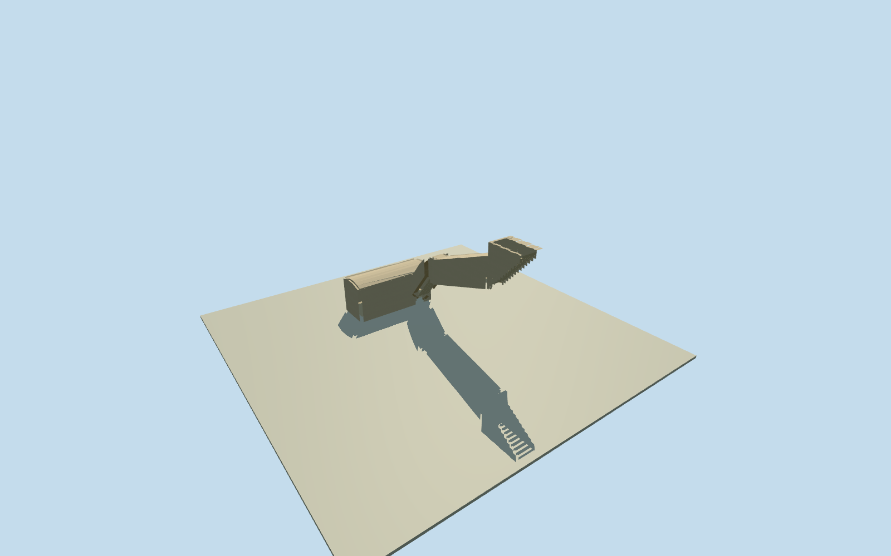

# Tomb of Yuya and Thuya (KV46)

Whole KV46 rock-cut tomb:15-riseropenentrance/firstportal, longslopingplaincorridor,17-riserlowerstair/pairedside-recesses, shortlowerlanding/1.20mdoorway, irregulartransverseburialchamber/one-metresectionfloorstep andclosedrockceilings. Original1907dimensionedplan/section andcurrentnativewholeT-plan/entrancecontext; ancientcarvedarchitectureonly, no furnishedtableau/genericmausoleum/naturalhill. Currentweathering/visitorhardware/ceilingroughness/nicheledgeprofile/floorstepinterpretation/groundcontact approximate.

Authoring state: **review-in-qa.json**. Current completion evidence is in [qa.json](qa.json) and the [completion ledger](../../../../qualla-structures/batches/qualla-002.PROGRESS.md).

- [Tomb of Yuya and Thuya](https://qualla.com/tomb-of-yuya-and-thuya/)

Whole KV46 ancient rock-cut tomb from exactoriginal1907Davisvolume printedxxiv/PDF36plan/section. MetricTplan reconstructedwithpublishedwidths/staircounts/slopes/chamberdepth, oneorthogonalnativeaxisframe. Current21-controlundergroundnativewalloutline and8-controlentryextent retained independently inmap-frame/native-controls asapproximategeographiccontext; neither is a solidbuilding/siteparcel. Bookmetricplanandnativeoutline differlocallybydecimetres; no aniso warp orsurveyfit.

Original128m129x129field/16641samples/2rawtiles frozen before floors/mainsections/mesh. Fixed entrytop datum0 at[0,-4]. Fifteen4mgoing/4.2mdropupperrisers, firstdoorfloor-4.2;9.26minclined/8.78mprojectedcorridordrop2.942651865239923;17lowersteps3.04mgoing/3.84mdrop to-10.982651865239923;1.05mlowerlandingthen1mfloordrop towholeburialchamberfloor-11.982651865239923. Publishedsectionguidesceilings; exactunevenrockprofile, nicheledgeheight andplacementof1mchamberfloorstep are originalestimatedinterpretations. No laterterrain/floor/sectionfitting. ContemporaryDEMdoesnotresolveundergroundvoids orhistoricthreshold.

The model represents ancient carvedarchitecturalgeometry andplainunpaintedrock, not a furnished1905discovery tableau or contemporaryvisitorequipment. Presentgate/rails/conservationweathering/paint not observedunderallowedimagepolicy.

Firstdoor.25mthickness/ceilingshape/nicheledges/chips/materialcolorsandpreciselocalfloorstepinterpretationoriginalmedium-fiestimates. Bookdimensions areoriginalperiodmeasurements, not a newcurrent survey.

Wholeundergroundchamberhasclosedrockroof/intradosandremainsnaturallycovered inEarth; onlyexternalentrystaircutout. Completegeometryshowninportableisolationandinsidecameras. No openpit/wholechamberterrainclearing ornaturalhillmesh.

Currentterraincontact/DEMclassification/overburden/internalsurvey/navigationcollisionunverified. Floors andnativeframe remainfixed; coarsefieldneverflattened orfitted.

Build: `node content/worldgen/source/places/ss/ssx/tomb_of_yuya_and_thuya/models/generate-yuya.mjs`. Add `--check` to verify exact regeneration. 1226 triangles; 1 materials; no embedded photographs.
