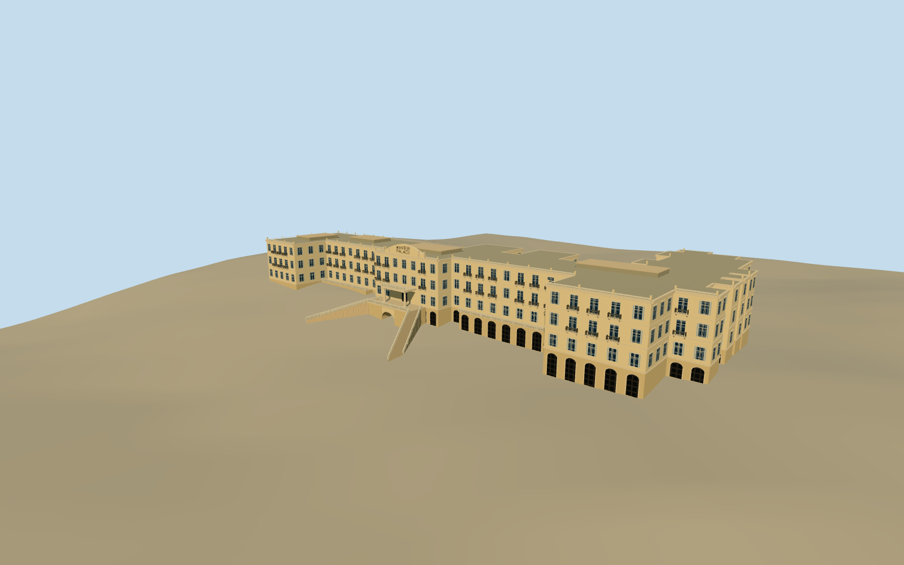

# Winter Palace Hotel

Old Nile-front Winter Palace Hotel with tiered French sash, warm ochre plaster, the shallow historic crown, and paired grand stairs over its arched entrance base.

Authoring state: **review-in-qa.json**. Current completion evidence is in [qa.json](qa.json) and the [completion ledger](../../../../qualla-structures/batches/qualla-003.PROGRESS.md).

- [Winter Palace Hotel](https://qualla.com/winter-palace-hotel/)

Reconstruction of the durable standing exterior based on public-domain street views. Heights, rear roof junctions, garden-side fenestration and stair profiles are estimates.

The model represents the historic hotel block and entrance before the 2026–27 conservation works. The separate Pavillon, garden complex, temporary works, interiors and any unconfirmed changes to the hotel are outside scope.

Warm stucco, light railings and cool glazing are based on the 2007 color view. Landscaping and finials are simplified.

Build: `node content/worldgen/source/places/ss/ssx/winter_palace_hotel/models/generate-winter-palace-hotel.mjs`. Add `--check` to verify exact regeneration. 34198 triangles; 6 materials; no embedded photographs.
