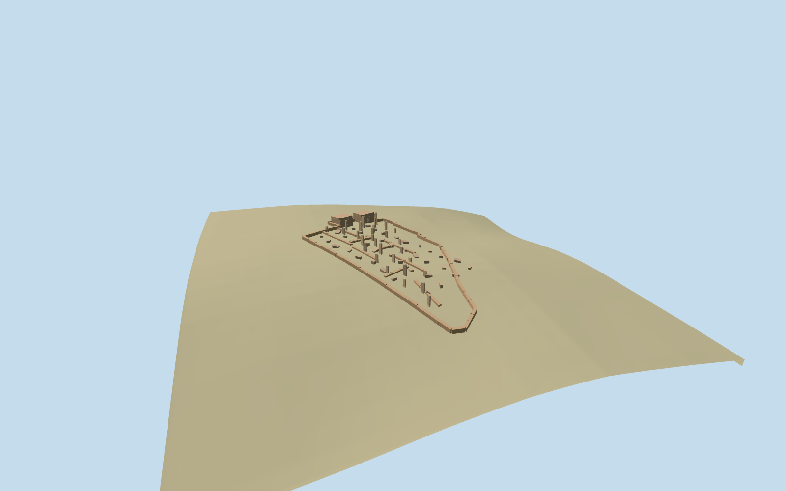

# serabit_el_khadim — Serabit el-Khadim

Reviewed2026-10-19 in one continuous author/build/inspect/fix round.

## Appearance

Inspected all 48 final current source/shared/medium-fi/native-site/fallback views. The mapped low enclosure contains two approximate western rock-chapel entrance masses with genuine backed portal voids, tall narrow rounded/broken monolith groups, low wall fragments, broad leaning slabs and small rubble blocks around open walking gaps. Thirty standing and thirty-eight fallen stones express photographed density; they are not a certified artifact inventory. Same-round renders prompted raw/faceted chapel cheeks, more irregular caps and broader thinner leaning slabs. Three ordinary photographs guide this recognizable medium-fi ruin vocabulary; exact fine hieroglyphs, individual chips and buried rooms are omitted.

## Shared materials and browser levels

Two reused 256² graphs: stone_sandstone for coarse low walls, stone_sandstone_raw for monolithic stelae, chapel rock and fallen stone. Metric UVs and linear warm sandstone tints; both material graphs read once through the production resolver. No embedded images or unique photo atlas. At most four source draws/two textured LOD draws; separate GPU streams and matching CPU/GPU byte accounting. All four triangle/download caps pass; initial geometry is331,264 bytes. Eviction releases every loaded geometry.

| Level | Triangles | Bytes | Draws |
| --- | ---: | ---: | ---: |
| skyline | 982 | 103952 | 1 |
| district | 2370 | 227312 | 2 |
| street | 2764 | 266936 | 2 |
| closeup | 3280 | 318956 | 2 |

Inspected current noon/late, economy/high, silhouette, architectural details, all four authored levels and transitions. The low enclosing outline and concentrated upright/chapel masses remain readable in the distance. Skyline deliberately thins small stones; district/street/close levels retain the fuller grouping and progressively rounded stone crowns. Shared neutral sandstone stays consistent. Flat library stages do not reproduce plateau grade and may expose buried footings; source terrain/native-site views carry contact judgment. The native integration fixture retains its standard green fallback ground color; it proves geometry fit, not desert landcover styling.

## Approximate map fit

Exact-QID way580657250 fixes a77.9×40m wall/archaeological envelope and its long axis; the standard named site point corroborates identity. Native east/south at heading0, internal angle-0.452864836238rad. Western jogs guide approximate chapel assignment; signed facing and internal group positions remain picture/map-shape estimates. Retain the original standard six-meter plateau grid. Long low walls follow sampled grade, while uprights/slabs and chapel portals have separately sampled local feet with buried bottoms. No building/ground/water cutout or broad new platform; the one independent in-tile building is byte-equivalent at all four loaded levels and failed loading. Native ground/water remain unchanged and unloading releases geometry.

## Limits

Accepted medium-fi visualization of the specific mapped Hathor temple ruins from three ordinary photographs and standard PMTiles/Mapzen data, without bespoke research. Internal stone/room counts and placements, western chapel assignment, signed doorway facing,1.6–4.9m stela heights, rock forms, low wall heights and excavation/threshold levels remain explicit approximations. Exact inscriptions, glyph inventory, individual rubble, mines and hidden chambers are omitted. This is not a surveyed archaeological reconstruction or restored intact temple. Physical-device/dense-city timing measurements remain pending.

## Selected checks

Six Khronos files: zero errors/warnings.1,624 actual geometry/contact probes; 48 current inspected views. Scene validation/sim30 and strict selected medium-fi audit pass. Source and runtime hashes/material bindings/LOD caps verified.

Rebuild: node packages/worldgen/scripts/generate-additional-landmarks.mjs --ids=serabit_el_khadim; node packages/worldgen/scripts/import-structure-models.mjs --ids=serabit_el_khadim; node packages/tooling/scripts/generate-landmark-lods.mjs --ids=serabit_el_khadim --force.

Source: sha256:e0230aa010f3702dd63d1154c0ac7e780a8b3ae0cbf64847c9c5f38609f9d4ae

Runtime: sha256:f97afcdd3fdd418885f26e3b5c2e0642284a66be65b4b10b3689b1f2121fe0eb

Input: sha256:64b7c31b4a96b612e370740a2de05e1e6a62adc3e5c1cb575e29027e71bdbeb9

## Viewed ordinary pictures

https://commons.wikimedia.org/wiki/File:SerabitBothChapels.jpg — Roland Unger; CC BY-SA3.0 (other versions offered); viewed only. Viewed only; no pixels copied.

https://commons.wikimedia.org/wiki/File:SerabitSouthernPart.jpg — Roland Unger; CC BY-SA3.0 (other versions offered); viewed only. Viewed only; no pixels copied.

https://commons.wikimedia.org/wiki/File:SerabitInscribedStela.jpg — Roland Unger; CC BY-SA3.0 (other versions offered); viewed only. Viewed only; no pixels copied.
