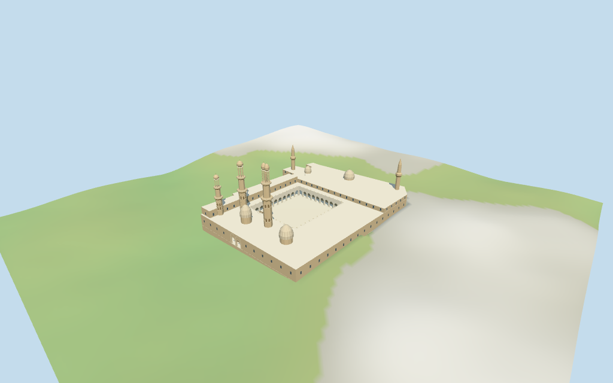

# al_azhar_mosque — al-Azhar Mosque

Reviewed2026-10-17 against current bytes. Accepted for the stated medium-fi exterior and approximate horizontal map fit. The whole boundary has an exact retained way/QID;internal court/tower/dome positions and all architectural heights are picture-proportioned estimates. Exact thresholds/street joins,current finish and unseen interiors remain unverified.

## Exterior and shared surfaces

Actually inspected all11 final portable views,including the1024×640 summary. Open pale court,pointed arcades with paired columns,alternating medallion/blind fields,stepped crest,flat gallery roofs,raised windowed ranges,four pale domes,three unequal western Mamluk minarets including paired al-Ghuri bulbs,and two slender pointed-cap minarets. Paired western gate has low round openings beneath taller arch bands;wood closes its recesses. A small projecting timber pulpit is included. Removed duplicate coplanar raised-roof caps and adjusted terminal bulb profiles after the first renders. All internal placements and heights remain picture-proportioned estimates;fine motifs,inscriptions,current finish and unseen interiors are unverified.

Actually inspected all11 final shared/geographic-flat views. Five existing256² sandstone,limestone,lime plaster,plain wood and bronze graphs;eight merged roles include the opaque untextured window exception. Metric UVs and linear tints;zero embedded images,unique atlases,baked light or copied artwork. All five graphs read once;unload leaves zero live model geometries. Shared stone patterns are stylistic approximations. The geographic-flat view matches the current14-point outer map control;court,tower and dome positions are explicitly estimated,not independently mapped. Portable/medium-fi views use declared preview terrain seating;exact host street/threshold joins remain unverified.

## Browser levels

| Level | Triangles | Bytes | Draws |
| --- | ---: | ---: | ---: |
| skyline | 982 | 99,376 | 1 |
| district | 3,740 | 342,724 | 8 |
| street | 14,720 | 1,330,216 | 8 |
| closeup | 25,920 | 2,411,516 | 8 |

Initial skyline plus district:**442,100 bytes**. Master **3,301,836 bytes /27,476 triangles**;runtime **3,301,132 bytes**. Five shared256² graphs/eight merged roles,zero embedded images;shared textures are additional.

Actually inspected all27 current medium-fi frames:Economy/High,noon/late,street/block/skyline,silhouette,six details,four matched LODs and four transitions. Matched whole skyline also inspected full size. Skyline982 retains the irregular base,open court,coarse arcade cadence,all five towers,paired bulb heads,four domes and twin gate;thin reveals,rails,columns,finials and most ornament drop out. District3740 restores finer arcades and crest,open upper pavilions,more rounded domes/bulbs and selected opaque windows. Street14720 adds simplified paired columns,medallions,blind bands and closed shaft recesses;close25920 adds full column profiles,dome ribs and denser crest. Initial442100 bytes plus shared textures;one/eight draws,separate position/normal streams,equal CPU/GPU geometry reservations. Context is synthetic arid attached housing,not a reconstruction of Cairo streets. Distant facet changes are visible at the deliberately matched close camera;physical-device timing remains unverified.

## Placement and scope

Retained exact way/24749059 and Q312342 match current standard viewer building35184396837891 (2*2^44+24749059),14 outer vertices. Current building properties have no name,height or inner holes;original multilingual QID/name tags remain separately retained. Anchor[31.262716222,30.045758518] and heading -0.608527939809 rad unchanged. Whole footprint remains mapped;court,gallery backs,domes,towers and entrance positions are explicitly picture-proportioned estimates inside it. Main gate faces-X;prayer range lies+X. Precise internal plan and individual tower coordinates have no independent mapped controls. No retained height,width or length statements and no current mapped height/min_height. Working gallery roof8.2m,main prayer-range roof11.4m,raised northern range13.3m;four small domes17.4–20.4m. Five minarets use estimated ground-to-finial envelopes37/46/50/34/36m. The three western Mamluk towers remain distinct,including paired al-Ghuri bulb heads;two slender Ottoman towers use pointed caps. Proportions from the inspected pictures,not surveyed heights;allow roughly6m tower-height and6m internal-plan uncertainty. Fine carved motifs,inscriptions,unseen fabric,current finish and exact thresholds unverified. Standard viewer DEM anchor datum 33.06707422096729m. Approximate floor -0.03681852832554m is median of 237 outside-perimeter samples at2m cadence and1m offset plus0.25m. Raw whole-footprint samples -4.148309607953795..4.397781723909979m show building-contaminated DEM. A visible-model ground cutout follows only the mapped outer boundary;modeled paving seats the compound. Preview terrain is locally seated beneath that footprint;raw161x161 grid retained separately. Exact surrounding paving/street/door joins and DEM vertical bias unverified. Independently reunited14 outer points/properties from current standard PMTiles. All1308 viewer-footprint checks cover the selected whole and preserve217 separate map buildings across six files. The237 outside-perimeter samples reproduce the approximate floor;1093 preview-grid points inside the mapped outline are seated at the lower of raw DEM or floor minus0.2m. The raw161² DEM grid remains intact. The registered visible-model terrain cutout follows only the mapped outer boundary. Approximate horizontal visualization fit is accepted;exact internal tower/court coordinates,vertical datum bias and street/access joins remain unverified.

Individual medium-fi al-Azhar Mosque:retained irregular whole boundary,open pale courtyard with pointed arcades,paired columns and medallion/blind-field cadence,low flat roofs and raised windowed ranges,four pale domes,five distinct minarets including paired al-Ghuri bulbs,western twin recessed gate and projecting wooden court pulpit. All internal forms are photo-proportioned estimates;shared256² materials and four complete browser LODs. Fine motifs,calligraphy,unseen fabric,current finish,precise internal plan and ground joins unverified. No retained height,width or length statements and no current mapped height/min_height. Working gallery roof8.2m,main prayer-range roof11.4m,raised northern range13.3m;four small domes17.4–20.4m. Five minarets use estimated ground-to-finial envelopes37/46/50/34/36m. The three western Mamluk towers remain distinct,including paired al-Ghuri bulb heads;two slender Ottoman towers use pointed caps. Proportions from the inspected pictures,not surveyed heights;allow roughly6m tower-height and6m internal-plan uncertainty. Fine carved motifs,inscriptions,unseen fabric,current finish and exact thresholds unverified. Standard viewer DEM anchor datum 33.06707422096729m. Approximate floor -0.03681852832554m is median of 237 outside-perimeter samples at2m cadence and1m offset plus0.25m. Raw whole-footprint samples -4.148309607953795..4.397781723909979m show building-contaminated DEM. A visible-model ground cutout follows only the mapped outer boundary;modeled paving seats the compound. Preview terrain is locally seated beneath that footprint;raw161x161 grid retained separately. Exact surrounding paving/street/door joins and DEM vertical bias unverified. Three inspected2008/2011/2019 pictures guide appearance;no bespoke surveys or redistributed photographs. Recessed minaret shaft fields close on wood proxies;near upper pavilions are open. Gallery backs are masonry;outer windows are opaque surface proxies. Fine carved medallions,calligraphy,muqarnas/spolia,exact parapet/finial profiles,precise internal plan,unseen rooms/roof fabric,current condition,navigability and physical-device performance remain unverified. No independently measured sub-footprints or vertical survey is claimed.

## Verification

**49 final views inspected;972 geometry probes;1,308 footprint checks.** Six Khronos validations:zero errors/warnings/images. Targeted byte reproduction,scene validate/sim30,recipe-only Biome,current recipe/input/model/LOD/report/capture/material bindings and independent map/terrain checks pass. Five graphs read once;unload zero live model geometry. Existing package builds reused;next full source checkpoint great_mosque_of_aleppo–great_mosque_of_xi_an.

Source:sha256:87b5b8b029f7ddf5d07c445afaa7b2a004360c5acb78da9955428a92f763aebe

Runtime:sha256:d5307eaeea8198b8a7b5d7c65668d60d0cca0c33e479be2767b060786044199a

Input:sha256:65f3b066de342b1c68b0ab94d8d516f37bf5583f99a9e096e21e3bedd476a108

Simulation:sha256:d2e0cfcfecc49920b4e9e8e50de1ee1cfdb902dab08c9cab7d9806941eb9553c

Commands:targeted generate/import/LOD/register --ids=al_azhar_mosque;generate --check;portable reflections/antialias/fitted shadows;shared reflections/adaptive clipping/bounded placement;medium-fi reflections;scene validate/sim30;recipe-only Biome. Bulk captures stay ignored.

## Inspected pictures

[Radosław Botev / Fundacja Nomos — 2019-07-15](https://commons.wikimedia.org/wiki/File:Courtyard_of_Al-Azhar_Mosque_Cairo_Egypt_2019_(1).jpg). CC-BY-3.0-PL. Actually viewed full courtyard:bright pale paving,pointed arcades on pale paired columns,alternating circular medallions and tall blind arch fields,crest cadence,wooden projecting pulpit and two tall western stone minarets with tiered balconies,open pavilions and one paired bulb head. Fine artwork/inscriptions omitted.

[R Prazeres — 2011-08-03](https://commons.wikimedia.org/wiki/File:Al-Azhar_roof_view_DSCF5473.jpg). CC-BY-SA-4.0. Actually viewed courtyard from roof:low flat gallery roofs,pale pointed arcade screens,stepped parapet crest,small pale domes,raised two-storey range with dark rectangular windows and two distant slender pointed-cap minarets. Internal dimensions and placement estimated;no measured plan inferred.

[Chris Brown — 2008-12-15](https://commons.wikimedia.org/wiki/File:Bab_al-Muzaynin.jpg). CC-BY-2.0. Actually viewed close main gate:paired low round openings below taller blind round-arch surrounds,in a rectangular stone facade with horizontal framed decorative panels. Geometry abstracts paired recesses and bands;no copied calligraphy or artwork.
