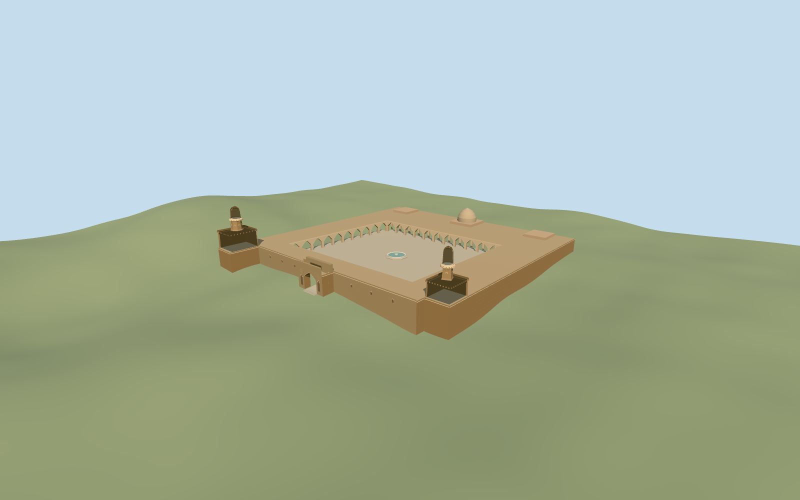

# Al-Hakim Mosque

The standing Al-Hakim Mosque, with two distinct Mamluk minaret crowns above Fatimid cases, a projecting portal, white-marble open courtyard and qibla dome.

Authoring state: **review-in-qa.json**. Current completion evidence is in [qa.json](qa.json) and the [completion ledger](../../../../qualla-structures/batches/qualla-003.PROGRESS.md).

- [Al-Hakim Mosque](https://qualla.com/al-hakim-mosque/)

The standing exterior uses its mapped footprint and court opening. Roof levels, doorway recesses, ornamental spacing and the two minaret heights are estimated.

The mosque originally had three domes. The mapped and surveyed standing exterior is represented with the surviving central mihrab dome and raised corner bays. Courtyard bay counts and fountain dimensions are approximate.

The bordering Fatimid wall and the Bab al-Futuh city gate are separate subjects. The model includes only the mosque and its own structural envelope.

Build: `node content/worldgen/source/places/st/stq/al_hakim_mosque/models/generate-al-hakim-mosque.mjs`. Add `--check` to verify exact regeneration. 15131 triangles; 7 materials; no embedded photographs.
