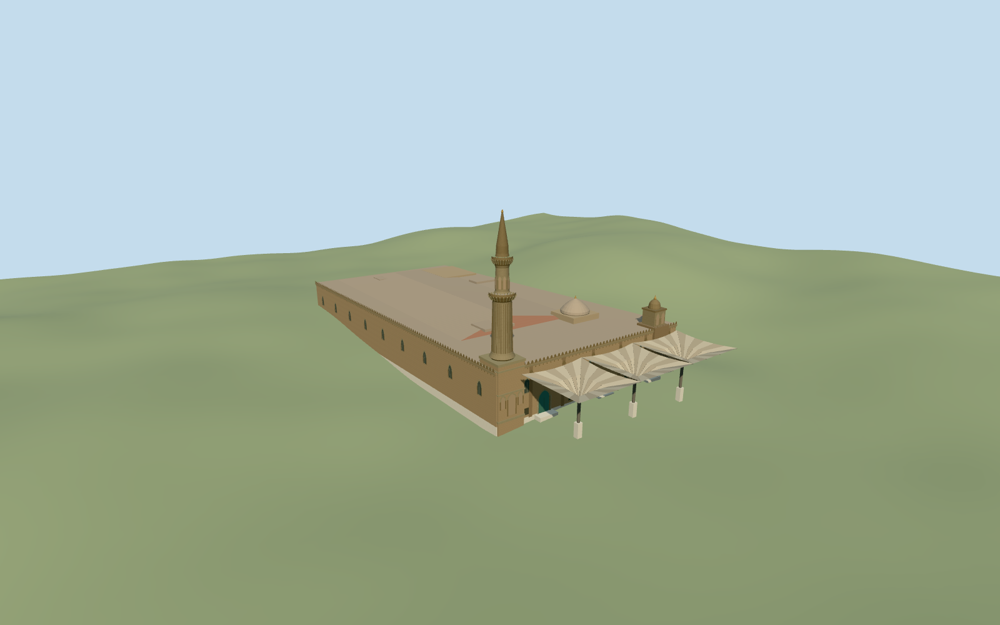

# Al-Hussein Mosque

Cairo’s Al-Hussein Mosque with Gothic revival stonework, a tall fluted Ottoman minaret, an older gate tower, a shrine dome and three wide prayer canopies.

Authoring state: **review-in-qa.json**. Current completion evidence is in [qa.json](qa.json) and the [completion ledger](../../../../qualla-structures/batches/qualla-003.PROGRESS.md).

- [Al-Hussein Mosque](https://qualla.com/al-hussein-mosque/)

The mosque envelope and plaza orientation are mapped. The unequal heights of the minarets, side and rear entrances, exact dome location and roof level changes are estimates.

The model shows the exterior mosque and its three forecourt umbrellas opened to their documented shading area. The umbrellas are represented in one static state.

The closest mesh represents Gothic foliage and corbel carving in simplified geometry. Minor contemporary equipment, furnishings, human figures, and neighboring bazaar buildings are outside scope.

Build: `node content/worldgen/source/places/st/stq/al_hussein_mosque/models/generate-al-hussein-mosque.mjs`. Add `--check` to verify exact regeneration. 10217 triangles; 6 materials; no embedded photographs.
