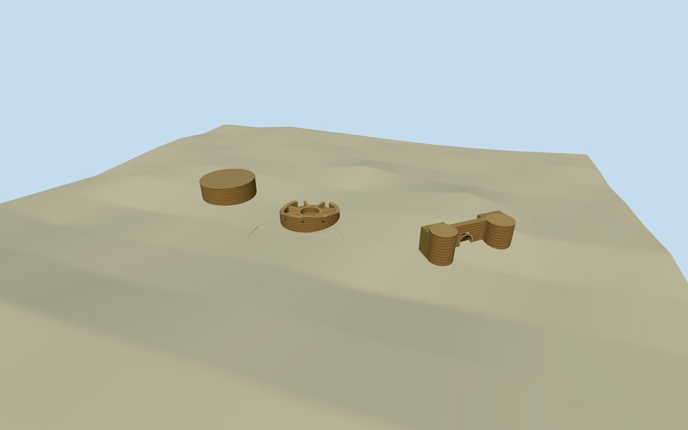

# Babylon Fortress

The two round towers, sunken canal-side court and south gate of Babylon Fortress in Coptic Cairo.

Authoring state: **review-in-qa.json**. Current completion evidence is in [qa.json](qa.json) and the [completion ledger](../../../../qualla-structures/batches/qualla-004.PROGRESS.md).

- [Babylon Fortress](https://qualla.com/babylon-fortress/)

The modeled north tower stops at the Roman wall beneath Saint George. The unrelated church superstructures and museum are separate physical structures.

The dates of the surveys differ from the current setting. The historic gate sections, exact interior floor elevations, exposed masonry breaks and archaeological court levels are approximated.

Build: `node content/worldgen/source/places/st/stq/babylon_fortress/models/generate-babylon-fortress.mjs`. Add `--check` to verify exact regeneration. 18176 triangles; 5 materials; no embedded photographs.
