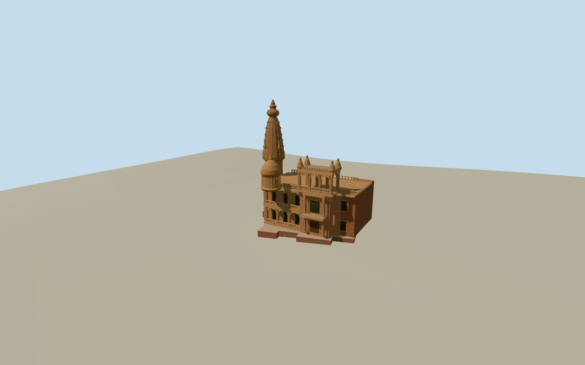

# Baron Empain Palace

The restored Heliopolis palace with a high tapered tower, lower dome, deep arcades, warm carved exterior and ornamental rooftop pavilion.

Authoring state: **review-in-qa.json**. Current completion evidence is in [qa.json](qa.json) and the [completion ledger](../../../../qualla-structures/batches/qualla-003.PROGRESS.md).

- [Baron Empain Palace](https://qualla.com/baron-empain-palace/)

The 2024 reconstruction follows the restored garden elevation and exact outer mapped perimeter. Minor fenestration and the unphotographed northwest decoration are estimates.

Carved relief is represented by simplified molded bands, piers, corbels, panels and finials. Gardens, freestanding statuary and interiors are outside the structure scope.

Ground controls come from the independent GEDTM30 bare-earth window. The original Terrarium field remains unchanged and can obscure the palace on hosts that use that coarse surface raster.

Build: `node content/worldgen/source/places/st/stq/baron_empain_palace/models/generate-baron-empain-palace.mjs`. Add `--check` to verify exact regeneration. 17776 triangles; 5 materials; no embedded photographs.
