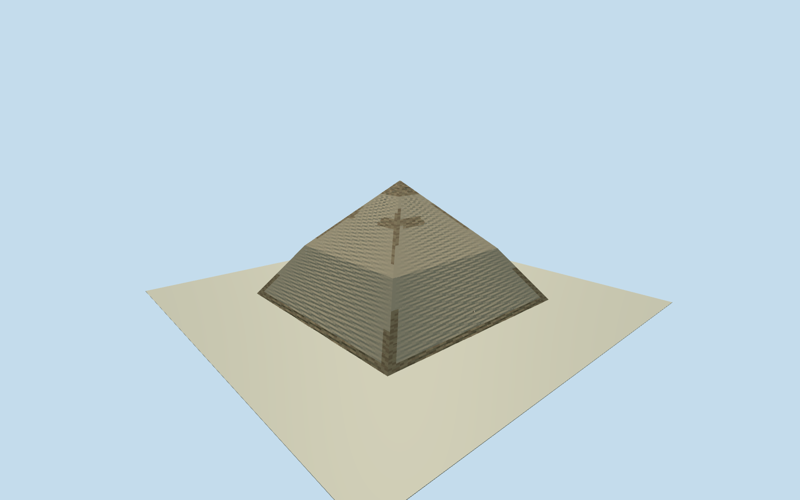

# Bent Pyramid

Surviving Dahshur Bent Pyramid:188m square lower footprint, steep pale limestone casing to47.04m, abrupt shallower upper slope to104.71m, weathered/exposed stone patches and ragged dark crown, small north/west passage mouths. Main pyramid only; satellite pyramid, enclosure, temples, causeway, access stairs and interior chambers excluded.

Authoring state: **review-in-qa.json**. Current completion evidence is in [qa.json](qa.json) and the [local 100 ledger](../../../../qualla-structures/batches/PROGRESS.md).

- [Bent Pyramid](https://qualla.com/bent-pyramid/)

Approximate surviving188m base and104.71m overall height; native mapped plan is coarser/narrower and remains the geographic control. Native building-part47.04m breakpoint adopted; article rounds this to49m. No survey claim.

One inspected clear public-domain Qualla panorama controls identifying pale casing, bend and dark weathered crown. Stone loss/color patch positions, hidden faces and exact portal depths are medium-fi interpretations; original pixels are not textures.

The coarse source DEM has artificial pyramid returns outside the native cutout and may obscure lower casing in geographic views. This is a recorded host-terrain limitation; pyramid geometry is not fitted to it.

Main pyramid exterior only. Satellite pyramid and detached structures, enclosure/causeway, modern visitor stair and interior are excluded. Footing extends1m below visualization datum; no fitted terrain platform or reshaped elevation field.

Build: `node packages/worldgen/scripts/generate-authored-places.mjs --ids=bent_pyramid`. Add `--check` to verify exact regeneration. 28346 triangles; 3 materials; no embedded photographs.
