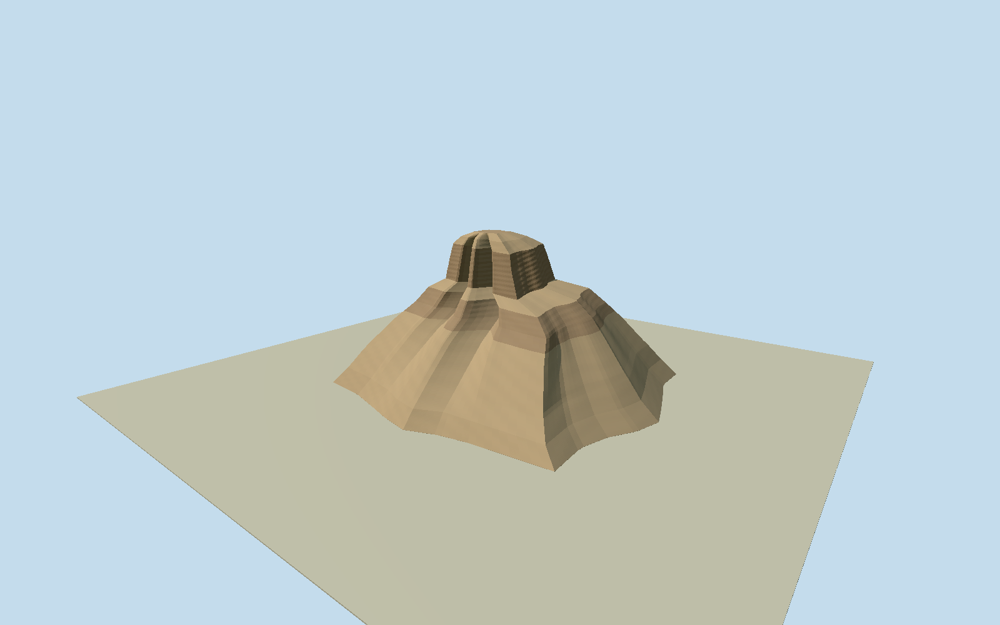

# Black Pyramid

Whole surviving Black Pyramid collapsed mudbrick core and its intrinsic broken shoulders, gullies and talus, with truncated off-center upper crown. Original medium-fi ruin, not a pristine75m reconstructed pyramid, generic cone or sand hill. Exclude detached temple/enclosure/nearby ruins, underground burial rooms, museum pyramidion, desert/roads/tourism props/people/modern city. Sculpt original closed broken clay-masonry mass with off-center broad truncated head, steep exposed uppercliffs, asymmetric stepped rightshoulder/buttresses, two deep weathered frontgullies and sloping intrinsicmudbrick/rubble aprons. Use actual irregular polygon sections/ridged erosion surfaces/canonicaladobe and earth materials. No ideal pyramid cap, fantasy entrance or generic noisy cone. Height52m/whole envelope112x102m and hidden erosion are explicit photo estimates; native180m circle is only identity. Independent field must remain untouched; if it contains the ruined mound, clip only actual model overlap for host review rather than doubling it or fitting/flattening source values.

Authoring state: **review-in-qa.json**. Current completion evidence is in [qa.json](qa.json) and the [completion ledger](../../../../qualla-structures/batches/qualla-002.PROGRESS.md).

- [Black Pyramid](https://qualla.com/black-pyramid/)

Named original OSMway39918837/Q284794 supplies object identity and reference center. Its32vertex180m-diameter circle is a coarse archaeological symbol/area, not the ruined core footprint or ideal pyramid base; never extrude it. Actual core/debris outline,52mheight, orientation/upper shoulders and all sections are bounded photographic estimates from current/historic cleared originals, not a measured survey. Native circle retained as separate evidence. Nearby anonymous ruins/protected-area boundary are not adopted as pyramid geometry.

Qualla-first ca1857FrancisFrith museumCC0original and supplemental exact lumoplank modern creatorCC0original individually inspected/native-SHA1matched. Modern primary author/creator and transfer bind same NSID/CC0release. Historic detail informs construction only; current major masses confirmed separately. No uncertain copyright source or photographic texture.

Whole surviving mudbrick core and intrinsic collapsed rubble slopes only. Off-center truncated crown, steep upper cliffs, lower right shoulder and two eroded front gullies are original shaped geometry.52mheight/112x102mcollapse envelope and concealed erosion/courses are explicit photographic medium-fi estimates, not surveyed dimensions or exact current fracture census. No ideal75mcap, limestone casing reconstruction, generic cone or fantasy entrance.

Native32vertex180m circle is a coarse archaeological identity/area, not the ruin footprint. It is retained separately and never extruded; nearby temples/enclosure/anonymous ruins, burial interiors and museum pyramidion are excluded.

Independent400m129x129field/16641samples unchanged; composite DEM may include the ruined mound itself. Only intrinsic model overlap is opened for context/shared terrain so the model is not doubled. Isolated portable stage intentionally has flat review ground. No fitted/flattened desert slab; exact base/host-terrain contact unverified/replaceFootprint=false.

Build: `node packages/worldgen/scripts/generate-authored-places.mjs --ids=black_pyramid`. Add `--check` to verify exact regeneration. 50024 triangles; 3 materials; no embedded photographs.
