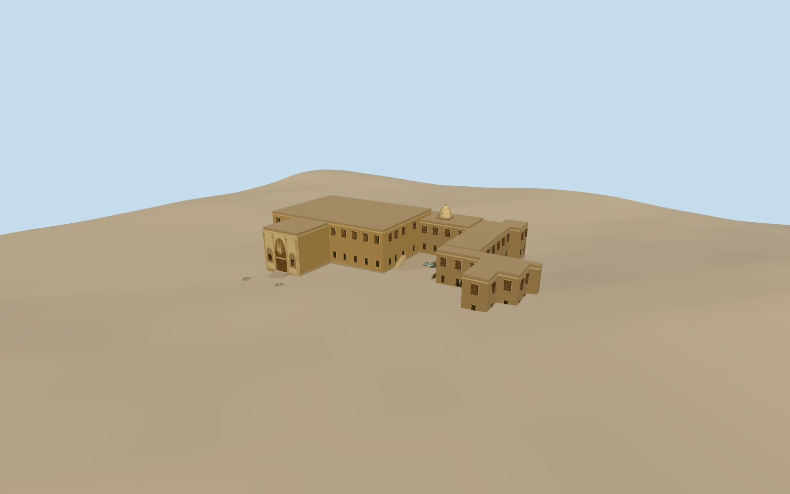

# Coptic Museum

Two sandstone museum wings with the neo-Fatimid entrance, east cupola, six-column court and historic mashrabiya windows.

Authoring state: **review-in-qa.json**. Current completion evidence is in [qa.json](qa.json) and the [local 100 ledger](../../../../qualla-structures/batches/PROGRESS.md).

- [Coptic Museum](https://qualla.com/coptic-museum/)

The model covers the museum wings, their connecting passage, the entrance and the garden-facing courts. Nearby churches and the Roman towers have separate identities.

The current building footprint follows the mapping. Wing heights, window spacing, stair shape, court locations and court floor grades are estimates based on the written architectural history.

Medium-fi geometric motifs represent the recessed shell and medallions, with simplified timber latticework. The original inscriptions and sculpture are beyond this exterior model.

Build: `node content/worldgen/source/places/st/stq/coptic_museum/models/generate-coptic-museum.mjs`. Add `--check` to verify exact regeneration. 10016 triangles; 6 materials; no embedded photographs.
