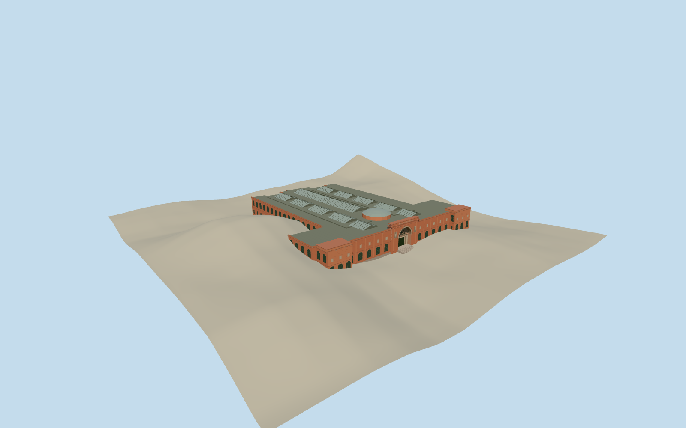

# Egyptian Museum

The Egyptian Museum’s salmon Beaux-Arts exterior, recessed Tahrir Square arch, dark rear gallery windows and skylit roofs.

Authoring state: **review-in-qa.json**. Current completion evidence is in [qa.json](qa.json) and the [completion ledger](../../../../qualla-structures/batches/qualla-003.PROGRESS.md).

- [Egyptian Museum](https://qualla.com/egyptian-museum/)

The Egyptian Museum on Tahrir Square is represented in May 2019. The opening depth, roof lights, flank details and extent of some roof alterations are approximate. The 2008 front photograph informs the surviving entrance stonework.

Fine carvings and inscriptions are represented by simplified relief and plaques. The original Terrarium samples are preserved, and the steep local source readings cover some lower side elevations in the terrain view.

Build: `node content/worldgen/source/places/st/stq/egyptian_museum/models/generate-egyptian-museum.mjs`. Add `--check` to verify exact regeneration. 11890 triangles; 5 materials; no embedded photographs.
