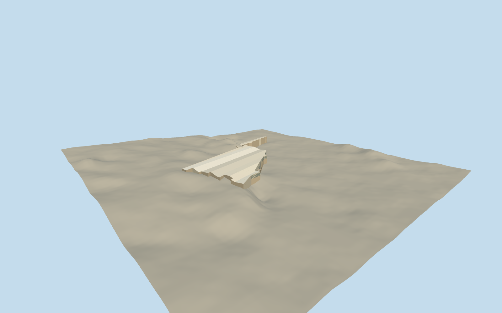

# Grand Egyptian Museum

Grand Egyptian Museum main building set into the plateau, with a broad folded concrete roof and shaded triangular-glazed entrance.

Authoring state: **review-in-qa.json**. Current completion evidence is in [qa.json](qa.json) and the [completion ledger](../../../../qualla-structures/batches/qualla-003.PROGRESS.md).

- [Grand Egyptian Museum](https://qualla.com/grand-egyptian-museum/)

The 56-point outside ring and four-point internal opening are mapped. Roof folds, the exact positions of internal stair and structural supports, current glazing colors and facade panel rhythms are estimated from the architect’s and contractor’s written descriptions.

The main grade is varied with the source relief. Heights are estimates constrained by the building relation’s 46-metre label, the architect’s plateau description and the contractor’s documented sections. The original surface model preserves mixed roof and terrain pixels.

The model covers the main museum. The independently mapped Khufu Boat Museum, plaza monuments, artwork and surrounding buildings are outside this structure.

Build: `node content/worldgen/source/places/st/stq/grand_egyptian_museum/models/generate-grand-egyptian-museum.mjs`. Add `--check` to verify exact regeneration. 2468 triangles; 5 materials; no embedded photographs.
