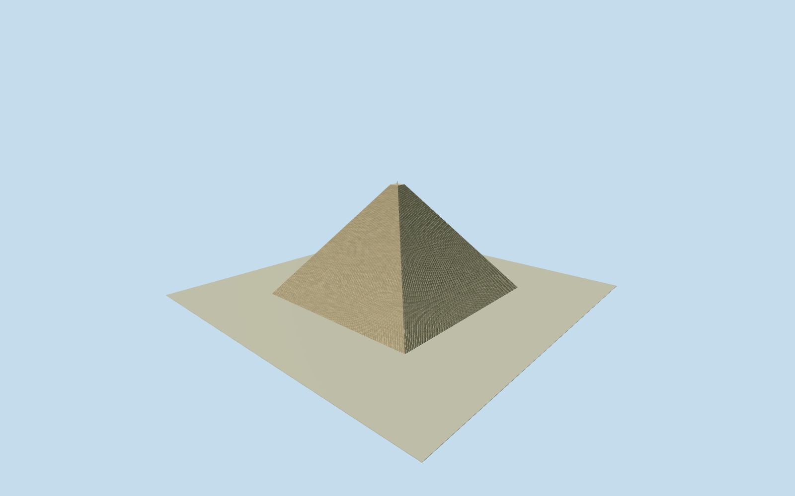

# Great Pyramid of Giza

Whole surviving GreatPyramidofGiza/KhufuQ37200 exterior on actual namedway4420397/allfive native controls and full base: complete four sloping rough limestone core faces/exposed stepped horizontal masonry courses and original restrained irregular block rhythm, small truncated summit/open air above, bounded north entry/rebate/chevrons and surviving basal casing fragments only where supportable. Current stripped weathered mass, not hypothetical polished white original/pyramidion. No neighboringKhafre/Menkaure/queens pyramids/wholeGiza complex/Sphinx/mortuarytemples/roads/sitepad/people/private burial interiors/artwork/inscriptions. Hidden exact courses/stonecensus/entrance/current summit details original bounded estimates.

Authoring state: **review-in-qa.json**. Current completion evidence is in [qa.json](qa.json) and the [completion ledger](../../../../qualla-structures/batches/qualla-002.PROGRESS.md).

- [Great Pyramid of Giza](https://qualla.com/great-pyramid-of-giza/)

Whole surviving Khufu pyramidway4420397/Q37200/allfive native basecontrols. Complete weathered core faces/real stepped course treads/small truncated summit and bounded two north entryrebates/chevron estimates. Neighboring Khafre/Menkaure/queens pyramids/temples/Sphinx/wholeGiza site/ground slab/private interiors excluded; no hypothetical polished white casing/pyramidion.

One exact1656x1242 Qualla DanielCsörföly2007-02 Own/PD-self photograph/nativeSHA1matched/clear namedcreator allrightsreleased nativegrant individually inspected after51familyQuallasearch/0conflicts. No supplementalimages needed, unrelatedCC0 masonrydiagram/museumfragment/interiors/portraits skippedwithoutpixels. No protected plan/photo pixels/borrowedmesh/generatedbitmap/copied inscriptions or sourcebody/policy changes.

Nativeheight138.8m retained for current mass, original bounded floor+.12/summit5.2% of base/24,60,128,203course levels/irregular original muted blockcolor rhythm. Nativebase224–229m approximates survey230.3m rather than inventing a replacement footprint. Individualstone/coursecensus/rear/currentfinish/basal casing remnants omitted or estimated. Northrebates/chevrons not seen in selected view: estimated centers+7/+5m east,height17/7m,width2.6/2m/depth1.6m. Small4.2m survey mast supported by Qualla story text, precise fixture/braces unsurveyed.

Independent1000m129x12916641-value field/fourrawtiles/PNG frozen before floor/course/summit geometry unchanged. Source contains pyramid/building/plateau relief and is not archaeological foundation survey; exact source/host contact unresolved/replacementfalse. Flat appearance separate; no terrain fitting/flattening/reacquisition or whole-sitepad.

Build: `node packages/worldgen/scripts/generate-authored-places.mjs --ids=great_pyramid_of_giza`. Add `--check` to verify exact regeneration. 55644 triangles; 3 materials; no embedded photographs.
