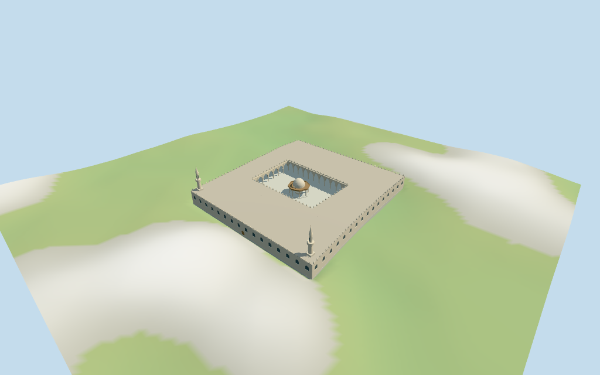

# mosque_of_amr_ibn_al_as — Mosque of Amr ibn al-As

Reviewed 2026-10-17 for the stated medium-fi exterior and approximate map fit. Current named PMTiles geometry supplies the outer footprint/court and scale. Heights, tower/pavilion positions, bay counts and detailed facing remain reconstructed.

## Exterior and shared materials

Inspected all 11 final portable views including a curated 1024×640 preview. Individual low courtyard mosque with four pointed colonnades, pale columns/capitals, dark roof soffits, stepped merlons and sparse round-arched exterior fields. The mapped court stays open around an octagonal ablution pavilion with eight columns, brown canopy/gallery rim, pale dome, finial and low basin. Two slender balcony minarets stand at estimated northwest outer corners. Added inward wall surfaces to close the backs of the exterior ranges and moved the arcade camera out from beneath the pavilion canopy before final captures. Lower LODs use plain inward wall faces; source/closeup retain aperture geometry. Heights, towers, pavilion, bay counts and secondary architectural divisions are estimates. Fine inscriptions, medallions, capitals, tap furniture, gallery lattice, fence/gardens and furnished interiors omitted.

Inspected all 11 final shared-material/geographic-flat views, including the outer/court overlay. Five existing shared 256² stucco, raw limestone, membrane, marble and plain wood graphs serve six merged roles including local opaque blue-grey fields. Metric UVs, linear colors and zero embedded images/copied photographs. Every graph is read once; eviction leaves zero live model geometries and restores host ground. Retained reference point remains fixed. Current named PMTiles outer polygon and its courtyard define scale and transform. Facing sense and internal architecture remain approximate; a mapped courtyard edge supplies the axis. Flat ground verifies transform/replacement/materials, not exact local grades.

## Browser levels

| Level | Triangles | Bytes | Draws |
| --- | ---: | ---: | ---: |
| skyline | 854 | 89320 | 1 |
| district | 3817 | 378020 | 6 |
| street | 15648 | 1538420 | 6 |
| closeup | 22707 | 2251208 | 6 |

**467,340 bytes for initial skyline plus district**, plus shared textures. Five existing 256² graphs, six merged roles, zero embedded images.

Inspected all 27 final medium-fi views: Economy/High, noon/late light, three distances, untextured silhouette, six details, four matched LODs and four transitions. Also inspected the matched skyline at full size. Skyline 854 retains open courtyard, coarse arcade groups, central domed pavilion/eight columns, low roof ranges and two balcony minarets. District 3817 restores flat exterior window rhythm, more arcade groups and sparse merlons. Street 15648 adds recessed exterior fields, denser pointed arcades, secondary columns and selected stepped merlons. Closeup 22707 refines arches/dome, dense merlons and inward window reveals. Initial skyline plus district 467340 bytes plus shared textures; one/six draws. Arcade-group spacing and merlon density visibly change between levels; conservative authored errors record those reductions. Static transitions and synthetic neighbors do not establish physical-device timing or full-city performance. Coarse dome and shadow faceting remains visible.

## Placement and limits

The retained Q683511 reference point [31.233161111,30.010138888] is unchanged. Its older record was reference-only with no resolved facing or footprint. Current Protomaps building 52776559533054 has 12 raw outer vertices and one four-vertex open courtyard, with a same-ID POI named Amr Ibn Al-As / عمرو بن العاص and nearby matching POI 35184400916520. These current named map controls support the identity and approximate fit; no historical exact way ID is invented. Heading 0.8687951695772824 rad aligns the first mapped courtyard edge with positive X, approximately northeast; positive Z is southeast. Exterior facing sense remains a visualization approximation. The raw outer outline and courtyard are retained exactly. Pavilion center is the mean courtyard vertex position; eight columns, canopy/dome, arcade spacing and two estimated northwest-wall minaret centers [-62,-55] / [39,-56] are architectural reconstruction. Surrounding city buildings, gardens, fence, roads and cemetery remain host content. Normal viewer DEM datum 19.715430667931006 m; working floor 1.3278170515619998 m is the median of 160 outside-perimeter samples at 1 m offset plus 0.3 m. 1466 raw outer-footprint samples span -1.5068494137133328..4.113417315506709 m. Adaptive foundation follows the outer outline; paving covers the complete outer cutout including the open court. The roof retains the exact mapped courtyard hole. Preview terrain seats the outer outline and 1.5 m margin. Exact street thresholds, courtyard drains/levels, current paving and surrounding retaining/road joins remain unverified. Independently reproduced the raw building from two current tile fragments: 12 outer vertices and one four-vertex courtyard. Reproduced both current named POIs, including the building-ID name Amr Ibn Al-As, and the heading from its first courtyard edge. All 414 actual renderer footprint checks pass across six GLBs: selected mosque covered and 68 exterior host buildings remain separate. All 910 FrontSide probes pass for pavilion dome/soffit, clear court, two minaret caps/balconies, every authored arcade passage/intrados, inward exterior wall faces and current exterior fields. Reproduced 1466 raw outer-footprint terrain samples, 160 perimeter samples and 1341 seated preview points. Ground cutout follows the outer polygon and is covered by model paving; roof hole preserves the mapped court. Exact thresholds, drains, street approaches, current paving and surrounding road/retaining joins remain unverified.

Individual medium-fi Mosque of Amr ibn al-As: current named outer footprint and exact open court, four roofed pointed arcades with pale columns, low exterior arched-window ranges and sparse entrances, stepped merlons, central octagonal ablution pavilion with pale dome/brown canopy and two slender balcony minarets. No generic stand-in; arcade and roof geometry follows this mapped court. Heights, minaret/pavilion positions, bay counts and fine architectural divisions remain explicit estimates. Five existing shared 256² graphs serve six merged roles and four separate browser LODs. Fine inscriptions, historic carving, tap furniture, fence, garden/city and furnished interiors omitted. No retained or current numeric height or level count exists. Retained width/length statements include 120×120 m and 17×29 m with no common temporal qualifier; preserve them without combining them or forcing the current map to those dimensions. Current mapped outline supplies horizontal scale. Picture-led heights above working floor: paving 1 m; court columns/capitals to 5.2 m, pointed court arches to 8.8 m, spandrels/soffit 9.8–10.3 m, flat roof 10.8 m and selected merlons to 12 m. The octagonal courtyard canopy is about 7.4 m high, pale dome to 13.2 m and finial 14.4 m. Twin minarets are estimated at 30 m overall, with lower shaft to 18 m, projecting balcony around 18–19.3 m, smaller upper stage to 24 m and pale conical cap/finial to 30 m. Detailed dome profile, gallery, exterior openings, tiers, thresholds and all vertical dimensions remain estimates; no surveyed engineering or furnished interior claim. Two useful actually inspected Commons photographs guide courtyard/pavilion and low exterior/towers. The older reference-only record is retained, including conflicting 120×120 and 17×29 dimension statements; current named map geometry supplies scale without forcing either statement onto it. No current/retained heights or independent pavilion/minaret controls exist. All vertical dimensions, tower origins, pavilion canopy/dome/basin, arcade bay counts, window spacing and detailed facade facing are visualization estimates. Orientation uncertainty is recorded as 30 degrees; it is not a surveyed facing. The open court/colonnades are exterior geometry, not a furnished or collision-certified interior. Current finish, engineering, hidden rooms, fine artwork and phone/tablet/laptop timings remain unverified.

## Verification

49 final views inspected; 910 FrontSide probes; 414 renderer footprint checks; six Khronos validations with zero errors/warnings. Current source/runtime/input/LOD/material/frame/report/placement hashes agree. Raw outer/court geometry, two named POIs, heading, terrain samples and 16-bit fixture reproduced. Source --check, placement --check, scene validate/sim30, LOD layout and recipe/registration Biome pass.

Source: sha256:432527162b638420f55a05fcdf15b32797b025f2910c5339490e2771e9603499

Runtime: sha256:274b6887cb16af3aa833dba98d63dbcf0387c5b91df61a8ed74b3781c11dd83b

Input: sha256:1fd638af9b77a3cf1d05fafa52ddb0d0dc8743a9176438ea02513c8f91c84b85

Commands: targeted generate-additional-landmarks/import-structure-models/generate-landmark-lods/register-landmark-previews --ids=mosque_of_amr_ibn_al_as; generator/placement --check; capture-structure-models --reflections --antialias --fit-shadows; capture-landmark-library --reflections --adaptive-clipping --bounded-placement; capture-medium-fi --ids=mosque_of_amr_ibn_al_as --reflections; selected LOD check; scene validate/sim30; recipe/registration Biome. Bulk captures stay ignored. Prior full source checkpoint great_mosque_of_aleppo–great_mosque_of_xi_an; next kocatepe_mosque–great_mosque_of_al_nuri.

## Inspected picture references

[Sherief1969 — 2019-02-09](https://commons.wikimedia.org/wiki/File:Amr_Ibn_Al_As_Mosque_1.jpg). CC-BY-SA-4.0; viewed only. Inspected complete 960×640 courtyard view. Pale marble court, open pointed arcades on slender pale columns, broad dark roof soffits, triangular/stepped merlons and central octagonal ablution canopy on eight columns. Canopy has brown timber soffit/edge gallery, pale dome and small finial over a low basin. Fine capitals, medallions, inscriptions, tap furniture and exact railing pattern not copied.

[Mohammed Basha — 2014-08-13](https://commons.wikimedia.org/wiki/File:جامع_عمرو_بن_العاص_Mosque_of_Amr_ibn_al-Aas.jpg). CC-BY-SA-3.0; viewed only. Inspected complete 960×640 exterior. Low light-cream facade with repeated round upper arched niches and warm stone arch surrounds, sparse pointed ground entrances, roofline merlons and two slender corner minarets with projecting balcony, tapering upper stage and pale pointed cap. Palms obscure part of the near tower. Fence, street furniture, garden and exact calligraphy/fine ornament remain host content or omitted.

## Shared-material refresh —2026-10-29

Material-only refresh2026-10-29: actually inspected11 new shared-material/geographic-flat-terrain frames. Source,imported master,all four runtime levels,scene/map/placement and retained portable/medium-fi evidence remain byte-bound. Current shared graph hashes and read-once/disposal checks are renewed. This does not upgrade the previously documented terrain,architecture or physical-device scope.
