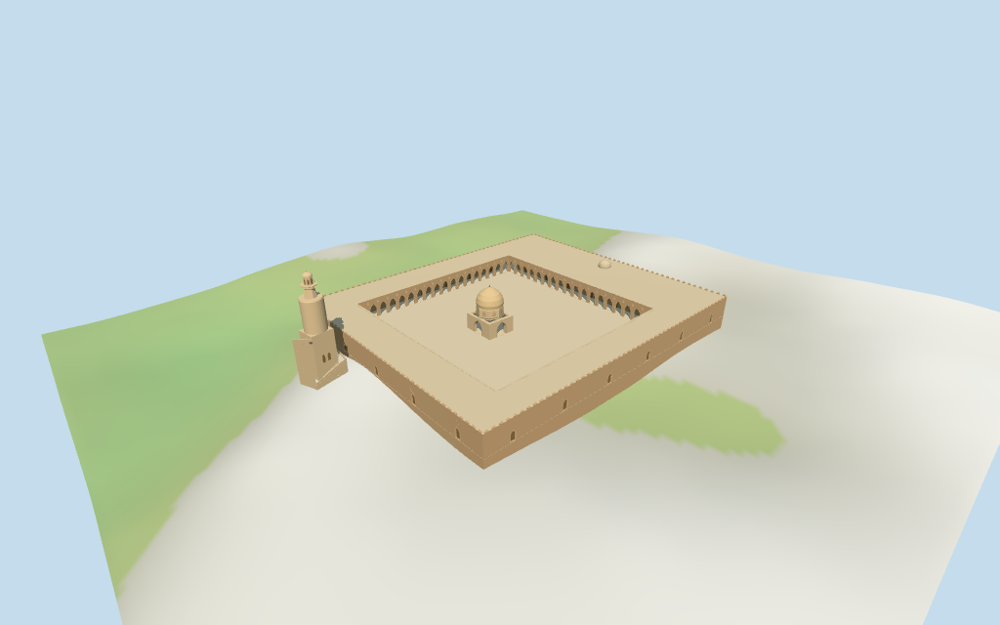

# Mosque of Ibn Tulun

Individual medium-fi Mosque of Ibn Tulun:large pale arcaded court/deep prayer range,pointed bays with smaller spandrel fields and selected parapet crest,open square fountain pavilion/stepped octagonal drum/ochre dome and the independent minaret with square wrapping ramp,cylindrical drum,two smaller upper stages and round cap. Three current mapped outlines remain fixed;retained40.44m minaret fact separated from approximate subdivisions and ambiguous92m facts. Six existing shared256² graphs,seven groups,four authored browser levels. Fine carved/stucco patterns,calligraphy,exact stair treads/handrails,unseen interiors,current finish and precise terrain/outer-enclosure joins omitted or unverified.

## Evidence and reconstruction

Published dimensions and reconstructed details are separated in spec.json. Primary references:

- [Reference](https://commons.wikimedia.org/wiki/File:Ibn_Tulun_Mosque_minaret_DSCF3911.jpg)
- [Reference](https://commons.wikimedia.org/wiki/File:Dome_and_Minarets_Above_the_Courtyard_of_Ahmad_Ibn_Tulun_Mosque.jpg)
- [Reference](https://commons.wikimedia.org/wiki/File:Ibn_Tulun_Mosqe_(3168240682).jpg)
- [Reference](https://commons.wikimedia.org/wiki/File:Mosque_of_Ibn_Tulun_the_largest_in_Egypt.jpg)

Six existing shared256² brick,sandstone,limestone,lime plaster,plain wood and cast bronze graphs,seven merged groups with metric UVs/linear tints. Zero embedded pictures,unique texture atlases,baked lighting or copied inscriptions.

## Model and axes

17,523 triangles; 52,569 vertices; 7 material groups; 2,107,092 bytes. Native bounds: -91.510, -9.589, -60.517 to 71.215, 47.336, 60.690. Source hash: `sha256:45c9fd4285e55d242579f093cab769d905c03a1f8731938144505a47dee8575d`.

{"x":"retained longest whole axis,approximately southeast;deep prayer range at+X,minaret outside−X","y":"up","z":"retained perpendicular axis,approximately southwest;no extra global rescale"}

Standard viewer DEM datum34.990787m;perimeter-9.24..6.33m relative to anchor. Working floor6.896m is maximum bilinear whole/minaret-footprint sample at2m spacing plus0.25m,not surveyed paving. Raw DEM retained without cutout/flattening;footings adapt below terrain and crossY=0. Exact outer access/thresholds/ziyada/court/terrain joins and free walking unverified.

## Reproduce

Run `node packages/worldgen/scripts/generate-additional-landmarks.mjs --ids=mosque_of_ibn_tulun` (or add `--check`). The generator preserves manually edited masters by checking their baseline hashes. Import through the standard authored-model workflow with optimization disabled; then capture all QA cameras, including shared-surface views.

## Pending work

- Retained exact relation/74081 /Q915413 matches current whole52776558207329 (3*2^44+74081),with named Mosque of Ahmed Ibn Tulun POI on the same encoded relation. Original anchor[31.24961082,30.0286587] and heading−0.899434425575rad unchanged,no horizontal scaling. Three current controls retain the five-point whole/four-point court plus separate four-point minaret and pavilion outlines. Earlier closed seven-vertex whole/four-vertex court remains separate. Pavilion follows its mapped offset,not a forced mathematical court centre. The minaret lies outside the western range. East prayer-range depth and estimated western access follow the map/pictures;precise doorway facing and approach/outer enclosure joins unverified.
- Retained facts include two40.44m height statements,one explicitly qualified to a minaret(Q48356),and unqualified92m width/length statements. Use40.44m for the minaret;do not rescale the roughly89.5m mapped court or141.9m whole to92m. Current three building controls have no height/min_height tags. Working roof9.2m/outer crest10.1m,pointed court arches6.4m,open fountain pavilion base7.2m/stepped drum11.7m/dome19.6m/finial20.6m and small prayer-roof cap13m are picture estimates. Minaret square core/ramp to18m,cylindrical drum30.8m,octagonal neck/lantern38.6m,cap40m/finial40.44m are estimated subdivisions of the retained height. Untagged heights/profiles/stair pitch and facing remain approximate within about2m/4°. Internal stairs,exact access and engineering unverified.
- Standard viewer DEM datum34.990787m;perimeter-9.24..6.33m relative to anchor. Working floor6.896m is maximum bilinear whole/minaret-footprint sample at2m spacing plus0.25m,not surveyed paving. Raw DEM retained without cutout/flattening;footings adapt below terrain and crossY=0. Exact outer access/thresholds/ziyada/court/terrain joins and free walking unverified.
- Three mapped controls preserve the mosque court,offset fountain pavilion and separate minaret. Pictures guide pointed court arcades,small upper fields,outer crest,pale roofs,open fountain arches/octagonal drum/ochre dome and square wrapping ramp/plain cylindrical drum/two upper minaret stages/round cap. Skyline merges court bays to4per side,omits crest and coarsens ramp/drums;district uses9court bays per side;near uses18. Small upper fields,drum/base/lantern recesses close on backing surfaces and do not establish interiors. Square lower ramp is a coarse visualization,not a traversable surveyed stair. Fine carving/calligraphy,exact spandrel motifs,handrails,unseen roofs/rooms/stairs and outer ziyada enclosure omitted or unverified. Standard DEM establishes an approximate flat working floor;exact terrace/threshold contacts and physical-device performance unverified.

This bundle follows the medium-fi standard. Medium-fi appearance and geographic fit are reviewed separately. Hash-bound visual acceptance is recorded separately after capture inspection.

## Additional geographic data

©OpenStreetMap contributors;Protomaps;Mapzen/USGS terrain tiles.
