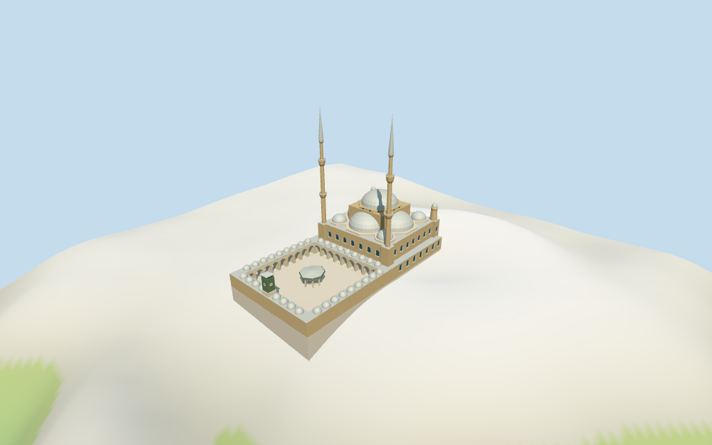

# Muhammad Ali Mosque

Individual medium-fi Muhammad Ali Mosque: exact aggregate/court and twenty current component controls; cascading pale central/four lower/four corner dome roofs, warm masonry prayer hall, paired tall pencil minarets with projecting balconies, open round-arched court colonnades and small roof cupolas, an octagonal fountain canopy and green/brown clock pavilion. Current plans/most part heights are controlled. Twin82 m finial totals intentionally use the retained overall fact instead of conflicting64 m map tags, with explicit uncertainty. Facade rhythm, clock/fountain dimensions, profiles and internal architecture remain estimates. Six existing shared256² graphs, seven merged roles and four independently budgeted LODs; no copied photographs, fine ornament or furnished interior. The separate eight-vertex central-court octagon 35184990184834 is interpreted as the picture-visible ablution fountain canopy; its exact mapped roof outline and position are retained. Fountain support layout, basin and canopy height remain estimates.

## Evidence and reconstruction

Published dimensions and reconstructed details are separated in spec.json. Primary references:

- [Reference](https://commons.wikimedia.org/wiki/File:Mosque_of_Muhammad_Ali,_Cairo_Citadel.jpg)
- [Reference](https://commons.wikimedia.org/wiki/File:Cairo_Citadel_Ablution_fountain.jpg)

Six existing shared256² limestone, raw limestone, standing-seam metal, marble, plain wood and cast bronze graphs serve seven merged roles. Clock/canopy green reuses the same wood graph with linear vertex tint. Metric UVs, no embedded images or copied art.

## Model and axes

29,190 triangles; 87,570 vertices; 7 material groups; 3,507,080 bytes. Native bounds: -55.900, -13.087, -28.127 to 56.000, 80.667, 28.160. Source hash: `sha256:6a0091ad258f5e1f2435b9fbd67f40230562ad6245061c7aabedc62adc3b74b5`.

{"x":"southeast toward prayer hall","y":"up","z":"southwest"}

Standard viewer DEM datum 102.36897713484342 m; working floor -1.3327120763836546 m is the median of 126 outside-main-perimeter samples at1 m offset plus.3 m. 676 raw footprint samples span -11.930602185203398..5.371156235872107 m. Foundation follows the exact aggregate outer ring. Preview terrain seats that outline and a1.5 m margin, including the model-covered open court paving. Exact Citadel retaining walls, stairs, foundations, thresholds and current grade joins are unverified; the coarse DEM is not a ground survey.

## Reproduce

Run `node packages/worldgen/scripts/generate-additional-landmarks.mjs --ids=muhammad_ali_mosque` (or add `--check`). The generator preserves manually edited masters by checking their baseline hashes. Import through the standard authored-model workflow with optimization disabled; then capture all QA cameras, including shared-surface views.

## Pending work

- Retained Q652046 map anchor [31.259647827,30.02905021] and heading -0.7484560352 rad remain unchanged; the separate original reference point is preserved in the source record. Current named Mosque of Muhammad Ali POI and aggregate relation 446128 / feature 52776558579376 identify this mosque. The raw parent has 21 outer vertices and one four-vertex court. Twenty separate current building parts supply prayer hall, central dome/drum, four lower dome controls, four corner caps, paired rear turrets, paired minarets and eastern projecting ranges. Positive X runs southeast toward the prayer hall; the court lies at negative X, so the main court facade faces negative X. Positive Z runs southwest. Facade divisions, court colonnade bays, fountain and clock-tower architecture are picture-led estimates. Separate Al Nasser Mohammad Ibn Qalaun Mosque, Citadel fortifications, museums and other buildings stay host content. The separate eight-vertex central-court octagon 35184990184834 is interpreted as the picture-visible ablution fountain canopy; its exact mapped roof outline and position are retained. Fountain support layout, basin and canopy height remain estimates.
- Current PMTiles tags are retained verbatim: aggregate/court ranges 8 m; inner prayer hall 18 m; central support block min_height19/height28, drum min_height28/height29 and central dome height37; four lower domes height27; four small corner caps min_height19/height23; two rear turrets height28; two minarets height64; eastern projection levels9 and10 and rear part min_height10/height15. Retained overall height82 m has no component qualifier and disagrees with the two unqualified map minaret totals64 m. This landmark visualization deliberately uses the retained82 m total for the twin pencil finials, overriding those two mapped totals; it does not claim the64 m tags measured a shaft stage. Shaft/balcony divisions and the added spire proportions remain picture estimates. All other tagged part totals are respected. Court eaves8 m, small arcade cupolas to10.5 m, fountain canopy to8.5 m and clock pavilion to19 m are estimated. Roof/drum profiles, windows, tiers and all hidden construction are reconstruction, not surveyed engineering.
- Standard viewer DEM datum 102.36897713484342 m; working floor -1.3327120763836546 m is the median of 126 outside-main-perimeter samples at1 m offset plus.3 m. 676 raw footprint samples span -11.930602185203398..5.371156235872107 m. Foundation follows the exact aggregate outer ring. Preview terrain seats that outline and a1.5 m margin, including the model-covered open court paving. Exact Citadel retaining walls, stairs, foundations, thresholds and current grade joins are unverified; the coarse DEM is not a ground survey.
- Two pictures guide the visible exterior; the 1983 court picture is a historical appearance reference. Fine stone carving, painted canopy art, inscriptions, exact clock mechanism, furnishings, hidden interiors, neighboring Citadel buildings and engineering are omitted. No physical phone/tablet/laptop timing or surveyed grade/facing claim.

This bundle follows the medium-fi standard. Medium-fi appearance and geographic fit are reviewed separately. Hash-bound visual acceptance is recorded separately after capture inspection.

## Additional geographic data

©OpenStreetMap contributors; Protomaps; Mapzen/USGS terrain.
