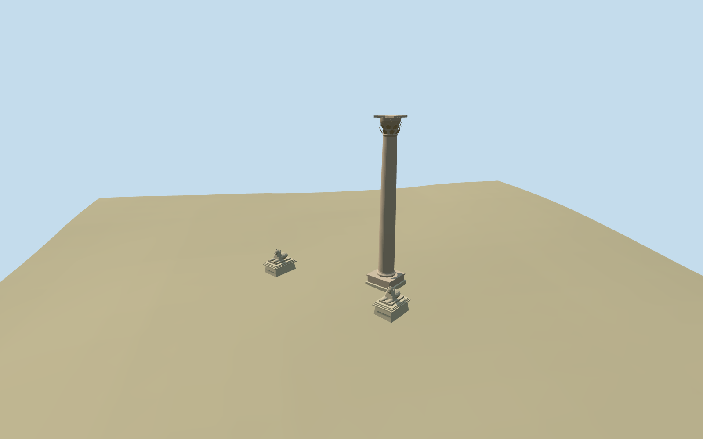

# Serapeum of Alexandria

Serapeum of Alexandria surviving landmark group: tall plain tapered granite column, moulded base and leafy Corinthian crown with concave square abacus; two separately based worn sphinxes with frontal heads, nemes flaps, chest/paws and simplified crouching rear masses. Pale restored plinths and original rough stone blocks remain distinct. Keep the surrounding archaeological ground open; no destroyed intact Serapis temple, inferred extensive ruins or hidden galleries are reconstructed.

## Evidence and reconstruction

Published dimensions and reconstructed details are separated in spec.json. Primary references:

- [Reference](https://commons.wikimedia.org/wiki/File:The_Serapeum_of_Alexandria_(II).jpg)
- [Reference](https://commons.wikimedia.org/wiki/File:The_Serapeum_of_Alexandria_(I).jpg)
- [Reference](https://commons.wikimedia.org/wiki/File:Sphinxes_at_the_Serapeum_of_Alexandria_(I).jpg)

Two registered recipes build the plain tapered granite column/leafy Corinthian crown and separately based worn sphinxes using two shared 256² material graphs, metric UVs and linear tints. No embedded images or unique atlas. The mapped column is an explicitly reviewed constituent of the Serapeum site, with a distinct component QID.

## Model and axes

4,586 triangles; 13,758 vertices; 3 material groups; 552,820 bytes. Native bounds: -11.496, -0.930, -3.424 to 11.146, 27.281, 19.836. Source hash: `sha256:92f47ff3bfc473844a56f6ecf28c530dacfcbfadf85698e90cecad93262c5f7d`.

{"x":"east","y":"up","z":"south"}

The geographic proposal uses exact-QID OpenStreetMap evidence. Map-derived orientation and estimated architectural details require real-site visual review; preview eligibility is distinct from geographic/fidelity approval. Map attribution: © OpenStreetMap contributors, ODbL-1.0.

## Reproduce

Run `node packages/worldgen/scripts/generate-additional-landmarks.mjs --ids=serapeum_of_alexandria` (or add `--check`). The generator preserves manually edited masters by checking their baseline hashes. Import through the standard authored-model workflow with optimization disabled; then capture all QA cameras, including shared-surface views.

## Pending work

- Serapeum of Alexandria surviving landmark group: tall plain tapered granite column, moulded base and leafy Corinthian crown with concave square abacus; two separately based worn sphinxes with frontal heads, nemes flaps, chest/paws and simplified crouching rear masses. Pale restored plinths and original rough stone blocks remain distinct. Keep the surrounding archaeological ground open; no destroyed intact Serapis temple, inferred extensive ruins or hidden galleries are reconstructed.
- The candidate is the Serapeum site Q521646. Its reference coordinate is about 88m southeast of the actual named column point. Standard PMTiles monument17593449217372 fixes the component center at29.8963925242424,31.182580653236712; the ordinary OpenStreetMap node1263172956 page confirms Pompei's Pillar and component Q492487. These are deliberately distinct site/component identities. The ordinary site photographs explicitly show this column and paired sphinxes as the Serapeum remains. mappedIdentity records that reviewed constituent association, not an assertion that the node has the site's QID. Native +X east/+Z south, runtime heading0. Approximate southeast-facing sphinx arrangement follows the photographed viewpoint; their spacing and bearing are picture-led estimates, not surveyed plans.
- The three inspected ordinary 2009 photographs guide the approximately27m column, slender unfluted entasis, flared leafy capital/concave abacus, square/moulded foot, worn frontal sphinx heads and long nemes flaps, paired paws, rough original blocks and pale tapered restored plinths. Shaft diameter about2.6m and sphinx/plinth height about4m are picture-led estimates. Sphinx back/animal anatomy, individual leaves/volutes, damaged facial carving and exact ancient inscriptions are simplified; no measured conservation record is claimed.
- Pinned standard Protomaps2026-10-14 and Mapzen13–14 extract, recentered on the named column point. Retain its original six-meter native grid and water. Column and each sphinx have separate locally sampled level footings with buried bottoms; no continuous fabricated podium spans the precinct. The coarse DEM does not resolve excavation walls or exact restored paving levels. Local foot/plinth heights, spacing and contact are approximate; surrounding low ruins and visitor landscape remain host context. No terrain, water or building cutout.
- The column point is mapped; column proportions, sphinx spacing/facing, restored plinth levels and sculpted detail are picture-led estimates. Preserve independent buildings and open archaeological ground. No lost intact temple or unobserved underground galleries are modeled.

This bundle follows the medium-fi standard. Medium-fi appearance and geographic fit are reviewed separately. Hash-bound visual acceptance is recorded separately after capture inspection.

## Additional geographic data

©OpenStreetMap contributors; Protomaps; Mapzen/USGS terrain.
