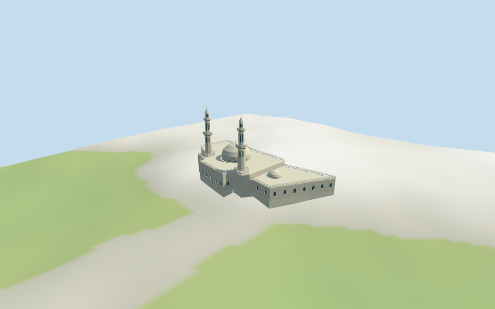

# masjid_al_qiblatain — Masjid al-Qiblatain

Reviewed 2026-10-17 for the stated medium-fi exterior and approximate map fit. The exact main footprint is mapped; detailed layout, facing and all heights remain reconstructed.

## Exterior and materials

Inspected all 11 final portable views, including a curated 1024×640 preview. Individual cream-white mosque with one larger pale pointed dome, smaller western cap, paired stepped minarets with square bases/octagonal shafts, two projecting balcony tiers and pale pointed caps. Pointed entrance/window recesses and original coarse open diamond parapets define the exterior rhythm. Corrected an octagonal trim band that was displaced by multiplying world coordinates, added a campus-envelope check, and retained a single main pointed entrance. No displaced trim remains in the final views. Internal roof/wing division, centers, bay rhythm and all heights are estimates. Fine historical interlacing, inscriptions, fixtures, palms, landscaping, newer surrounding decks/parking/shade sails and furnished interiors are omitted.

Inspected all 11 final shared-material/geographic-flat views including the north-up exact footprint overlay. Five existing shared 256² stucco, raw limestone, lime plaster, plain wood and cast bronze graphs serve six merged roles including local opaque blue-grey fields. Linear colors, metric UVs and zero embedded images or copied photographs. Every graph is read once; eviction disposes model geometry and restores ground. Original anchor, heading and exact irregular 15-vertex main outline remain fixed. Architectural facing remains approximate within the retained axis. Flat terrain verifies transforms, replacement and materials, not exact ground contact.

## Browser levels

| Level | Triangles | Bytes | Draws |
| --- | ---: | ---: | ---: |
| skyline | 696 | 72820 | 1 |
| district | 3696 | 388280 | 6 |
| street | 11800 | 1186236 | 6 |
| closeup | 14190 | 1447216 | 6 |

**461,100 bytes for initial skyline plus district**, plus shared textures. Five existing 256² graphs, six merged roles, zero embedded images.

Inspected all 27 final medium-fi views: Economy/High, noon/late light, three distances, untextured silhouette, six details, four matched LODs and four transitions. Also inspected the matched skyline at full size. Skyline 696 retains the paired stepped minarets, larger/smaller domes and irregular stepped main/wing mass; fine parapet openings and all glazing drop out. District 3696 restores recessed facade fields, tower fields and thin diamond parapets. Street 11800 adds solid parapet bars, curve resolution and selected cornices. Closeup 14190 refines aperture curves, dome facets and upper-tier frames. Initial skyline plus district 461100 bytes plus shared textures; one/six draws. Faceted dome/cornice and shadow transitions remain visible. Static transition fixtures do not establish a timed physical-device test. Synthetic neighbors and coarse terrain are review fixtures.

## Placement and limits

Retained exact way 66510098 / Q2334553 is current viewer building 35184438598930. Original anchor and heading and all 15 current raw outer vertices retained; there are no mapped holes. Positive X approximately east-northeast, positive Z south-southeast. A lower western wing is partitioned at estimated local X=-14. The larger pale dome is estimated at [11,1], small side dome at [-20,1] and paired minarets at [-7.5,-12] / [27,-7.8]. These roof/tower centers and the division are picture-led visualizations within the map outline, not separate surveyed controls. No current or retained heights or independent roof/tower geometry exist. The older image camera coordinates are approximate and do not establish facade facing. Surrounding buildings, newer surrounding decks/parking and shade structures, palms, gardens, roads and city remain host content. Normal viewer DEM datum 609.4174649335225 m; working floor -1.1692176058288168 m is the median of 90 outside-perimeter samples at 1 m offset plus 0.3 m. 292 raw footprint samples span -4.2495680797585464..2.3436222551545143 m. Adaptive perimeter footings follow the raw main outline. Preview terrain seats that outline and a 1.5 m margin; paving covers the raw cutout. Exact road approach, entry steps, parking/deck levels and current terrain joins remain unverified. Independently reproduced the exact current main control and all 15 raw vertices. All 18 actual renderer footprint checks pass across six GLBs: the selected main mosque is covered and two exterior host buildings 35184876545106 / 35184876545107 remain separate. All 249 FrontSide probes pass for both dome caps, each minaret cap and two balconies, current recessed facade fields and clearance outside the western wedge. All six horizontal envelopes remain inside X=-47..47, Z=-24..24, catching misplaced trim. Reproduced 292 raw terrain samples, 90 outside-perimeter samples and 296 seated preview points. Exact current thresholds, approach steps, road grade and new surrounding deck/parking levels remain unverified.

Individual medium-fi Masjid al-Qiblatain exterior: exact irregular main footprint, pale main dome and smaller western side dome, paired stepped square/octagonal minarets with projecting balconies and pointed caps, light roof cornices, open original diamond parapets and recessed pointed entrance/window rhythms. Internal plan, roof/tower centers and all heights are explicit picture estimates. Five existing shared 256² graphs serve six merged roles and four separate budgeted browser LODs. Newer surrounding decks, shade canopies, parking, garden, city, fine historic screen artwork and furnished interiors omitted. No current or retained numeric heights or level counts are available. Picture-led visualization estimates above working floor: podium 1 m; west wing eaves 8 m; main hall eaves 10.8 m; main flat roof 11.2 m and parapet 12.6 m. Main dome drum 11.2–13 m, pale pointed cap to 21.4 m and finial 23 m; side dome base 8.2 m, cap to 12.2 m and finial 13.5 m. Twin minarets have square bases to 12 m, tapered octagonal shafts to 25 m, projecting balcony around 25–26.3 m, upper tiers to 34 m, smaller balcony and pale pointed cap/finial to 42 m. Every vertical dimension, window rhythm, parapet module, tier, balcony and dome profile is approximate. No engineering or furnished interior claim. Two actually inspected useful Commons pictures guide the pale massing and tiered minarets. No retained/current numeric heights, roof parts or minaret plans exist. Detailed facade facing and all dome/tower positions, internal dimensions, heights, parapet modules and bay rhythms remain estimates; orientation uncertainty is recorded as 30 degrees. The 2025 picture includes newer foreground construction which is not established as part of this exact mapped building. Those surrounding decks, shade structures, city and unseen interiors remain outside this model. Fine historic artwork, exact finish, structural engineering and physical phone/tablet/laptop timing remain unverified.

## Verification

49 final views inspected; 249 FrontSide probes; 18 renderer footprint checks; six envelope checks and six Khronos validations with zero errors/warnings. Current source/runtime/input/LOD/material/frame/report/placement hashes agree. Exact raw outline and retained 16-bit terrain fixture reproduced. Source reproduction, placement check, scene validate/sim30, LOD layout and recipe/registration Biome pass.

Source: sha256:fb17d4aa0c916c225cfbc19a059af56251225e65b7e7639d18aae97611687fab

Runtime: sha256:a4b46740edcaad77e3ab46a2f51cf400fb04dede551eeecd05fba4351a7e53e1

Input: sha256:4a02b39431c6deca09bdb860c7a6fd79e998f72084951e6764c0099f370c8bd4

Commands: targeted generate-additional-landmarks/import-structure-models/generate-landmark-lods/register-landmark-previews --ids=masjid_al_qiblatain; generator/placement --check; capture-structure-models --reflections --antialias --fit-shadows; capture-landmark-library --reflections --adaptive-clipping --bounded-placement; capture-medium-fi --ids=masjid_al_qiblatain --reflections; selected LOD check; scene validate/sim30; recipe/registration Biome. Bulk captures stay ignored. Prior full source checkpoint great_mosque_of_aleppo–great_mosque_of_xi_an; next routine checkpoint kocatepe_mosque–great_mosque_of_al_nuri.

## Inspected picture references

[Aiman titi — 2011-03-04](https://commons.wikimedia.org/wiki/File:Masjid_al-Qiblatain.jpg). CC-BY-SA-3.0; viewed only. Inspected complete 960×720 exterior. Cream-white paired minarets with square bases, octagonal shafts, projecting stacked balconies, small dark arched fields, pale conical caps and gold finials. Larger pale pointed dome and smaller side dome, pointed door recess, simple arched windows and open interlaced parapet. Trees/lights obscure some lower wall; exact fine ornament, signs, landscaping and furniture not copied.

[Diego Delso — 2025-05-22](https://commons.wikimedia.org/wiki/File:Mezquita_de_al-Qiblatayn,_Medina,_Arabia_Saudita,_2025-05-22,_DD_10-12_HDR.jpg). CC-BY-SA-4.0; viewed only. Inspected complete 960×434 wide street view. Two stepped pale minarets, larger white dome and low open parapet visible behind foreground raised ranges and shade structures. Supports pale finish and tiered tower silhouette. Separate newer foreground decks, parking, shade sails, street lights and neighboring ranges remain host content; image does not establish their ownership or exact internal roof/tower positions.
