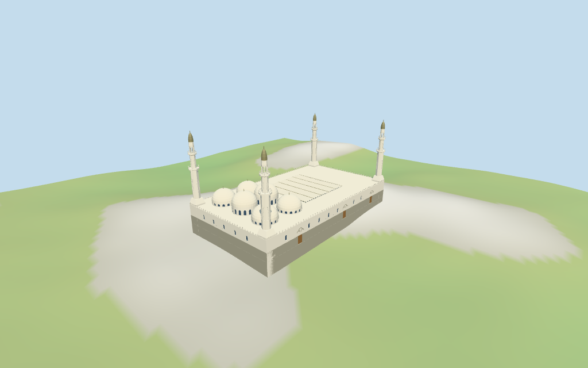

# Quba Mosque

Individual medium-fi Quba Mosque:grey granite plinth/white enclosure with pointed merlon crown,six mapped white domes in two rows with taller middle pair,four staged square-to-octagonal minarets/two balconies/open lanterns/small bronze caps,rectangular entrance fields with trefoil hoods,pointed courtyard arcades and observed deployed cream cloth shade. Five existing shared256² graphs,seven merged groups,four browser levels. Exact compound/court/dome controls;all heights/minaret/door/canopy partitions,fine ornament,current finish and exact site joins estimated or unverified.

## Evidence and reconstruction

Published dimensions and reconstructed details are separated in spec.json. Primary references:

- [Reference](https://commons.wikimedia.org/wiki/File:Quba_Mosque_from_Afar_(2024).jpg)
- [Reference](https://commons.wikimedia.org/wiki/File:Quba_Mosque_Full_Picture_(2024).jpg)
- [Reference](https://commons.wikimedia.org/wiki/File:Quba_Mosque_Minaret_(2024).jpg)
- [Reference](https://commons.wikimedia.org/wiki/File:Quba_Mosque_Entrance_Gate_1.jpg)
- [Reference](https://commons.wikimedia.org/wiki/File:Quba_Mosque_Center.jpg)

Five existing shared256² lime plaster,granite,plain wood,bronze and canvas graphs;seven groups including local blue-grey glazing. Roof/walls reuse plaster with distinct finishes. Shared textures,metric UVs,linear tints;no embedded images,unique facade maps,baked lighting or copied lettering.

## Model and axes

37,468 triangles; 112,404 vertices; 7 material groups; 4,500,396 bytes. Native bounds: -47.656, -2.505, -26.660 to 47.584, 49.681, 26.690. Source hash: `sha256:9f36d7f9a4d4daa7b997eb9f18d17ec088c9d7b54f4a8e5f7a0cc34964a529bb`.

{"x":"north courtyard/rear wing,opposite south prayer hall","y":"up","z":"east entrance side"}

Standard viewer DEM datum611.764133m;whole perimeter-1.94 to3.76m relative to datum. Floor4.681m is maximum retained perimeter/interior-grid sample plus0.30m. Adaptive granite footings crossY=0 and extend below retained ground. Approximate attachment plane;coarse terrain may expose tall footings. No cutout,flattening or road replacement. Exact door/step/court/plaza/street/base contact,altitude and walking remain unverified.

## Reproduce

Run `node packages/worldgen/scripts/generate-additional-landmarks.mjs --ids=quba_mosque` (or add `--check`). The generator preserves manually edited masters by checking their baseline hashes. Import through the standard authored-model workflow with optimization disabled; then capture all QA cameras, including shared-surface views.

## Pending work

- Retained exact relation/18051738 /Q276569 identifies Medina Quba Mosque. Current whole52776576184986 (3×2^44+18051738) plus six layer1 circular roof controls retain122 raw outline/courtyard-hole/dome points/properties. Anchor[39.61725515,24.43936425] and heading1.500731771622rad unchanged,no horizontal rescale. Native−X south prayer hall/qibla, +X north courtyard/rear wing, +Z east entrance side, −Z west. Pictures resolve facing with about3° uncertainty. Dome centers/radii follow mapped roof circles;four corner minaret centers,arcade bays/door locations,wall partitions and canopy structure are picture-led estimates with about2.5m horizontal working uncertainty. Separate expanding plazas,outer umbrellas,service buildings,roads,landscaping and city content remain host assets.
- Retained Wikidata heights/widths/lengths are empty;current compound and six circular controls have no heights. All elevations are picture-led working estimates,not nominal surveyed facts. Four minaret tips45m;wide square bases10.5m,tapered transition13m,octagonal shaft27m,lower balcony27.8m,upper stage34m/second balcony34.8m,open lantern35–38.5m and small metal cap40–44m/tip45m. Main enclosure9.8m/grey cladding4.2m,parapet crown10.7m,central pair dome drums13.8m/caps19.3m and outer four drums11.5m/caps17m,finials+1.1m. Courtyard arcade9.5m with deployed fabric shade about9.7–10.2m;exact dimensions,profiles,unseen sides,current finish and moving shade machinery unverified.
- Standard viewer DEM datum611.764133m;whole perimeter-1.94 to3.76m relative to datum. Floor4.681m is maximum retained perimeter/interior-grid sample plus0.30m. Adaptive granite footings crossY=0 and extend below retained ground. Approximate attachment plane;coarse terrain may expose tall footings. No cutout,flattening or road replacement. Exact door/step/court/plaza/street/base contact,altitude and walking remain unverified.
- Individual medium-fi exterior from five actually inspected Kaliper1 December2024 exterior/minaret/entrance/court pictures and standard viewer PMTiles/DEM. Six domes,grey-plinth/white enclosure,crown parapets,four two-balcony minarets/open lanterns and bronze caps,shallow rectangular entrance recesses/trefoil hoods,pointed court arcades and static deployed fabric shade. Fine carved lattice/muqarnas,inscriptions,actual room plans,engineering,fixtures,carpets and current site finish excluded or abstracted. Court arcade voids are exterior circulation;main prayer-hall portal terminates closed and no enclosed interior/free traversal claim is made. Canopy is the observed covered state,not animated machinery;plaza umbrellas and outer expansion remain separate host content. Exact ground/door/stair/plaza contact,altitude/walking and physical-device timing unverified.

This bundle follows the medium-fi standard. Medium-fi appearance and geographic fit are reviewed separately. Hash-bound visual acceptance is recorded separately after capture inspection.

## Additional geographic data

©OpenStreetMap contributors;Protomaps;Mapzen/USGS terrain tiles.
