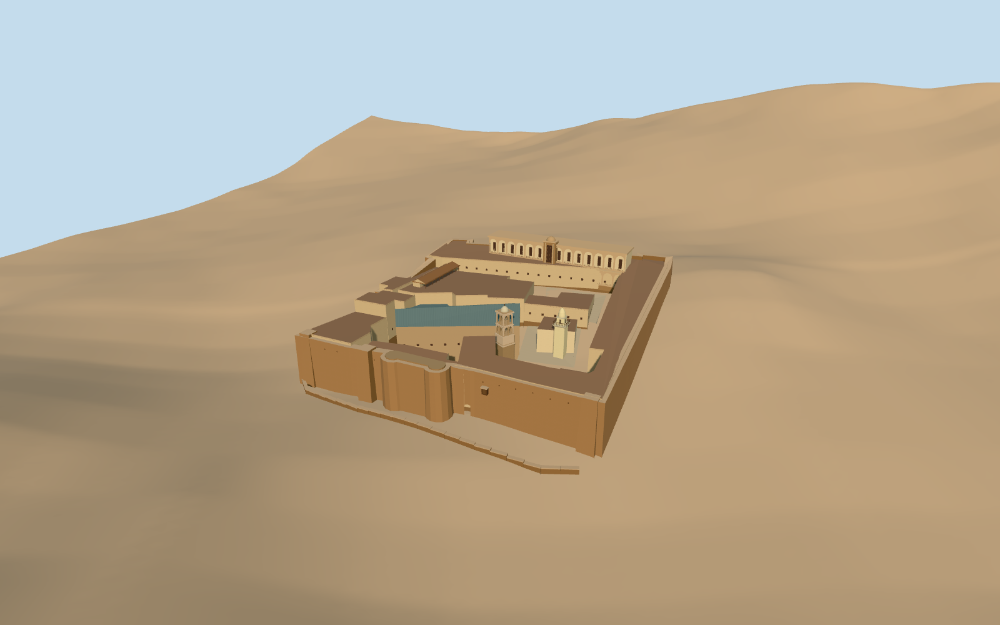

# Saint Catherine’s Monastery

Saint Catherine’s Monastery in April 2011, with the granite fortification, the Transfiguration Basilica, its open bell tower, the whitewashed Fatimid minaret and the monastery’s terraced ranges.

Authoring state: **review-in-qa.json**. Current completion evidence is in [qa.json](qa.json) and the [completion ledger](../../../../qualla-structures/batches/qualla-003.PROGRESS.md).

- [Saint Catherine's Monastery](https://qualla.com/saint-catherine-s-monastery/)

The natural field is retained as sampled. Its grid does not represent masonry courtyard terraces, survey elevations or the paths below the wall.

Native geometry controls the building footprints and most of the outer wall. Wall thickness follows the UNESCO nomination. Local crown profile, buttress projections, narrow entrance and lower retaining wall geometry are estimates matched to the panorama.

Basilica, cloister ranges, minaret and bell tower use estimated ridge heights and simplified openings. A courtyard gallery is reconstructed from the visible elevations and surrounding native boundaries.

The model represents the exterior in April 2011. Small inscriptions, interior chapels, the orchard, and later visitor paths are outside the modeled scope.

Build: `node content/worldgen/source/places/sv/sv0/saint_catherine_s_monastery/models/generate-saint-catherines-monastery.mjs`. Add `--check` to verify exact regeneration. 9136 triangles; 6 materials; no embedded photographs.
