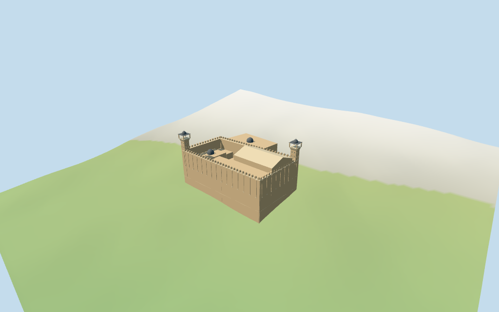

# cavern_of_the_patriarchs — Cavern of the Patriarchs

Reviewed2026-10-17 against current bytes. Accepted for the stated medium-fi exterior and approximate horizontal fit. All untagged heights/subplans and unseen roofs are estimates;current finish,subterranean caves/interiors and exact hillside/threshold joins remain unverified.

## Exterior and shared surfaces

Inspected all11 current portable views including the1024×640 summary. Massive pale/buff stone enclosure with shallow upper pilasters,thin cornice/coping and rounded parapet teeth,two square corner minarets with narrow paired shaft lights/corbelled projecting stages/open four-post pavilions/faceted dark caps and finials,mapped main/attached ranges and three small dark caps. Selected closed side entry fields/alternating stone arch band and threshold landings. Corrected the initially excessive whole-complex floor by separating the enclosure and uphill annex planes and removing the flat apron outside the enclosure. Main inner roof shape/vertical divisions remain estimates;unseen faces/current finish and exact hillside/threshold joins unverified.

Inspected all11 current shared/geographic-flat views. Four existing256² ashlar,sandstone,painted-metal and plain wood graphs;five merged groups. Wall courses/pilasters/shafts share ashlar,cornices/arch trim/paving sandstone,caps dark painted metal and doors wood. Alternating portal stones use original vertex tints on the same shared trim graph;panes are local dark blue-grey. Metric UVs/linear tints,zero embedded images,baked lighting or copied facade artwork. Shared graphs read once;unload leaves zero live model geometries. Geographic fixture uses flat terrain;portable/medium-fi use retained standard viewer DEM. No surveyed altitude or complete terrain-contact claim.

## Browser levels

| Level | Triangles | Bytes | Draws |
| --- | ---: | ---: | ---: |
| skyline | 854 | 90,044 | 1 |
| district | 3,606 | 324,320 | 5 |
| street | 7,122 | 635,200 | 5 |
| closeup | 9,416 | 808,308 | 5 |

Initial skyline plus district: **414,364 bytes**. Master **1,235,220 bytes /10,266 triangles**;runtime **1,234,716 bytes**. Four shared256² graphs,five groups,zero embedded images;shared runtime textures are additional.

Inspected all27 current medium-fi views:Economy/High,noon/late,three distances,silhouette,six details,four matched levels and four transitions. Skyline854 keeps enclosure,pilaster/coping and coarse crenellation rhythm,twin square towers/open upper stages/dark caps,attached ranges and three small caps. District3606 adds closer parapet rhythm and closed shaft/door/annex fields. Street7122/close9416 add rounded tooth facets,finer cap ribs,paired arch bands and corner corbels. One/five draws;initial414364bytes. Browser POSITION/NORMAL separate;CPU/GPU reservations equal. Separate enclosure1.561820m and uphill annex5.778383m working floors improve the exterior proportions;raw terrain remains. Outside base exposure/threshold joins and synthetic neighborhood/device timings remain unverified.

## Placement and scope

Retained exact way/1302827171 /Q204200 identifies the Cavern of the Patriarchs complex. Current PMTiles exact feature35185674916003 (2^45+1302827171) appears as an attraction POI with nominal elevation890m,not a whole-building polygon. Preserve that identity separately from the earlier retained18-point complex outline and all nine current building/part controls. Current controls have58 raw points/properties and one fragment each;no height/min_height tags. No invented current whole-outline ID or horizontal rescale. Anchor[35.110855844,31.524788611] and heading−0.875871355461rad unchanged. Native+X southeast prayer-hall end,−X northwest attached ranges;native+Z southwest long pilastered enclosure/garden approach,−Z northeast Jawliyah annex/side street. Enclosure subdivision,wall thickness,minarets and door positions are picture-led estimates within about3m/facing about3°. Nine mapped ranges/three small dome controls retain their polygons. Adjacent city buildings,roads,park and public approach remain host content. Retained facts have no numerical height/width/length claims;current building/part controls have no height/min_height. POI elevation890m is a nominal location elevation,not building height or surveyed floor. Working enclosure wall16.2m/coping16.5m/rounded teeth17.6m,pilasters7.2–16.2m,inner main hall19m plus22m ridge,attached ranges8.5–13m above their declared plane,small caps13.2m above the annex plane and twin corner minaret tips28m are picture-estimated proportions above the declared floor. Shafts22m,corbelled stages22–23.3m/open pavilions23.3–25.8m/caps25.8–27.6m/finials28m. Roof shape,merlon/pilaster cadence,wall thickness,window/door/stair dimensions and unseen faces are estimates,not surveys. Current finish,interiors,subterranean caves,engineering and exact site contacts unverified. Standard viewer DEM datum892.130383m;retained complex perimeter-4.65..5.35m relative to anchor. Working floor1.562m is maximum bilinear DEM sample on the estimated enclosure and its boundary at1.5m spacing plus0.4m. The uphill mapped annex has a separate working floor5.778m. The initial whole-complex maximum raised the enclosure disproportionately;separate planes preserve picture proportions. These are not surveyed platform elevations. Only the enclosure has modeled court paving;outside lanes retain host terrain. Adaptive foundations extend below retained DEM and crossY=0;outside exposure may differ from the actual hillside. Raw DEM retained without cutout/flattening;public approach/roads remain host content. Exact altitude,terrain/threshold/stair/street contact and walking unverified. All84 actual viewer-footprint checks cover nine selected building/part controls and preserve five separate nearby hosts across source,runtime and four LOD files. Current raw polygon geometry/properties independently reunited from PMTiles;earlier exact aggregate outline retained separately. The current exact POI is not treated as a new building outline. Independent1.5m DEM sampling checks913 enclosure and334 annex samples;floor offsets are working reconstruction planes,not surveyed elevations. Approximate horizontal fit accepted within these limits.

Individual medium-fi Cavern of the Patriarchs exterior:massive buff-stone enclosure with shallow upper pilasters/coping/rounded crenellations,two square corner minarets with paired lights/corbelled galleries/open upper pavilions/faceted caps,independent mapped prayer and attached ranges/three small caps,selected closed entry fields and threshold landings. Four existing shared256² ashlar/sandstone/painted-metal/wood graphs,five merged groups,four browser levels. Earlier exact complex outline,current identity POI and nine current building/part polygons retained separately. All untagged heights and architectural subplans are picture estimates;subterranean caves/interiors/current finish and exact terrain/threshold joins omitted or unverified. Retained facts have no numerical height/width/length claims;current building/part controls have no height/min_height. POI elevation890m is a nominal location elevation,not building height or surveyed floor. Working enclosure wall16.2m/coping16.5m/rounded teeth17.6m,pilasters7.2–16.2m,inner main hall19m plus22m ridge,attached ranges8.5–13m above their declared plane,small caps13.2m above the annex plane and twin corner minaret tips28m are picture-estimated proportions above the declared floor. Shafts22m,corbelled stages22–23.3m/open pavilions23.3–25.8m/caps25.8–27.6m/finials28m. Roof shape,merlon/pilaster cadence,wall thickness,window/door/stair dimensions and unseen faces are estimates,not surveys. Current finish,interiors,subterranean caves,engineering and exact site contacts unverified. Standard viewer DEM datum892.130383m;retained complex perimeter-4.65..5.35m relative to anchor. Working floor1.562m is maximum bilinear DEM sample on the estimated enclosure and its boundary at1.5m spacing plus0.4m. The uphill mapped annex has a separate working floor5.778m. The initial whole-complex maximum raised the enclosure disproportionately;separate planes preserve picture proportions. These are not surveyed platform elevations. Only the enclosure has modeled court paving;outside lanes retain host terrain. Adaptive foundations extend below retained DEM and crossY=0;outside exposure may differ from the actual hillside. Raw DEM retained without cutout/flattening;public approach/roads remain host content. Exact altitude,terrain/threshold/stair/street contact and walking unverified. Four actually inspected2010/2014/2024 exterior/side-entry pictures guide enclosure subdivision,minarets,pilasters,rounded merlons,corbels,small caps and entry fields within about3m/facing about3°. Preserve58 current raw building/part points plus18 earlier aggregate-outline points. Main untagged roof divisions and all vertical dimensions are estimates;the890m POI elevation is not building height. Main working floor1.561820m is maximum enclosure/boundary bilinear DEM sample plus0.4m;annex has its own5.778383m plane. Raw DEM retained without cutout/flattening. Model court paving is limited to the enclosure;outside lanes,garden/public approach steps,roads and city buildings remain host content. Fine stone wear,inscriptions,lattice/fixtures,cables/flags/modern furniture,subterranean caves/interiors,current finish and engineering omitted or unverified. Door/shaft fields close;upper pavilions and uncovered court are exterior voids,no cave/interior/free traversal claim. Exact altitude,ground/threshold/stair/street contacts and physical-device timing unverified. No bespoke surveys or redistributed photographs.

## Verification

**49 current frames inspected;278 geometry probes;84 footprint checks.** Six Khronos validations:zero errors/warnings/images. Targeted byte reproduction,scene validation,30-tick simulation and current input/recipe/model/LOD/capture/report/material bindings pass. Shared graphs read once;unload leaves zero live model geometries. Next routine full source checkpoint cavern_of_the_patriarchs–al_azhar_mosque.

Source: sha256:f366b1b2cd5a25d82957760f10e6c34970f1640ac22bc294f7b80843203e4f56

Runtime: sha256:c8cfe7337e0ebf4404e25def9bd125957cae970e78154fa45740dc5043411614

Input: sha256:de7595017db3b2abc4b4ca6b9b68923c7576ae2b64b910cc0498c0169c7446fb

Simulation: sha256:db832973ac3c86d072ca295cb3226acebae9cc0781c35f1474fb4a9b96f8a32d

Commands:targeted generate/import/LOD/register --ids=cavern_of_the_patriarchs;generate --check;portable reflections/antialias/fitted shadows;shared reflections/adaptive clipping/bounded placement;medium-fi reflections;scene validate/sim30. Bulk captures remain ignored.

## Inspected pictures

[DGtal — 2024-11-21](https://commons.wikimedia.org/wiki/File:Cavern_of_the_Patriarchs,_2024.jpg). CC-BY-SA-4.0;viewed only,not redistributed. Inspected960×720 night overview:large rectangular buff-stone enclosure,regular upper shallow pilasters,rounded crenellations,substantial square corner minarets with projecting balcony stages and small dark caps. One taller plain inner roof mass rises behind the enclosure. Night lighting and temporary flags/fixtures are not model surface colors. Ground landscaping and modern furniture remain host content.

[Zairon — 2014-03-06](https://commons.wikimedia.org/wiki/File:Hebron_Grab_der_Patriarchen_(Synagoge)_A.JPG). CC-BY-SA-4.0;viewed only,not redistributed. Inspected960×710 daylight front approach:large pale/buff ashlar lower wall,closely spaced shallow upper pilasters under a continuous coping and rounded merlon sequence. Two square stone minarets have narrow paired lights,projecting corbelled gallery stages,dark open upper pavilions and little pitched/faceted caps. Broad low approach stair in foreground. Exact heights,stair/platform levels and finer coping dimensions remain estimates.

[Zairon — 2014-03-06](https://commons.wikimedia.org/wiki/File:Hebron_Grab_der_Patriarchen_(Synagoge)_C.JPG). CC-BY-SA-4.0;viewed only,not redistributed. Inspected960×544 nearer enclosure corner:massive pale tan stone courses,upper pilaster strips and thin horizontal cornice,rounded parapet teeth. Small attached lower range with a dark little dome at one end,plain taller inner wall behind opposite corner,arched side opening at right. Fine stone deterioration,vegetation,cables,signs and unseen roof arrangement omitted or unverified.

[A ntv — 2010-10-25](https://commons.wikimedia.org/wiki/File:Cave_of_Patriarch_-_side_entrance_to_the_mosque.JPG). CC-BY-SA-3.0;viewed only,not redistributed. Inspected960×720 historical narrow side street:rough ashlar wall,small pointed pale closed door and larger pointed portal with alternating pale/reddish stone bands;stair rises within that entry. Rectangular high window and low metal awning. Historical approach geometry only;current access,security furniture,cables,interiors and exact street/threshold joins remain unverified.
